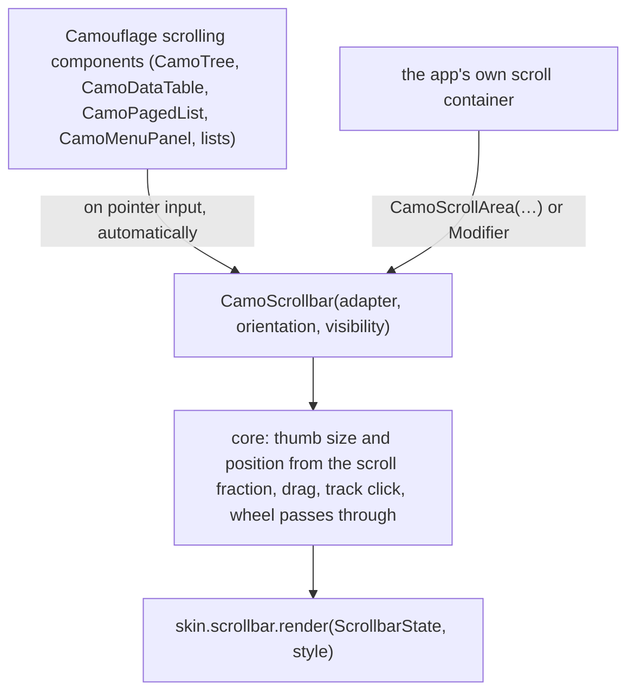
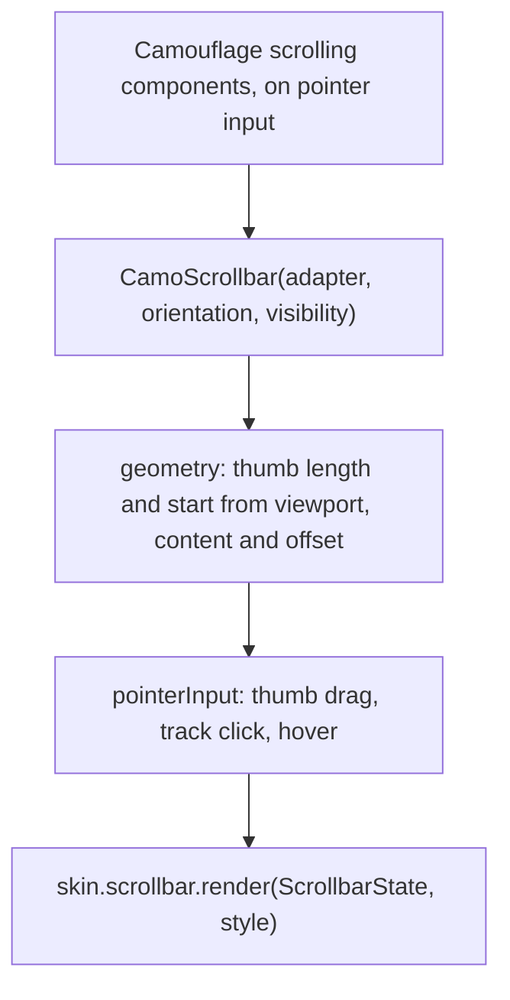
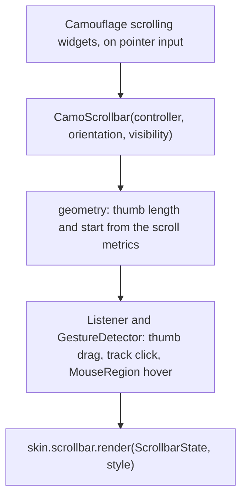

{/* Generated by docs/internal/scripts/sync_vault.py from the Camouflage design notes. Edit the notes and re-run the script; changes made here are overwritten. */}

# CamoScrollbar

## Concept {#concept}

:::info[Milestone: M16 (v0.2), raised by Graft (srctool/camouflage#78)]

:::

### 1. Why

On desktop and the web every scrolling component (lists, trees, tables, text) shows a scrollbar, and the platform's default does not match the skin: a wide classic bar next to a Carbon table, or none at all in Compose. Desktop apps expect a **thin overlay bar that appears on scroll and widens on hover**, drawn in the skin's colours, usable by dragging the thumb and clicking the track. Touch platforms keep their native indicators.

### 2. Shape



**Skin mapping preview:** Material: a 12 dp track with a rounded thumb that widens on hover. Cupertino: an 8 dp overlay thumb with no track. Fluent: a thin 2 dp line that expands to 12 on hover, with arrows off. Carbon: a 6 dp thumb on a transparent track that grows to 10 on hover. Minimal: a 4 dp thumb. Every skin: a minimum thumb of 32 dp.

### 3. API

#### Contract

```kotlin
fun CamoScrollbar(
    adapter: CamoScrollAdapter,                 // how far and how much the content scrolls
    orientation: Orientation = Vertical,
    visibility: ScrollbarVisibility = Auto,     // Auto (the skin's default), OnScroll, Always
    modifier,
)

fun CamoScrollArea(content: Slot, vertical: CamoScrollAdapter? = null, horizontal: CamoScrollAdapter? = null)   // a box with the bars laid over the content

interface CamoScrollAdapter { val viewport: Float; val content: Float; val offset: Float; fun scrollTo(offset: Float) }
```

Adapters come from the platform's scroll states (Kotlin: `ScrollState`, `LazyListState`, `LazyGridState`; Flutter: a `ScrollController`).

**Where it applies.** **Automatically inside Camouflage's own scrolling components** (tree, data table, paged list, menu panel, select list), only when `CamoEnvironment.input` is `Pointer` and the platform is desktop or web; and **explicitly** in an app's own scroll container through `CamoScrollArea`. Touch input shows nothing.

**State → renderer:** `ScrollbarState(orientation, thumbStart, thumbLength, hovered, dragging, visible)`. The renderer draws the track and thumb; core owns the geometry, the drag, the track click (page up or down), the fade timing and the hit area.

#### Tokens used

- `colors.onSurfaceVariant` at low alpha for the thumb, higher on hover and drag; `shapes.full`
- `motion.durationShort` and `durationLong` (fade in and out); none with reduced motion

#### Component theme

`theme.components.scrollbar: ScrollbarTheme?`.

| Field | Type | Carbon default | What it's for |
|---|---|---|---|
| `thickness` / `hoverThickness` | Dp | 6 / 10 | the thumb width idle and under the pointer |
| `minThumb` | Dp | 32 | the shortest thumb |
| `visibility` | `ScrollbarVisibility` | `OnScroll` | when it shows |
| `hideDelay` | Duration | 1200 ms | how long it stays after scrolling stops (`OnScroll`) |
| `colors` | ScrollbarColors(thumb, thumbHover, thumbDrag, track) | see the skin | every colour it uses |

#### Accessibility

- A scrollbar is **not a focus stop and is hidden from the accessibility tree**: assistive technology scrolls the content through its own scroll actions, and a keyboard user scrolls with the content's keys (Page Up and Down, Home, End, arrows).
- It never takes focus or captures the wheel: wheel and trackpad events go to the content.
- The thumb has a minimum size and, while dragged, a larger hit area, so it stays usable at 200% text.

### 4. Build steps

1. The geometry as pure functions (thumb length and start from viewport, content and offset; offset from a thumb position; track click paging), with unit tests that need no window.
2. `CamoScrollbar`, the adapters, `CamoScrollArea` and the pointer-input check in core; the fade state machine.
3. `ScrollbarRenderer` in the five skins and the debug skin; `ScrollbarTheme`.
4. Wire it into `CamoTree`, `CamoDataTable`, `CamoPagedList`, `CamoMenuPanel` and `CamoSelect`'s list.
5. Tests: geometry; drag and track click; fade timing and `Always`; hidden with touch input; hover thickness; RTL (a vertical bar sits on the end edge); goldens per skin in light and dark.

**Done when**
- [ ] Lists, trees and tables in the desktop sample show the skin's scrollbar, usable by drag and track click, on Kotlin and Flutter, with a renderer in every skin.

### 5. Edge cases

| Case | Decided behavior |
|---|---|
| Content shorter than the viewport | No thumb is drawn. |
| A very long list (lazy content) | The thumb length follows the average item size seen so far; the drag maps to a fraction, so it stays smooth. |
| Nested scrollables | Each has its own bar; the inner one wins under the pointer. |
| Touch platforms | Nothing is drawn (native indicators stay). |
| The OS setting ("show scroll bars": automatically, when scrolling, always on macOS) | **Not in the first cut.** The skin and the theme decide `visibility`. Reading the macOS setting is a later capability. |

## Implementation {#implementation}

<KotlinOnly>

### 1. Why {#kotlin-1-why}

Compose Multiplatform's `VerticalScrollbar` and `HorizontalScrollbar` exist only in the desktop (JVM) source set and are not themeable by a skin; wasmJs has none. Core draws its own from a `ScrollAdapter`, in `commonMain`, so desktop and web both follow the skin.

### 2. Shape {#kotlin-2-shape}



### 3. API {#kotlin-3-api}

```kotlin
@Composable public fun CamoScrollbar(adapter: CamoScrollAdapter, orientation: Orientation = Orientation.Vertical, visibility: ScrollbarVisibility = ScrollbarVisibility.Auto, modifier: Modifier = Modifier)
@Composable public fun CamoScrollArea(modifier: Modifier = Modifier, vertical: CamoScrollAdapter? = null, horizontal: CamoScrollAdapter? = null, content: @Composable () -> Unit)
@Composable public fun rememberCamoScrollAdapter(state: ScrollState): CamoScrollAdapter
@Composable public fun rememberCamoScrollAdapter(state: LazyListState): CamoScrollAdapter
@Composable public fun rememberCamoScrollAdapter(state: LazyGridState): CamoScrollAdapter
```

- **Adapters:** `ScrollState` gives exact `value` and `maxValue`; `LazyListState` and `LazyGridState` estimate the content from the items laid out so far (the average item size times the item count), as Compose's own scrollbar does.
- **Input mode:** the bar is composed only when `CamoEnvironment.input == Pointer` and the platform is not Android or iOS; Android and iOS draw nothing.
- **Drag and click:** `pointerInput` on the track (`detectDragGestures` on the thumb, a tap on the track pages by a viewport); the wheel is not consumed.
- **Fade:** an `Animatable` alpha; `OnScroll` shows the bar when the adapter's offset changes and hides it `hideDelay` later; reduced motion makes it instant.

### 4. Build steps {#kotlin-4-build-steps}

As the base note's §4. Module: `camouflage-core` (package `scrollbar`); renderer parts in the skin modules; ABI dump updated.

**Done when**
- [ ] Lists, trees and tables in the desktop sample show the skin's scrollbar, usable by drag and track click, with a renderer in every skin.

### 5. Edge cases {#kotlin-5-edge-cases}

| Case | Decided behavior |
|---|---|
| wasmJs | Same code; the page's own scrollbars are hidden inside Camouflage's scroll containers (the canvas has none). |
| A scrolling component inside `CamoScrollArea` | The component's own automatic bar is suppressed (a local flag), so two bars never overlap. |

</KotlinOnly>

<DartOnly>

### 1. Why {#dart-1-why}

`RawScrollbar` is in Flutter's widgets layer, but its thumb is painted from parameters, not by a skin, and Flutter's `Scrollbar` (Material) is off limits in core. Core uses one geometry core and a skin renderer, as on Kotlin, driven by a `ScrollController`.

### 2. Shape {#dart-2-shape}



### 3. API {#dart-3-api}

```dart
class CamoScrollbar extends StatefulWidget { const CamoScrollbar({super.key, required this.controller, this.orientation = Axis.vertical, this.visibility = ScrollbarVisibility.auto, required this.child}); }
class CamoScrollArea extends StatelessWidget { /* wraps a scrollable with its CamoScrollbar(s) */ }
```

- **Adapter:** a `ScrollController`'s `position` (`viewportDimension`, `maxScrollExtent`, `pixels`, `jumpTo`), through a `NotificationListener<ScrollMetricsNotification>` so lazy lists update as they extend.
- **Input mode:** built only when `CamoEnvironment.input` is `pointer`; mobile platforms return the child unchanged.
- **Drag and click:** a `Listener` and `GestureDetector` on the track and thumb; the wheel passes through to the scrollable; a `MouseRegion` drives hover.
- **Painting:** a `CustomPaint` whose painter comes from `skin.scrollbar.render`; no Material import.

### 4. Build steps {#dart-4-build-steps}

As the base note's §4. Package: `camouflage_core` (`lib/src/scrollbar`); renderer parts in each skin; layers and no-Material checks stay green.
**Done when**
- [ ] Lists, trees and tables in the desktop sample show the skin's scrollbar, usable by drag and track click, with a renderer in every skin.

### 5. Edge cases {#dart-5-edge-cases}

| Case | Decided behavior |
|---|---|
| A `Scrollbar` or `ScrollConfiguration` from Material in the app | Not touched; Camouflage's own scrolling widgets set `ScrollBehavior` to one without the platform scrollbar, so two bars never overlap. |
| Web | The browser's own bar is hidden inside Camouflage's scroll containers; the skin's bar replaces it. |

</DartOnly>
