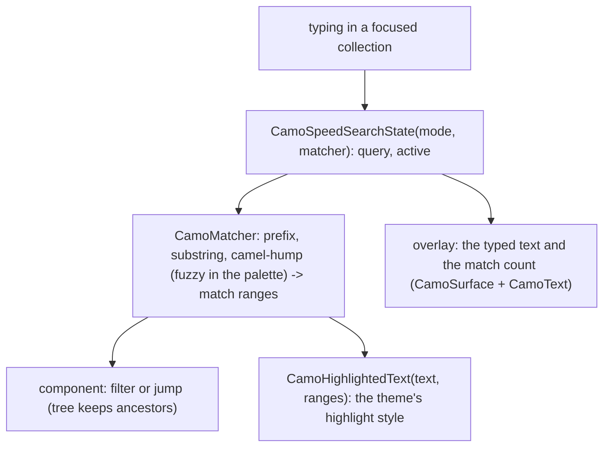

{/* Generated by docs/internal/scripts/sync_vault.py from the Camouflage design notes. Edit the notes and re-run the script; changes made here are overwritten. */}

# CamoSpeedSearch

:::info[Milestone: M16 (v0.2), raised by Graft (srctool/camouflage#73)]

:::

## 1. Why

JetBrains-style **speed search**: start typing in a focused tree, list or menu and it filters or jumps, with the matches highlighted, with no separate field. `CamoTree` and `CamoMenu` only jump to the next item starting with a typed letter today. The command palette (CamoCommandPalette) needs the same matching and highlighting, so this ships first and owns them.

## 2. Shape



**No new renderer.** The overlay is a `CamoSurface` with a `CamoText`; the highlight is a text style from `theme.components.speedSearch`. ADR-45 asks desktop pieces to compose what exists.

## 3. API

```kotlin
class CamoSpeedSearchState(mode: SpeedSearchMode = Filter) {        // app- or component-owned
    var query: String; val active: Boolean
    fun clear()
}
enum class SpeedSearchMode { Filter, Jump }                          // hide non-matches, or only move to the next match

object CamoMatcher {
    fun match(query: String, text: String, kind: MatchKind = Auto): List<IntRange>?   // null: no match
}
enum class MatchKind { Prefix, Substring, CamelHump, Fuzzy, Auto }  // Auto = prefix, then substring, then camel-hump

@Composable fun CamoHighlightedText(text: String, ranges: List<IntRange>, modifier)   // highlight from the theme

CamoTree(..., speedSearch: CamoSpeedSearchState? = null)
CamoListItem lists: the app filters its own items with state.matches(text) and shows CamoHighlightedText
CamoMenuAnchor(..., speedSearch: Boolean = false)
CamoDataTable(..., speedSearch: CamoSpeedSearchState? = null)        // filters rows by any visible text column
```

**Component theme** `theme.components.speedSearch: SpeedSearchTheme?`: `highlightColor`, `highlightTextColor`, `overlayPlacement`, `strings` ("n matches", "No matches").

### Accessibility

- A typed query is announced as a polite live region: "3 matches" or "No matches"; Up and Down move between matches and announce the focused one.
- Esc clears the query first, and only then closes or leaves the component.

## 4. Build steps

1. `CamoMatcher` as pure functions (prefix, substring, camel-hump, fuzzy with a score), unit tests with no window; a 5,000-item benchmark test.
2. `CamoSpeedSearchState`, the key handling (printable keys, Backspace, Esc, Up and Down) and the overlay.
3. `CamoHighlightedText` and the theme field; the tree's filter that keeps the ancestors of matches and expands them.
4. Menu (opt-in), data table and the list sample; tests per component and for the live region.

## 5. Edge cases

| Case | Decided behavior |
|---|---|
| A 5,000-node tree | The matcher runs over the flattened node texts once per query change; the filtered list is memoized, so typing does not drop frames. |
| The same keys as a text field inside the item | The field wins: speed search starts only when the focus is on the collection itself. |
| Type-ahead in `CamoMenu` today | Stays as the default (jump to the next item starting with the letters); `speedSearch = true` replaces it with filter plus highlight. |
| Matching accents and case | Case-insensitive, accent-insensitive (the select's rule). |
| Right to left | The overlay anchors to the start edge; matching is on the logical text. |
