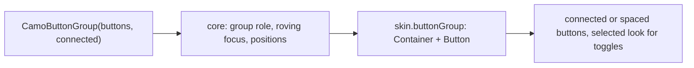
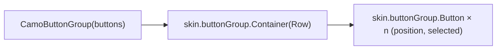
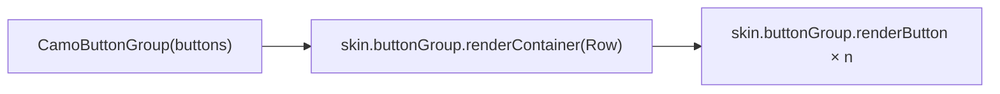

{/* Generated by docs/internal/scripts/sync_vault.py from the Camouflage design notes. Edit the notes and re-run the script; changes made here are overwritten. */}

# CamoButtonGroup

## Concept {#concept}

### 1. Why

A button group puts **related buttons together** as one control: a set of commands (Cut, Copy, Paste), or a set of toggles (Bold, Italic, Underline) in an editor (Material button groups, Fluent's button set). It is not a segmented control: a segmented control chooses **one value for a setting** ('Day / Week / Month'); a button group runs **commands** or toggles **independent flags**. `connected` groups share borders and corners; spaced groups keep a gap.

### 2. Shape



**Split of duties**

| Core | Skin (renderer) |
|---|---|
| the button model, selection mode (none or multiple, or single for a one-of toggle row), roving focus and the group role, position for each button's "2 of 3" and shape | the container, each button's look by position (rounded ends, shared borders), the selected look, spacing |

**Material mapping preview:** the M3 button groups.
- Connected: buttons share a 1 dp border; only the outer ends are fully rounded; the pressed or selected button becomes `primary`-filled and rounder.
- Spaced (standard): `spacing.xs` gap between independent buttons.

### 3. API

#### Contract

```kotlin
data class CamoGroupButton(
    val key: Any,
    val text: String? = null,
    val icon: Widget? = null,               // needs a contentDescription when there is no text
    val contentDescription: String? = null,
    val onClick: () -> Unit,
    val selected: Boolean? = null,          // non-null → a toggle
    val enabled: Boolean = true,
)

fun CamoButtonGroup(
    buttons: List<CamoGroupButton>,
    connected: Boolean = true,
    appearance: Appearance? = null,         // null → ButtonGroupTheme.defaultAppearance (skin default: Outline)
    tone: Tone = Default,
    enabled: Boolean = true,
)
```

Each button reports its **position** (first, middle, last, only) so the renderer can round the outer corners of a connected group.

**State → renderer:** `ButtonGroupState(count, connected, appearance, tone, enabled)` for the container and `GroupButtonState(selected, enabled, position, appearance, tone, interaction)` for each button. **Slots:** `GroupButtonSlots(text?, icon?)`.

#### Tokens used

- the tone family; `outline`, `outlineVariant`, `primary` / `onPrimary` (selected)
- `shapes.full` (Material's end rounding), `shapes.small` (Minimal and Fluent corners)
- `typography.labelLarge`, `spacing.xs` (spaced gap), icons 18 to 24
- `motion.durationShort` (the selected fill)

#### Component theme

`theme.components.button group: ButtonGroupTheme?`. Every field is nullable in the theme. The skin's `defaults(theme)` fills whatever isn't set (Material defaults shown). See [Theme](/guide/foundations/theme) §3.10.

| Field | Type | Material default | What it's for |
|---|---|---|---|
| `defaultAppearance` | Appearance | `Outline` | the appearance when a call passes none (ADR-28) |
| `height` | Dp | 40 | button height |
| `shape` | Shape | `shapes.full` | the outer corners |
| `innerShape` | Shape | `shapes.extraSmall` | the corners between connected buttons |
| `spacing` | Dp | 2 | the gap in a spaced group |
| `borderWidth` | Dp | 1 | shared borders |
| `iconSize` / `iconGap` | Dp | 18 / 8 | icon and label |
| `textStyle` | CamoTextStyle | `labelLarge` | labels |
| `colors` | GroupColors(content, border, selectedContainer, selectedContent) | M3 values | every color it uses |

#### Accessibility

- A **group** named by the app; each button is a button, and a toggle announces "Bold, toggle button, pressed" ("2 of 3").
- **One Tab stop**; the arrows move between enabled buttons (wrapping); Space and Enter activate.
- Icon-only buttons need a `contentDescription` (a debug assertion).

### 4. Build steps

1. `CamoGroupButton`, `ButtonGroupTheme` / `Style`, state, slots, renderer, the `CamoSkin` field.
2. `CamoButtonGroup`, the DebugSkin renderer.
3. Tests: commands fire; toggles keep the app's `selected`; roving focus; positions and shapes (first, middle, last); disabled; the assertion for an icon-only button without a description.

**Done when**
- [ ] An editor's Bold / Italic / Underline group and a Cut / Copy / Paste group work by touch, keyboard and screen reader.

### 5. Edge cases

| Case | Decided behavior |
|---|---|
| One button | A group of one: its own position `only`. |
| Wrapping | A group never wraps; too many buttons belong in a toolbar's overflow. |
| Single-select toggles ("align left / center / right") | Allowed: the app keeps one `selected` true; for a setting-like choice prefer the segmented control. |
| RTL | Order and end rounding mirror. |

 > - **Selection modes:** v0.1 has commands and independent toggles only; the app owns `selected`. A built-in single or multiple selection helper (like `CamoChipGroup`) can come with the sample if you want it.

## Implementation {#implementation}

<KotlinOnly>

### 1. Why {#kotlin-1-why}

A `Row` of skin-drawn buttons with a group role and roving focus, built from the same pieces as the segmented control (`ItemPosition`, `rememberRovingFocus`), with `Role.Button` and `toggleable` instead of radio semantics.

### 2. Shape {#kotlin-2-shape}



### 3. API {#kotlin-3-api}

```kotlin
@Composable public fun CamoButtonGroup(buttons: List<CamoGroupButton>, modifier: Modifier = Modifier,
    connected: Boolean = true, appearance: Appearance? = null, tone: Tone = Tone.Default, enabled: Boolean = true)
```

- The container is `selectableGroup`-free (it is not a single choice): `Modifier.semantics { collectionInfo }` and arrow-key roving focus.
- A toggle is `toggleable(role = Role.Checkbox)` announced as a toggle button (`ToggleableState`); a command is `clickable(role = Role.Button)`.

### 4. Build steps {#kotlin-4-build-steps}

1. The group, `ButtonGroupTheme` / `Style`, state, slots, renderer, the `CamoSkin` field, the DebugSkin renderer.
2. Tests: commands, toggles, arrows, positions, semantics.

**Done when**
- [ ] The groups work by touch, keyboard and screen reader on all targets.

### 5. Edge cases {#kotlin-5-edge-cases}

| Case | Decided behavior |
|---|---|
| Touch target | Each button keeps the 48 target through `minimumTouchTarget` even when the visual is 40. |

 > - None specific.

</KotlinOnly>

<DartOnly>

### 1. Why {#dart-1-why}

A `Row` of skin-drawn buttons with roving focus, built from the segmented control's pieces (`CamoItemPosition`, `CamoRovingFocus`), with button and toggle semantics instead of radio semantics.

### 2. Shape {#dart-2-shape}



### 3. API {#dart-3-api}

```dart
class CamoButtonGroup extends StatelessWidget {
  const CamoButtonGroup({super.key, required this.buttons, this.connected = true, this.appearance, this.tone = Tone.defaultTone, this.enabled = true});
}
```

- `Semantics(button: true, toggled: selected)` per button; `CamoBehavior` for tap, keyboard and hover; the 48 `CamoTouchTarget`.

### 4. Build steps {#dart-4-build-steps}

1. The group, theme, style, state, slots, renderer, the `CamoSkin` field, the DebugSkin renderer.
2. Widget tests as in the base note.

**Done when**
- [ ] The groups work on all platforms.

### 5. Edge cases {#dart-5-edge-cases}

| Case | Decided behavior |
|---|---|
| Disabled group | Every button is disabled with the disabled look. |

 > - None specific.

</DartOnly>
