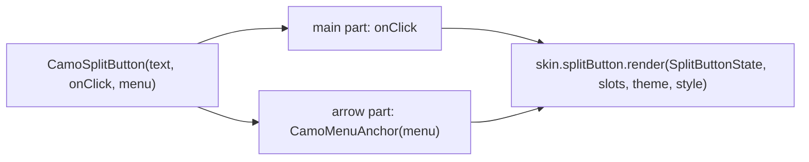
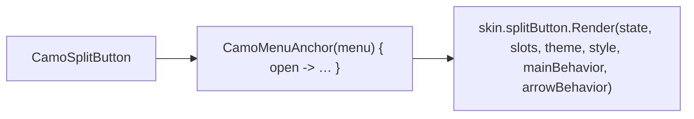
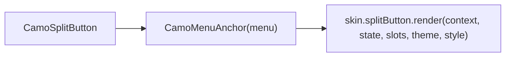

{/* Generated by docs/internal/scripts/sync_vault.py from the Camouflage design notes. Edit the notes and re-run the script; changes made here are overwritten. */}

# CamoSplitButton

## Concept {#concept}

### 1. Why

A split button is a **primary action with a menu of related ones**: 'Save' with an arrow for 'Save as…', 'Save a copy' (Material's split button, Apple's pull-down and pop-up buttons, Fluent's SplitButton and MenuButton, Carbon's combo button). The main part runs the default action; the arrow part opens a menu. A menu-only variant (a button that just opens a menu) is the same component without a default action.

### 2. Shape



**Split of duties**

| Core | Skin (renderer) |
|---|---|
| the two hit areas (main and arrow), the menu (reusing `CamoMenuAnchor`), keyboard (Enter runs the action, Down or Alt+Down opens the menu), semantics, focus return | the container, the divider between the parts, the chevron, appearance and tone colors, corners |

**Material mapping preview:** the M3 split button.
- Two segments in one pill: the label part and a 48 wide chevron part, a 2 dp gap in the standard form.
- Appearances follow `CamoButton`'s.

### 3. API

#### Contract

```kotlin
fun CamoSplitButton(
    text: String,
    onClick: (() -> Unit)?,                  // null → a menu button: the whole button opens the menu
    menu: List<CamoMenuEntry>,               // the same entries as CamoMenuAnchor
    appearance: Appearance? = null,          // null → SplitButtonTheme.defaultAppearance
    tone: Tone = Default,
    enabled: Boolean = true,
    prefixIcon: Widget? = null,
    menuContentDescription: String = "More options",
)
```

The arrow part has its own accessible name (`menuContentDescription`) and opens the menu below the whole button. A menu button (`onClick == null`) is one part that opens the menu.

**State → renderer:** `SplitButtonState(text, hasAction, expanded, appearance, tone, enabled, mainInteraction, arrowInteraction)`. **Slots:** `SplitButtonSlots(prefixIcon?)`.

#### Tokens used

- the same tone and appearance colors as `CamoButton` (container, content, border)
- `shapes.full` (Material), `shapes.small` (Minimal, Fluent), `outlineVariant` / the content color at 40% (the divider)
- `typography.labelLarge`, icons 18
- `motion.durationShort` (the chevron turns when open)

#### Component theme

`theme.components.split button: SplitButtonTheme?`. Every field is nullable in the theme. The skin's `defaults(theme)` fills whatever isn't set (Material defaults shown). See [Theme](/guide/foundations/theme) §3.10.

| Field | Type | Material default | What it's for |
|---|---|---|---|
| `defaultAppearance` | Appearance | `Solid` | the appearance when a call passes none (ADR-28) |
| `height` | Dp | 40 | button height |
| `shape` | Shape | `shapes.full` | outer corners |
| `innerShape` | Shape | `shapes.extraSmall` | the corners between the parts |
| `arrowWidth` | Dp | 40 | the arrow part |
| `gap` | Dp | 2 | the gap between the parts (0 draws a divider line instead) |
| `iconSize` / `iconGap` | Dp | 18 / 8 | icons |
| `textStyle` | CamoTextStyle | `labelLarge` | the label |
| `arrowIcon` | IconSource | chevron down | the arrow |
| `colors` | per appearance, like `ButtonTheme` | M3 values | every color it uses |

#### Accessibility

- Two controls in a group: the main button ("Save, button") and the arrow ("More options, button, has popup, collapsed"). A menu button is one control ("Sort, button, has popup").
- **Keyboard:** Tab reaches the main part then the arrow; Enter or Space runs the focused part; **Down** or **Alt+Down** on either part opens the menu and focuses its first item; Esc closes it and returns focus to the part that opened it.
- The menu is a normal `CamoMenuAnchor` menu (items, checks, dividers).

### 4. Build steps

1. `SplitButtonTheme` / `Style`, state, slots, renderer, the `CamoSkin` field.
2. `CamoSplitButton` built on `CamoMenuAnchor`, the DebugSkin renderer.
3. Tests: the main action fires and the arrow opens the menu; the whole button opens it in menu-button mode; keyboard (Enter, Down, Alt+Down, Esc and focus return); disabled; both parts' semantics; the menu items.

**Done when**
- [ ] A Save split button and a Sort menu button work by touch, keyboard and screen reader.

### 5. Edge cases

| Case | Decided behavior |
|---|---|
| Disabled | Both parts are disabled; a disabled main with an enabled menu is not a case (disable the entries instead). |
| Loading state | Not in v0.1 (a loading action belongs on a plain `CamoButton`). |
| Narrow window | The label ellipsizes; the arrow keeps its width. |
| RTL | The arrow is on the left; the chevron is not mirrored. |

:::info[Changed in the M9 build (2026-11-02)]

- The renderer takes a **behavior** with the two hit areas: the label part's and the arrow part's. A menu button (`onClick == null`) has one part, drawn with the arrow inside it.
- There is no `colors` field: the split button draws with the button's colors, `skin.button`'s style resolved for the appearance and tone, so the two always match. The theme gains `padding` (the label part's start and end).
- The menu opens below the whole button. The arrow announces expanded or collapsed (neither Compose nor Flutter has a "has popup" state); while Flutter's menu route is open, the page behind it is hidden from screen readers. Focus returns to the first part, not necessarily the part that opened the menu.
- Minimal draws a 40 tall button with a divider line between the parts; Fluent a 32 tall one with a 1 px gap. Not built: a menu as wide as the button.

:::

 > - **Menu button mode:** one component with `onClick = null` instead of a separate `CamoMenuButton` (Fluent has both). Say if you want a separate name.

## Implementation {#implementation}

<KotlinOnly>

### 1. Why {#kotlin-1-why}

The arrow part is a `CamoMenuAnchor` whose anchor is the whole button's bounds, so the menu opens under the entire split button while only the arrow part is the click target.

### 2. Shape {#kotlin-2-shape}



### 3. API {#kotlin-3-api}

```kotlin
@Composable public fun CamoSplitButton(text: String, onClick: (() -> Unit)?, menu: List<CamoMenuEntry>,
    modifier: Modifier = Modifier, appearance: Appearance? = null, tone: Tone = Tone.Default, enabled: Boolean = true,
    prefixIcon: (@Composable () -> Unit)? = null, menuContentDescription: String = "More options")
```

- Two behaviors from core: `mainBehavior` (`clickable(role = Role.Button)`) and `arrowBehavior` (`clickable` that opens the menu, with `stateDescription` expanded or collapsed and a popup action). The renderer applies each to its own part.
- `onPreviewKeyEvent` on both parts for Down and Alt+Down; focus returns to the part that opened the menu via two `FocusRequester`s.

### 4. Build steps {#kotlin-4-build-steps}

1. `SplitButtonTheme` / `Style`, state, slots, renderer, the `CamoSkin` field, `CamoSplitButton`, the DebugSkin renderer.
2. Tests as in the base note.

**Done when**
- [ ] Both modes work on all targets.

### 5. Edge cases {#kotlin-5-edge-cases}

| Case | Decided behavior |
|---|---|
| Touch targets | Each part keeps the 48 minimum (`minimumTouchTarget`). |

:::info[Changed in the M9 build (2026-11-02)]

- `CamoSplitButton` wraps the whole button in `CamoMenuAnchor` with a `CamoMenuController`; `SplitButtonBehavior(main, arrow)` holds the two parts' `Modifier`s (key handling for Down, semantics, `clickable`, touch target). The arrow's `contentDescription` is `menuContentDescription`, its `stateDescription` Expanded or Collapsed.
- Tests: the main action and the menu, the menu button, the arrow's state, Down to open, disabled. Sample: the editor's Save with Save as, Save a copy and Export.

:::

 > - None specific.

</KotlinOnly>

<DartOnly>

### 1. Why {#dart-1-why}

The arrow part opens a `CamoMenuAnchor` positioned from the whole button, with two `CamoBehavior`s (main and arrow).

### 2. Shape {#dart-2-shape}



### 3. API {#dart-3-api}

```dart
class CamoSplitButton extends StatefulWidget {
  const CamoSplitButton({super.key, required this.text, required this.onPressed, required this.menu, this.appearance,
      this.tone = Tone.defaultTone, this.enabled = true, this.prefixIcon, this.menuSemanticLabel = 'More options'});
  final VoidCallback? onPressed;   // null = a menu button
}
```

- `Semantics(button: true, hasExpandedState: true, expanded: open)` on the arrow; `FocusNode`s for both parts; the menu needs an Overlay (inside a route).

### 4. Build steps {#dart-4-build-steps}

1. Theme, style, state, slots, renderer, the `CamoSkin` field, the widget, the DebugSkin renderer.
2. Widget tests as in the base note.

**Done when**
- [ ] Both modes work on all platforms.

### 5. Edge cases {#dart-5-edge-cases}

| Case | Decided behavior |
|---|---|
| `onPressed: null` | A menu button: the whole button opens the menu. |

:::info[Changed in the M9 build (2026-11-02)]

- `CamoSplitButton` is a `StatefulWidget` with a `CamoMenuController` and one `CamoInteractionController` per part. `SplitButtonBehavior.main` and `.arrow` wrap a renderer's visuals in `CamoBehavior`, `Semantics` and a touch target; `CallbackShortcuts` opens the menu on Down and Alt+Down.
- While the menu route is open, the page behind it (and so the arrow's expanded state) is hidden from screen readers; tests read the state from the skin. Sample: the editor's Save with its menu.

:::

 > - None specific.

</DartOnly>
