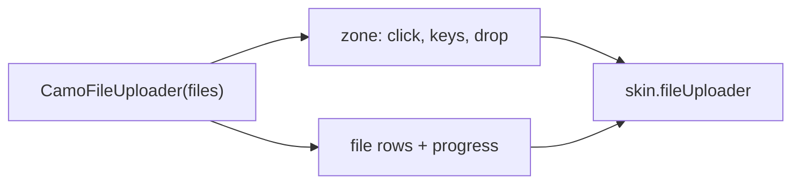
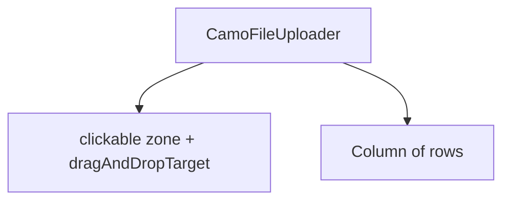
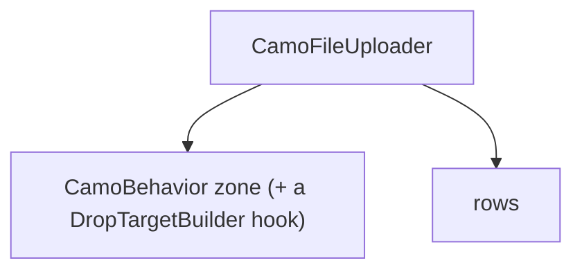

{/* Generated by docs/internal/scripts/sync_vault.py from the Camouflage design notes. Edit the notes and re-run the script; changes made here are overwritten. */}

# CamoFileUploader

## Concept {#concept}

### 1. Why

A file uploader is **a drop zone and a button that start choosing files, with a list showing each file's progress**: attachments, imports (Carbon's file uploader, Fluent patterns). Core never touches the filesystem (ADR-27): it reports the user's intent (`onPick`, `onDrop`) and the app opens the system picker and runs the upload, feeding progress back.

### 2. Shape



**Split of duties**

| Core | Skin (renderer) |
|---|---|
| the zone's states (idle, drag-over, disabled), `onPick` on click, Enter and Space, `onFilesDropped` on desktop and web (the platform's drop target, as a list of names and sizes plus an opaque handle), the file list model, remove and retry actions, semantics | the zone's look (dashed border, fill, icon, text), the file row (name, size, progress bar, error), the state colors |

**Material mapping preview:** the M3 has none.
- A dashed `outline` zone, `shapes.medium`, `surfaceContainerLow`; rows with `CamoProgressBar`.

### 3. API

#### Contract

```kotlin
data class UploadFile(
    val id: Any, val name: String, val sizeBytes: Long? = null,
    val progress: Float? = null,             // 0..1; null: waiting
    val status: UploadStatus = Uploading,    // Uploading | Done | Failed(message)
)

fun CamoFileUploader(
    files: List<UploadFile>,
    onPick: () -> Unit,                      // open the app's picker
    onFilesDropped: ((List<DroppedFile>) -> Unit)? = null,   // null: no drop target
    onRemove: (UploadFile) -> Unit, onRetry: ((UploadFile) -> Unit)? = null,
    hint: String? = null,                    // "PNG or JPG, up to 5 MB"
    enabled: Boolean = true, multiple: Boolean = true,
    label: String,
)
```

**State → renderer:** `UploaderZoneState(dragOver, enabled, interaction)` and `UploadRowState(status, progress, interaction)`. **Slots:** icon, title, hint; the row's name, size, actions. Rows use `skin.progressBar` for the bar.

#### Tokens used

- `colors.surfaceContainerLow`, `outline`, `primary` (drag-over), `error`
- `shapes.medium`, `spacing.l`, `typography.bodyMedium`

#### Component theme

`theme.components.file uploader`. Every field is nullable in the theme. The skin's `defaults(theme)` fills whatever isn't set (Material defaults shown). See [Theme](/guide/foundations/theme) §3.10.

| Field | Type | Material default | What it's for |
|---|---|---|---|
| `zoneShape` | Shape | `shapes.medium` | |
| `dashed` | Boolean | true | the border style |
| `zoneHeight` | Dp | 120 | |
| `icon` | IconSource | upload | |
| `colors` | UploaderColors(zone, border, dragBorder, error, text) | M3 values | every color it uses |
| `strings` | UploaderStrings | English | "Drop files here or", "Remove", "Retry", progress words |

#### Accessibility

- The zone is **one button** ("Upload files, button") with the hint as its description; Enter and Space call `onPick`.
- Each file row announces name, size and state ("report.pdf, 45%" with the bar's progress value); remove and retry are buttons. A failure is announced as an alert once.

### 4. Build steps

1. `UploadFile`, `DroppedFile`, the drop-target expect/actual (desktop, web; none on mobile), theme, state, renderer, the `CamoSkin` field.
2. `CamoFileUploader`, the DebugSkin renderer.
3. Tests: pick by click and keys, drop, rows and progress, remove and retry, disabled, semantics.

**Done when**
- [ ] The upload wizard sample drives it with fake progress.

### 5. Edge cases

| Case | Decided behavior |
|---|---|
| Case | Decided behavior |
|---|---|
| Types and sizes | The app validates; `Failed(message)` shows the reason. |
| No drop target (mobile) | The zone is just the button. |
| Many files | The list scrolls inside the parent's constraints. |

 > - **Which drop-target APIs per platform** (Compose's `dragAndDropTarget`, the web drop event, Flutter's desktop drop plugin) are decided in the build; v0.1 may ship drop on desktop and web only.

## Implementation {#implementation}

<KotlinOnly>

### 1. Why {#kotlin-1-why}

Compose Multiplatform's `dragAndDropTarget` (desktop, web) turns drops into `DroppedFile` (name, size, the platform handle); on Android and iOS only the button.

### 2. Shape {#kotlin-2-shape}



### 3. API {#kotlin-3-api}

```kotlin
@Composable public fun CamoFileUploader(files: List<UploadFile>, onPick: () -> Unit, onRemove: (UploadFile) -> Unit,
    label: String, modifier: Modifier = Modifier, onFilesDropped: ((List<DroppedFile>) -> Unit)? = null,
    onRetry: ((UploadFile) -> Unit)? = null, hint: String? = null, enabled: Boolean = true, multiple: Boolean = true)
```

### 4. Build steps {#kotlin-4-build-steps}

1. Zone, drop target, rows, renderer.
2. Tests: pick, drop (desktop), rows, semantics.

**Done when**
- [ ] Works by touch, mouse, keyboard and screen reader on all targets.

### 5. Edge cases {#kotlin-5-edge-cases}

| Case | Decided behavior |
|---|---|
| Drop on Flutter | Via the app's `dropTargetBuilder`; the example uses none (button only) so core stays plugin-free. |

 > - None specific.

</KotlinOnly>

<DartOnly>

### 1. Why {#dart-1-why}

There is no drop target in the widgets layer; `DragTarget` is for in-app drags. Drops from outside the app need a platform plugin, so core exposes `onFilesDropped` and the example wires `desktop_drop` or the web's `DropzoneView`-like channel in the app, not in core.

### 2. Shape {#dart-2-shape}



### 3. API {#dart-3-api}

```dart
class CamoFileUploader extends StatelessWidget {
  const CamoFileUploader({super.key, required this.files, required this.onPick, required this.onRemove,
      required this.label, this.dropTargetBuilder, this.onRetry, this.hint, this.enabled = true, this.multiple = true});
}
```

- `dropTargetBuilder(context, child, setDragOver, onDropped)` lets the app wrap the zone with whatever drop plugin it uses.

### 4. Build steps {#dart-4-build-steps}

1. Zone, hook, rows, renderer.
2. Widget tests: pick, rows, the hook, semantics.

**Done when**
- [ ] Works by touch, mouse, keyboard and screen reader in the example.

### 5. Edge cases {#dart-5-edge-cases}

| Case | Decided behavior |
|---|---|
| Drop on Flutter | Same. |

 > - None specific.

</DartOnly>
