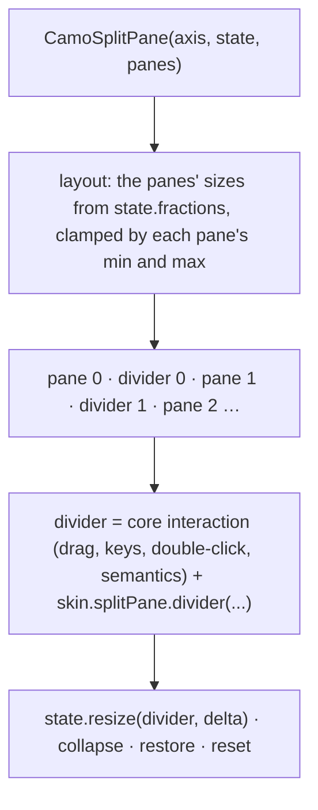
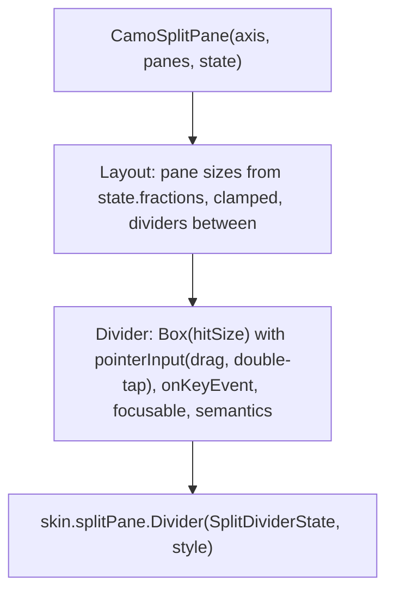
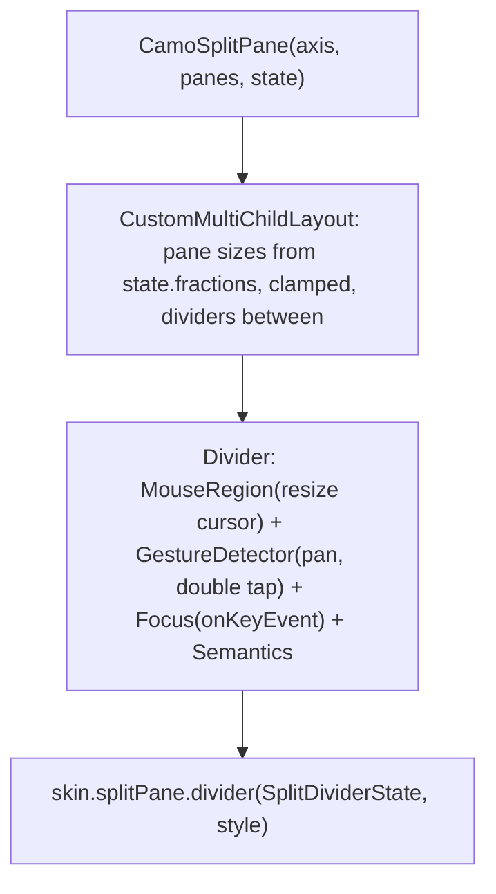

{/* Generated by docs/internal/scripts/sync_vault.py from the Camouflage design notes. Edit the notes and re-run the script; changes made here are overwritten. */}

# CamoSplitPane

## Concept {#concept}

:::info[Milestone: M16 (v0.2), raised by Graft (srctool/camouflage#71)]

:::

### 1. Why

Desktop tools lay out two or more panes side by side or stacked (a list, a detail, a log) and let the user drag the divider. The canonical layouts are plain composition (Canonical Layouts (List-Detail, Feed, Supporting Pane)), but the **draggable, accessible divider** is real work that every desktop app repeats: pointer drag, minimum sizes, keyboard resize, collapse, semantics and a layout the app can save. `CamoSplitPane` is that, and the dock layout (a later item) is built on it.

### 2. Shape



**Skin mapping preview:** Material: a 1 dp `outlineVariant` line with an 8 dp hit area. Cupertino: a hairline. Fluent: a 1 dp `neutralStroke2` line that thickens on hover. Carbon: 1 px `border-subtle`, the accent colour while dragging. Minimal: a hairline. All draw a focus ring on the keyboard-focused divider.

### 3. API

#### Contract

```kotlin
fun CamoSplitPane(
    axis: Axis,                       // Horizontal: panes side by side (start to end); Vertical: stacked
    panes: List<CamoPane>,            // two or more
    state: CamoSplitState,            // app-owned: sizes and which panes are collapsed
    modifier,
)

data class CamoPane(
    val minSize: Dp = 80.dp,
    val maxSize: Dp? = null,
    val collapsible: Boolean = false,
    val content: Slot,
)

class CamoSplitState(initial: List<Float>) {       // the pane sizes as fractions of the container, summing to 1
    val fractions: List<Float>
    val collapsed: Set<Int>
    fun resize(divider: Int, deltaPx: Float)        // moves space between the two neighbours of a divider
    fun collapse(pane: Int); fun restore(pane: Int); fun reset()
    fun snapshot(): CamoSplitSnapshot               // plain data (fractions, collapsed) the app can persist
}
```

**Sizes.** The state stores **fractions** (a saved layout restores on a different window size); `minSize` and `maxSize` are **dp** (a pane never gets too small to use). Nested splits are composition: a pane's content is another `CamoSplitPane`.

**Layout rule.** A divider moves space between its two neighbours only, clamped by both neighbours' min and max. When the container resizes the fractions are kept and then clamped, and the excess goes to the nearest panes. A collapsible pane dragged below half its `minSize` snaps to zero (collapsed); a collapsed pane restores to its previous fraction.

**State → renderer:** `SplitDividerState(axis, hovered, focused, dragging, collapsedBefore, collapsedAfter)`. **Slots:** none. Core owns the layout, the hit area and the interaction; the renderer draws the line (and an optional grip).

#### Tokens used

- `colors.outlineVariant` (idle), `colors.outline` (hover), `colors.primary` (dragging and focus)
- `spacing` for the key step, `motion.durationShort` for a collapse and restore animation (none with reduced motion)

#### Component theme

`theme.components.splitPane: SplitPaneTheme?` (nullable fields, filled by the skin's `defaults(theme)`).

| Field | Type | Default | What it's for |
|---|---|---|---|
| `thickness` | Dp | 1 | the drawn line |
| `hitSize` | Dp | 8 | the grab area, centred on the line |
| `keyStep` / `keyStepLarge` | Dp | 16 / 64 | arrow and Shift+arrow resize |
| `colors` | SplitPaneColors(line, hover, dragging, focus) | outlineVariant, outline, primary, primary | every colour it uses |
| `grip` | Boolean | false | a small grip in the middle (some skins) |

#### Accessibility

- A divider is **focusable** and exposes the platform's adjustable value ("Resize panel, 35 percent"), with increase and decrease actions, because the platforms have no splitter role (the WAI-ARIA window splitter pattern is exposed as a slider-like value).
- **Keyboard:** Left and Right (Up and Down when stacked) move the divider by `keyStep`, with Shift by `keyStepLarge`; Home and End go to the minimum and maximum; Enter collapses or restores a collapsible neighbour; Tab moves between dividers.
- **Pointer:** a resize cursor over the hit area; drag; **double-click resets** the two neighbours to their initial sizes.
- Right to left mirrors a horizontal split (the first pane is on the right), and Left and Right keep their visual meaning.

### 4. Build steps

1. `CamoSplitState` and the layout rule as pure functions (clamping, redistribution, collapse), with unit tests that need no window.
2. The `CamoSplitPane` layout and the divider interaction in core (drag, keys, double-click, cursor, semantics).
3. `SplitPaneRenderer` in the five skins and the debug skin; `SplitPaneTheme` in `CamoComponentThemes`.
4. Sample: a three-pane layout (list, detail, log) with a collapsible log; the saved layout restored on launch.
5. Tests: sizes from fractions; min and max respected; collapse and restore; resize by key and by accessibility action; double-click reset; nested splits; RTL; a restored snapshot on a different window width; goldens in light and dark per skin.

**Done when**
- [ ] A three-pane layout resizes by mouse, keyboard and screen reader, respects minimum sizes and restores saved fractions, on Kotlin and Flutter, with a renderer in every skin.

### 5. Edge cases

| Case | Decided behavior |
|---|---|
| The container is smaller than the sum of the minimums | The panes shrink below `minSize` in proportion, so nothing is cut off; dividers stay usable. |
| A pane's content has an intrinsic size | The split gives it exactly its size; the content scrolls or clips (the app's choice). |
| Collapsed pane | Its content leaves the composition (not just hidden), its divider stays so it can be restored. |
| Touch input | The hit area grows to 24 dp; dragging works with a finger. |
| Many panes | Any number; dividers are numbered in order. More than four is a design smell. |
| Persisting | The app saves `snapshot()`; the state accepts it back. Camouflage stores nothing itself. |

## Implementation {#implementation}

<KotlinOnly>

### 1. Why {#kotlin-1-why}

Compose has no split pane in common code (JetBrains' `SplitPane` lives in the desktop-only Compose Desktop libraries and is not themeable or accessible). Core builds one from `Layout`, pointer input and key handling, so it works on desktop and web and follows the skin.

### 2. Shape {#kotlin-2-shape}



### 3. API {#kotlin-3-api}

```kotlin
@Composable
public fun CamoSplitPane(
    axis: Orientation,
    panes: List<CamoPane>,
    state: CamoSplitState = rememberCamoSplitState(panes.size),
    modifier: Modifier = Modifier,
)
public class CamoPane(val minSize: Dp = 80.dp, val maxSize: Dp? = null, val collapsible: Boolean = false, val content: @Composable () -> Unit)
@Stable public class CamoSplitState(initial: List<Float>) { /* fractions, collapsed, resize, collapse, restore, reset, snapshot */ }
@Composable public fun rememberCamoSplitState(count: Int, initial: List<Float>? = null): CamoSplitState   // rememberSaveable
```

- **Layout:** a custom `Layout` measures each pane with a fixed main-axis size from the state (converted to px with the container's size) and the full cross size. The clamping and redistribution are pure functions in `SplitMath.kt`.
- **Drag:** `detectDragGestures` on the divider's hit box; `state.resize(divider, delta)` on each move. `onDoubleTap` resets.
- **Keys:** `onKeyEvent` on the focusable divider; Left and Right swap in RTL (`LayoutDirection`).
- **Semantics:** `progressBarRangeInfo` (the current fraction and its range), `setProgress` (increase and decrease), `stateDescription = "35 percent"`, `contentDescription = "Resize panel"`; the role is the nearest adjustable one, since Compose has no splitter role.
- **Cursor:** `Modifier.pointerHoverIcon` with a small `expect`/`actual` `ResizeCursor` (AWT `Cursor.E_RESIZE_CURSOR` and `S_RESIZE_CURSOR` on the JVM, CSS on wasm); Android and iOS draw none.
- **Saving:** `rememberCamoSplitState` uses `rememberSaveable` with a `Saver` over the snapshot; apps that persist across launches keep their own copy of `snapshot()`.

### 4. Build steps {#kotlin-4-build-steps}

As the base note's §4. Module: `camouflage-core` (package `splitpane`); renderer part in each skin module; ABI dump updated (`updateKotlinAbi`).

**Done when**
- [ ] A three-pane layout resizes by mouse, keyboard and screen reader, respects minimum sizes and restores saved fractions, with Material, Cupertino, Fluent, Carbon and Minimal.

### 5. Edge cases {#kotlin-5-edge-cases}

| Case | Decided behavior |
|---|---|
| Recomposition while dragging | The drag reads the latest state through `rememberUpdatedState`; the gesture is keyed on the divider index only (a scene rebuilt per hover would restart every gesture, found in M11). |
| Pointer capture leaving the window | The drag ends on `onDragEnd` and `onDragCancel`. |
| wasmJs | The same code; the cursor comes from CSS. |

</KotlinOnly>

<DartOnly>

### 1. Why {#dart-1-why}

Flutter has no split pane in the widgets layer. Core builds one from a `CustomMultiChildLayout`, `GestureDetector`, `Focus` and `Semantics`, with no Material or Cupertino import, so it follows the skin.

### 2. Shape {#dart-2-shape}



### 3. API {#dart-3-api}

```dart
class CamoSplitPane extends StatefulWidget {
  const CamoSplitPane({super.key, required this.axis, required this.panes, required this.state});
  final Axis axis;
  final List<CamoPane> panes;
  final CamoSplitState state;
}
class CamoPane { const CamoPane({required this.child, this.minSize = 80, this.maxSize, this.collapsible = false}); }
class CamoSplitState extends ChangeNotifier { /* fractions, collapsed, resize, collapse, restore, reset, snapshot */ }
```

- **Layout:** a `MultiChildLayoutDelegate` with the same pure `SplitMath` functions as Kotlin (kept in step by shared test vectors).
- **Cursor:** `MouseRegion(cursor: SystemMouseCursors.resizeColumn / resizeRow)`.
- **Keys:** `Focus` with `onKeyEvent`; `TextDirection` swaps Left and Right.
- **Semantics:** `Semantics(label: 'Resize panel', value: '35 percent', increasedValue:, decreasedValue:, onIncrease:, onDecrease:)` so TalkBack and VoiceOver adjust it.
- **State:** a `ChangeNotifier` the app owns (and can feed to `RestorationMixin` or its own storage through `snapshot()`).

### 4. Build steps {#dart-4-build-steps}

As the base note's §4. Package: `camouflage_core` (`lib/src/split_pane`); renderer parts in each skin; the layers check and the no-Material check stay green.

**Done when**
- [ ] A three-pane layout resizes by mouse, keyboard and screen reader, respects minimum sizes and restores saved fractions, with Material, Cupertino, Fluent, Carbon and Minimal.

### 5. Edge cases {#dart-5-edge-cases}

| Case | Decided behavior |
|---|---|
| A pane that scrolls | The pane gets tight constraints on the main axis; its own scroll view fills it. |
| Hit area under a clip | The divider's hit box is inside the layout, never in a clip that would cut it (the touch-target lesson from M15). |

</DartOnly>
