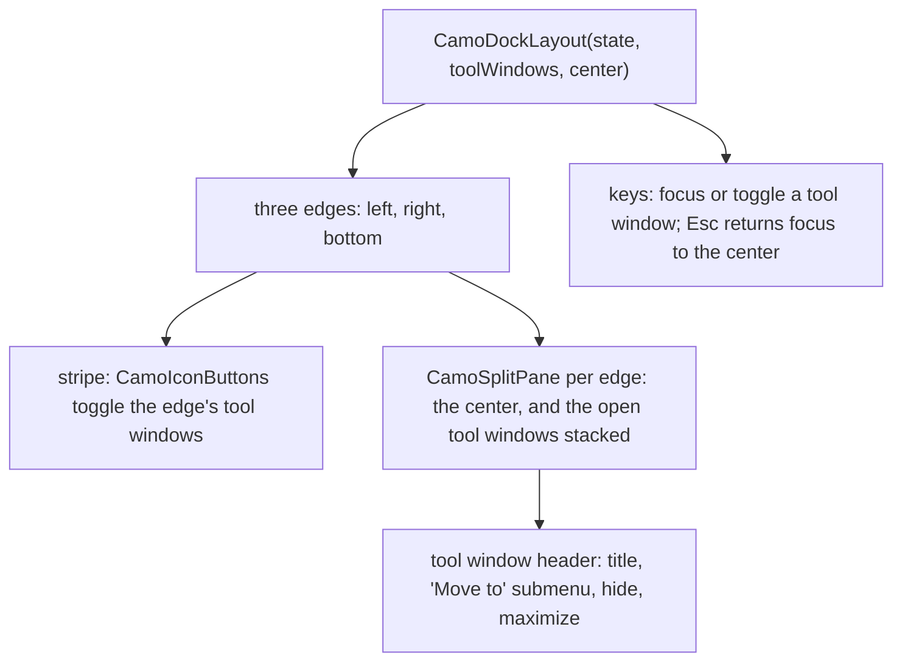

{/* Generated by docs/internal/scripts/sync_vault.py from the Camouflage design notes. Edit the notes and re-run the script; changes made here are overwritten. */}

# CamoDockLayout

:::info[Milestone: M16 (v0.2), raised by Graft (srctool/camouflage#75)]

:::

## 1. Why

IDE-style tool windows: side and bottom panels that open from icon stripes on the window edges, resize, hide, maximize and move to another edge. Graft's left panel, details panel and bottom tool window use it; any desktop tool app could. It is built on CamoSplitPane (the divider) and existing buttons and menus.

## 2. Shape



**No new renderer.** Stripes are icon buttons, the header is a top bar row with icon buttons and a menu, the divider is the split pane's: all drawn by existing renderers.

## 3. API

```kotlin
@Composable fun CamoDockLayout(
    state: CamoDockState,                        // app-owned: where each tool window is, open or not, and its size
    toolWindows: List<CamoToolWindow>,
    modifier,
    center: Slot,
)
data class CamoToolWindow(
    val id: Any, val title: String, val icon: Slot,
    val defaultEdge: DockEdge,                   // Left, Right, Bottom
    val content: Slot,
)
class CamoDockState(layout: Map<Any, DockPlacement>) {
    fun toggle(id: Any); fun open(id: Any); fun close(id: Any); fun move(id: Any, edge: DockEdge)
    fun maximize(id: Any); fun restore(); fun focus(id: Any)        // focus: open it and move focus into it
    fun snapshot(): CamoDockSnapshot                                  // plain data to persist
}
```

- **Resize** uses the split pane's divider (and its keys and semantics); the sizes are the dock state's fractions.
- **Move**: a "Move to" submenu in the tool window header (menu first, as the issue says; drag later).
- **Keyboard**: `state.focus(id)` for the app's shortcuts; Esc inside a tool window returns focus to the center; the stripe buttons are in the tab order.
- **Maximize** hides the other edges and the center; the stripes stay, and restore brings them back.

## 4. Build steps

1. `CamoDockState`: the placement, open and maximize rules as pure functions, tested without a window.
2. The edge layout from nested split panes and the stripes; the tool window header with the move menu.
3. Focus handling (`focus`, Esc to the center) and the keyboard.
4. Sample: three docks and five tool windows, rearranged and restored from a snapshot; tests for each rule, RTL (left and right swap), screen reader.

## 5. Edge cases

| Case | Decided behavior |
|---|---|
| Several tool windows open on one edge | They stack in a nested split pane (each its own divider), in stripe order. |
| A tool window moved to a full edge | It joins the others there; its previous edge's stripe loses its button. |
| A window too small for the docks | The docks keep their `minSize`; the center takes what is left and may scroll; below a threshold only the stripes show. |
| Right to left | Left and right edges swap (they mean start and end), so a layout saved in one direction restores in the other. |
| Floating windows and tabs inside a dock | Out of scope for 0.2.0. |

## 6. As built (M16, 2026-11-21)

:::tip[Built on Kotlin and Flutter (srctool/camouflage#75), no new renderer]

One composable and one state, as proposed; several open windows on an edge are stacked in a split of their own.

:::

- **State:** `CamoDockState(defaults, open)` takes each window's id and starting edge in stripe order (the layout gets the windows' content separately). `snapshot()` holds order, edges, open set, dock sizes (fractions of the window) and the maximized id. The sizes of stacked windows are not in the snapshot yet.
- **Sizes** are written back from the split panes after a drag; `apply()` rebuilds the splits from the restored sizes.
- **Header:** "Move to" submenu, maximize or restore, hide. Below 150 px the header keeps the title and one menu, and maximize and hide move into it (the buttons overflowed in a squeezed dock).
- **Focus:** `state.focus(id)` opens the window and focuses the first focusable thing in its content, not the header; Esc in a window returns to the first focusable thing in the center, and a text field that handles Esc keeps it.
- **RTL:** left and right are start and end; a saved layout restores mirrored.
- **Not built:** the "only stripes below a threshold" mode (docks shrink in proportion instead), dragging a window to another edge, floating windows, tabs in a dock.
