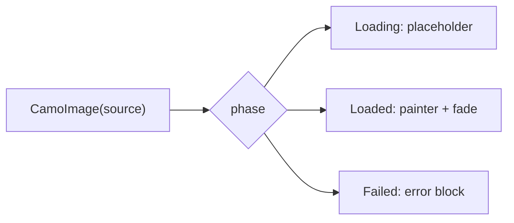
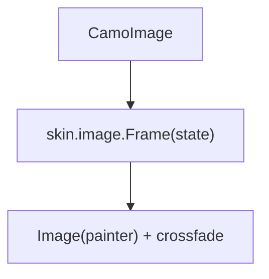
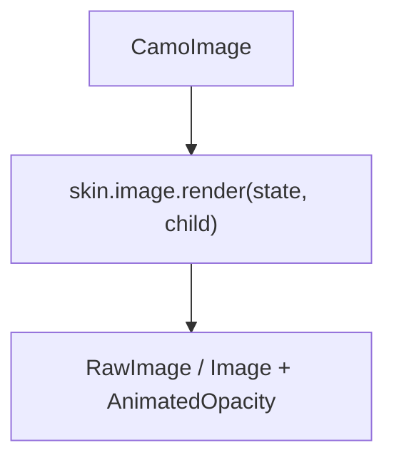

{/* Generated by docs/internal/scripts/sync_vault.py from the Camouflage design notes. Edit the notes and re-run the script; changes made here are overwritten. */}

# CamoImage

## Concept {#concept}

### 1. Why

An image shows **a picture with a shape, a placeholder while it loads and a fallback when it fails** (Material's cards, Fluent's Image, Apple's image views). It does not load anything itself: core never depends on an image loader (ADR-27), so the app passes a loaded painter or a loader's state.

### 2. Shape



**Split of duties**

| Core | Skin (renderer) |
|---|---|
| the state model (`Loading`, `Loaded(painter)`, `Failed`), content scale, alignment, the description (required, or decorative), crossfade, aspect ratio | the shape, the placeholder and error look (a tinted block with an icon), the border and overlay, the fade duration |

**Material mapping preview:** the M3 uses `shapes` on images; no component.
- `shapes.medium` mask, placeholder `surfaceContainerHigh`.

### 3. API

#### Contract

```kotlin
sealed interface ImageSource {
    data class Loaded(val painter: Painter) : ImageSource
    data object Loading : ImageSource
    data class Failed(val error: Throwable? = null) : ImageSource
}

fun CamoImage(
    source: ImageSource,
    contentDescription: String?,             // null: decorative
    shape: ShapeRole = Medium,
    contentScale: ContentScale = Crop,
    aspectRatio: Float? = null,
    alignment: Alignment = Center,
)
```

**State → renderer:** `ImageState(phase: Loading | Loaded | Failed, shapeRole)`; the renderer draws the frame and the placeholder or error content; core draws the painter inside the frame with the fade.

#### Tokens used

- `colors.surfaceContainerHigh`, `onSurfaceVariant` (placeholder icon), `outlineVariant` (border)
- `shapes.*` by role; `motion.durationMedium`

#### Component theme

`theme.components.image`. Every field is nullable in the theme. The skin's `defaults(theme)` fills whatever isn't set (Material defaults shown). See [Theme](/guide/foundations/theme) §3.10.

| Field | Type | Material default | What it's for |
|---|---|---|---|
| `placeholderIcon` | IconSource | image | while loading |
| `errorIcon` | IconSource | broken image | on failure |
| `fadeMillis` | Int | 200 | crossfade (0 with reduced motion) |
| `borderWidth` | Dp | 0 | a hairline frame |
| `colors` | ImageColors(placeholder, icon, border) | M3 values | every color it uses |

#### Accessibility

- An image needs a `contentDescription`, or `null` to mark it decorative (hidden from screen readers); a debug check reports an omitted choice. A failed image keeps its description and adds "could not load".
- Not focusable.

### 4. Build steps

1. `ImageSource`, `ImageTheme` / `Style`, state, renderer, the `CamoSkin` field.
2. `CamoImage`, the DebugSkin renderer.
3. Tests: phases, fade, decorative semantics, aspect ratio, content scale.

**Done when**
- [ ] The sample's gallery shows placeholders, images and a failure.

### 5. Edge cases

| Case | Decided behavior |
|---|---|
| Case | Decided behavior |
|---|---|
| No size given | The painter's intrinsic aspect ratio. |
| A loader library | Maps its state to `ImageSource` (a documented one-liner for Coil and Kamel; none in core). |

:::info[Changed in the M10 build (2026-11-02)]

- The renderer has one part, the frame: `ImageState(phase, shape)` and the loaded image as content that core fades in. `ImageTheme` has `placeholderIcon`, `errorIcon`, the fade (Kotlin `fadeMillis`, Flutter a `Duration`), `borderWidth` and `ImageColors(placeholder, icon, border)`; there are no theme `strings` ("could not load" is fixed English).
- The frame fills the size the caller gives it (a size or `aspectRatio` is needed). A decorative image (`null` description) is hidden from screen readers; a failed one adds "could not load".
- Not built: an image-loader integration and a Flutter `CamoImage.network`; the app maps its loader to `ImageSource`.

:::

 > - **A built-in async loader** is out of scope (ADR-27); say if you want a `camouflage-coil` integration package later.

## Implementation {#implementation}

<KotlinOnly>

### 1. Why {#kotlin-1-why}

The painter is drawn by `Image`/`Painter` inside the renderer's frame; core passes `ContentScale` and alignment.

### 2. Shape {#kotlin-2-shape}



### 3. API {#kotlin-3-api}

```kotlin
@Composable public fun CamoImage(source: ImageSource, contentDescription: String?, modifier: Modifier = Modifier,
    shape: ShapeRole = ShapeRole.Medium, contentScale: ContentScale = ContentScale.Crop, aspectRatio: Float? = null)
```

- The crossfade is `Crossfade`/`animateFloatAsState` honoring the provider's reduced motion.
- `clearAndSetSemantics {}` when decorative; otherwise `contentDescription` and `Role.Image`.

### 4. Build steps {#kotlin-4-build-steps}

1. Source, frame, fade, semantics, renderer.
2. Tests: phases, decorative, fade.

**Done when**
- [ ] Works by touch, mouse, keyboard and screen reader on all targets.

### 5. Edge cases {#kotlin-5-edge-cases}

| Case | Decided behavior |
|---|---|
| Flutter convenience | `CamoImage.network` maps `Image.network` frames; Kotlin has none (no loader in core). |

:::info[Changed in the M10 build (2026-11-02)]

- `ImageSource.Loaded(painter)`; the fade is `animateFloatAsState`, so an image that is loaded from the first frame doesn't fade.

:::

 > - None specific.

</KotlinOnly>

<DartOnly>

### 1. Why {#dart-1-why}

`ImageProvider` and `RawImage`/`Image` are in the widgets layer; the app maps its loader's frames to `ImageSource` (Flutter's `Image.frameBuilder` or `loadingBuilder` can feed it).

### 2. Shape {#dart-2-shape}



### 3. API {#dart-3-api}

```dart
class CamoImage extends StatelessWidget {
  const CamoImage({super.key, required this.source, required this.semanticLabel, this.shape = ShapeRole.medium,
      this.fit = BoxFit.cover, this.aspectRatio, this.alignment = Alignment.center});
  CamoImage.network(...)   // a convenience over NetworkImage with frame and error builders
}
```

- `Semantics(image: true, label:)`, or `ExcludeSemantics` when decorative.

### 4. Build steps {#dart-4-build-steps}

1. Source, frame, fade, semantics, renderer.
2. Widget tests: phases, decorative, fade.

**Done when**
- [ ] Works by touch, mouse, keyboard and screen reader in the example.

### 5. Edge cases {#dart-5-edge-cases}

| Case | Decided behavior |
|---|---|
| Large images | `cacheWidth`/`cacheHeight` come from the layout size in the convenience constructor. |

:::info[Changed in the M10 build (2026-11-02)]

- `ImageSource.loaded(Widget)`: the picture is a widget (usually an `Image`; the app sets its fit), because a widget needs no decoding in tests and fits every loader.

:::

 > - None specific.

</DartOnly>
