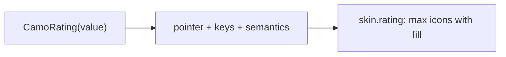
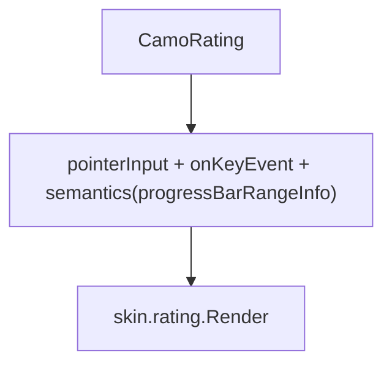
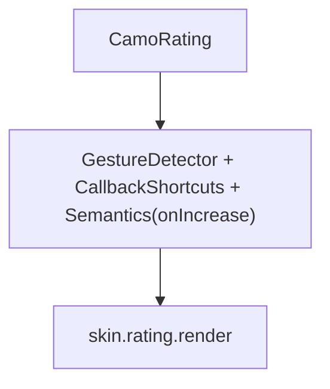

{/* Generated by docs/internal/scripts/sync_vault.py from the Camouflage design notes. Edit the notes and re-run the script; changes made here are overwritten. */}

# CamoRating

## Concept {#concept}

### 1. Why

A rating shows or collects **a score on a small scale**, usually stars (Fluent's Rating, Apple's rating controls, Material's rating in lists). It can be read-only (an average) or interactive, with whole or half steps.

### 2. Shape



**Split of duties**

| Core | Skin (renderer) |
|---|---|
| the value, steps, pointer and keyboard (arrows, Home, End, digits), hover preview, semantics (an adjustable value), read-only and disabled | the icon (star, heart), filled, half and empty looks, size, gap, colors |

**Material mapping preview:** the M3 has none; Material apps draw stars.
- 24 dp stars, `primary` filled, `outline` empty.

### 3. API

#### Contract

```kotlin
fun CamoRating(
    value: Float,                            // 0..max, in steps
    onValueChange: ((Float) -> Unit)? = null,   // null: read-only
    max: Int = 5,
    step: RatingStep = Whole,                // Whole | Half
    size: RatingSize = Medium,
    enabled: Boolean = true,
    label: String,                           // names it: "Quality"
)
```

**State → renderer:** `RatingState(value, max, step, hoverValue, interactive, enabled)`; the renderer draws `max` icons; `RatingItemState(fill: 0f..1f, interaction)` gives each its fill.

#### Tokens used

- `colors.primary` (filled), `outline`, `onSurfaceVariant`
- icon size 16 / 24 / 32, `spacing.xs`

#### Component theme

`theme.components.rating`. Every field is nullable in the theme. The skin's `defaults(theme)` fills whatever isn't set (Material defaults shown). See [Theme](/guide/foundations/theme) §3.10.

| Field | Type | Material default | What it's for |
|---|---|---|---|
| `icon` | IconSource | star | filled and empty (outline) variants |
| `iconSize` | Dp by size | 16 / 24 / 32 | |
| `gap` | Dp | 4 | |
| `colors` | RatingColors(filled, empty, hover, disabled) | M3 values | every color it uses |
| `strings` | RatingStrings | English | "3 of 5 stars" |

#### Accessibility

- Read-only: announces "Quality, 3.5 of 5 stars". Interactive: an **adjustable** value (a slider role): Up, Right and swipe-up increase by a step, Down, Left and swipe-down decrease, Home and End set the ends; screen readers get increment and decrement actions.
- One Tab stop; the hover preview is visual only.

### 4. Build steps

1. `RatingStep`, `RatingTheme` / `Style`, state, renderer, the `CamoSkin` field.
2. `CamoRating`, the DebugSkin renderer.
3. Tests: steps, tap and drag, keys, half values, read-only, semantics.

**Done when**
- [ ] The sample's review form and the table's average column work.

### 5. Edge cases

| Case | Decided behavior |
|---|---|
| Case | Decided behavior |
|---|---|
| Tapping the current value | Does not clear it (`allowClear = true` makes it). |
| RTL | Fills from the right. |

:::info[Changed in the M10 build (2026-11-02)]

- `RatingColors(filled, empty, hover, disabled)`; there is one icon: empty icons are the same icon in the empty color and half icons clip the filled one (so a skin needs a filled glyph only). Sizes are `smallSize`, `mediumSize` and `largeSize`.
- The renderer draws `max` icons from `RatingState` (value, hover value, interaction or focus); each icon plus its gap must share the width evenly, because core maps the pointer position to a value from the width. The hover preview is mouse only.
- Semantics: read-only announces "3.5 of 5 stars"; interactive adds the adjustable actions (Kotlin `setProgress`, Flutter increase and decrease). Not built: `allowClear` and built-in strings.

:::

 > - **A count next to the stars** ("4.5 (212)") is the app's `CamoText`; say if you want it built in.

## Implementation {#implementation}

<KotlinOnly>

### 1. Why {#kotlin-1-why}

`Modifier.draggable`/`pointerInput` over the row of icons; `Modifier.semantics { setProgress }` and `progressBarRangeInfo` for the adjustable role.

### 2. Shape {#kotlin-2-shape}



### 3. API {#kotlin-3-api}

```kotlin
@Composable public fun CamoRating(value: Float, label: String, modifier: Modifier = Modifier,
    onValueChange: ((Float) -> Unit)? = null, max: Int = 5, step: RatingStep = RatingStep.Whole,
    size: RatingSize = RatingSize.Medium, enabled: Boolean = true)
```

### 4. Build steps {#kotlin-4-build-steps}

1. Interaction, semantics, renderer.
2. Tests: taps, drag, keys, semantics.

**Done when**
- [ ] Works by touch, mouse, keyboard and screen reader on all targets.

### 5. Edge cases {#kotlin-5-edge-cases}

| Case | Decided behavior |
|---|---|
| Half steps | The pointer position inside an icon picks the half. |

:::info[Changed in the M10 build (2026-11-02)]

- Pointer: tap and horizontal drag from `pointerInput`; keys from `onKeyEvent`; `ProgressBarRangeInfo` carries the value.

:::

 > - None specific.

</KotlinOnly>

<DartOnly>

### 1. Why {#dart-1-why}

`GestureDetector` and `Semantics(increasedValue/decreasedValue, onIncrease, onDecrease)` give the adjustable role.

### 2. Shape {#dart-2-shape}



### 3. API {#dart-3-api}

```dart
class CamoRating extends StatelessWidget {
  const CamoRating({super.key, required this.value, required this.label, this.onChanged, this.max = 5,
      this.step = RatingStep.whole, this.size = RatingSize.medium, this.enabled = true});
}
```

### 4. Build steps {#dart-4-build-steps}

1. Interaction, semantics, renderer.
2. Widget tests: taps, drag, keys, semantics.

**Done when**
- [ ] Works by touch, mouse, keyboard and screen reader in the example.

### 5. Edge cases {#dart-5-edge-cases}

| Case | Decided behavior |
|---|---|
| Half steps | Same. |

:::info[Changed in the M10 build (2026-11-02)]

- A `StatefulWidget`: `GestureDetector`, `MouseRegion` for the hover and a `Focus` for the keys; `Semantics(slider, increasedValue, decreasedValue)`.

:::

 > - None specific.

</DartOnly>
