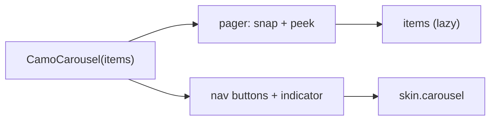
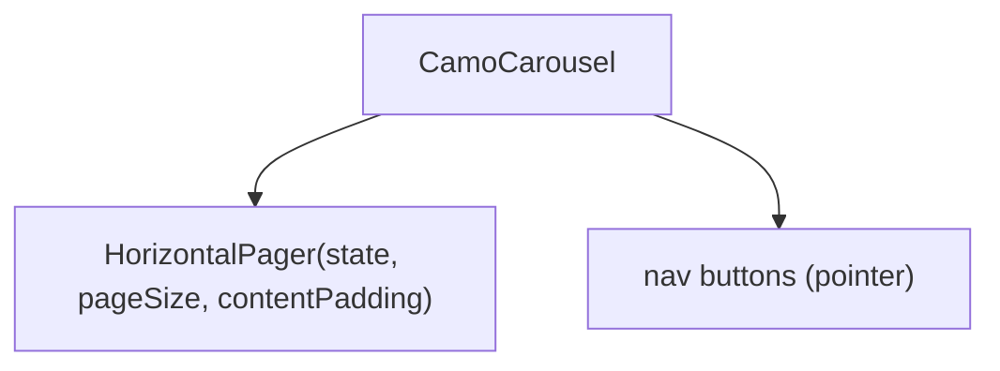
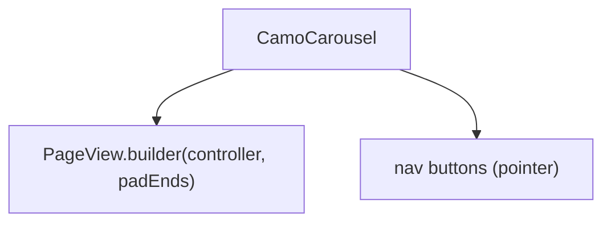

{/* Generated by docs/internal/scripts/sync_vault.py from the Camouflage design notes. Edit the notes and re-run the script; changes made here are overwritten. */}

# CamoCarousel

## Concept {#concept}

### 1. Why

A carousel shows **a horizontal strip of items you swipe or step through**: a photo gallery, featured cards, onboarding pages (Material's carousel, Fluent's Carousel, page views). Items can peek at the edges. It is not tabs and not a pager for navigation (that is `CamoTabs` with a pager).

### 2. Shape



**Split of duties**

| Core | Skin (renderer) |
|---|---|
| the paging and snapping, the `page` state (controlled or remembered), peek and item width, previous and next buttons on pointer devices, keyboard, semantics ("item 2 of 5"), optional page indicator through `CamoPagination` | the container, the previous and next buttons, the indicator look, the item mask and spacing |

**Material mapping preview:** the M3 carousel (multi-browse, uncontained, hero).
- Items `shapes.extraLarge`, 16 dp gaps, a hero item at 3x the small ones.

### 3. API

#### Contract

```kotlin
fun <T> CamoCarousel(
    items: List<T>,
    state: CarouselState = rememberCarouselState(),   // page, scrollToPage(i)
    itemKey: (T) -> Any,
    layout: CarouselLayout = Paged,          // Paged (one at a time) | Peek(fraction) | MultiBrowse
    showButtons: Boolean = Auto,             // pointer devices
    showIndicator: Boolean = true,
    caption: String,
    content: @Composable (T) -> Unit,
)
```

**State → renderer:** `CarouselState(page, pageCount, hasPrevious, hasNext)`; the renderer draws the container and `NavButton(direction, enabled, interaction)`; the item content is the app's. The indicator is `CamoPagination`'s page-control form.

#### Tokens used

- `colors.surface`, `onSurface`, `scrim`
- `shapes.extraLarge` (item mask), `spacing.m` gap
- `motion.durationMedium` (snap)

#### Component theme

`theme.components.carousel`. Every field is nullable in the theme. The skin's `defaults(theme)` fills whatever isn't set (Material defaults shown). See [Theme](/guide/foundations/theme) §3.10.

| Field | Type | Material default | What it's for |
|---|---|---|---|
| `itemShape` | Shape | `shapes.extraLarge` | the mask |
| `itemSpacing` | Dp | 12 | between items |
| `peek` | Dp | 24 | the next item showing at the edge |
| `buttonStyle` | ButtonColors | scrim fill | previous and next |
| `strings` | CarouselStrings | English | "previous", "next", "item 2 of 5" |

#### Accessibility

- A **region** named by `caption`; each item announces "item 2 of 5"; the previous and next buttons are buttons.
- Left and Right (reading direction) move one item; Home and End jump. Off-screen items are not focusable.
- Reduced motion: the snap is instant.

### 4. Build steps

1. `CarouselState`, layouts, `CarouselTheme` / `Style`, state, renderer, the `CamoSkin` field.
2. `CamoCarousel`, the DebugSkin renderer.
3. Tests: snap and page state, peek, buttons, keys, RTL, semantics.

**Done when**
- [ ] The admin sample's image gallery pages by swipe, buttons and keys.

### 5. Edge cases

| Case | Decided behavior |
|---|---|
| Case | Decided behavior |
|---|---|
| One item | No buttons or indicator. |
| Many items | Lazy: only the visible ones compose. |
| RTL | The strip and the buttons mirror. |

:::info[Changed in the M10 build (2026-11-03)]

- The renderer has three parts: `Container`, `Item` (each item's mask) and `Button` (previous and next); the page dots are `CamoPagination`'s dots form. `CarouselTheme` has `itemShape`, `itemSpacing`, `peek`, `buttonSize`, the two icons and `CarouselColors(buttonContainer, buttonContent)`. The layouts are `Paged` and `Peek`; multi-browse and hero layouts are not built.
- The buttons show on pointer devices by default (`showButtons`) and flip in right-to-left layouts. Left and Right (reading direction), Home and End step and jump; each item announces "item 2 of 5" and the previous and next buttons are named. There is no auto-play. A single item has no buttons or dots.
- Position is the platform's own pager state, so the app can read and move it: no new state type.

:::

 > - **Auto-play** is not in v0.1 (an accessibility hazard); say if you want it with a pause control.

## Implementation {#implementation}

<KotlinOnly>

### 1. Why {#kotlin-1-why}

`HorizontalPager` from Compose Foundation, with a `PageSize` for peek, `rememberPagerState`; the state wraps it.

### 2. Shape {#kotlin-2-shape}



### 3. API {#kotlin-3-api}

```kotlin
@Composable public fun <T> CamoCarousel(items: List<T>, itemKey: (T) -> Any, caption: String, modifier: Modifier = Modifier,
    state: CarouselState = rememberCarouselState(), layout: CarouselLayout = CarouselLayout.Paged,
    showButtons: Boolean? = null, showIndicator: Boolean = true, content: @Composable (T) -> Unit)
```

- `CarouselState` holds the `PagerState`; `scrollToPage` and `animateScrollToPage` are suspend functions.
- Semantics: the pager's `collectionInfo`, each page `collectionItemInfo`; buttons use `Role.Button`.

### 4. Build steps {#kotlin-4-build-steps}

1. State, pager, buttons, indicator, renderer.
2. Tests: page state, keys, semantics, RTL.

**Done when**
- [ ] Works by touch, mouse, keyboard and screen reader on all targets.

### 5. Edge cases {#kotlin-5-edge-cases}

| Case | Decided behavior |
|---|---|
| Drag on desktop | Mouse drag scrolls (a scroll behavior with the mouse as a drag device). |

:::info[Changed in the M10 build (2026-11-03)]

- `state` is Compose's `PagerState` (`rememberPagerState { items.size }` by default); items are a `HorizontalPager` with the peek as `contentPadding`.

:::

 > - None specific.

</KotlinOnly>

<DartOnly>

### 1. Why {#dart-1-why}

Flutter's `PageView` (widgets layer) with `viewportFraction` for peek; `CamoCarouselController` wraps its controller.

### 2. Shape {#dart-2-shape}



### 3. API {#dart-3-api}

```dart
class CamoCarousel<T> extends StatefulWidget {
  const CamoCarousel({super.key, required this.items, required this.itemKey, required this.caption, required this.itemBuilder,
      this.controller, this.layout = CarouselLayout.paged, this.showButtons, this.showIndicator = true});
}
```

- `Semantics(container: true, label: caption)`, each page `Semantics(label: 'item 2 of 5')`.
- Keys through `CallbackShortcuts` on a `FocusScope`.

### 4. Build steps {#dart-4-build-steps}

1. Controller, `PageView`, buttons, indicator, renderer.
2. Widget tests: page state, keys, semantics, RTL.

**Done when**
- [ ] Works by touch, mouse, keyboard and screen reader in the example.

### 5. Edge cases {#dart-5-edge-cases}

| Case | Decided behavior |
|---|---|
| Nested vertical scroll | The pager scrolls horizontally only. |

:::info[Changed in the M10 build (2026-11-03)]

- The controller is a `PageController` (a `peek` layout uses a viewport fraction, so a controller you pass must match). The carousel needs a height: the items fill it.

:::

 > - None specific.

</DartOnly>
