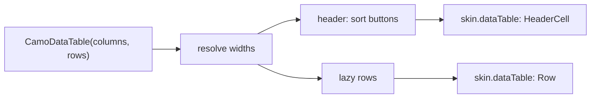
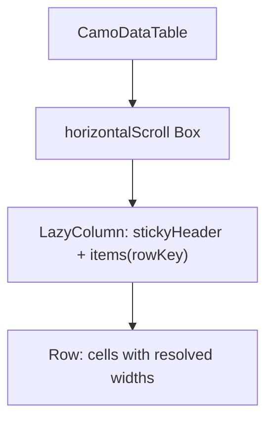
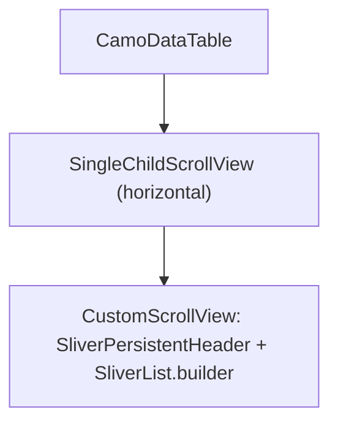

{/* Generated by docs/internal/scripts/sync_vault.py from the Camouflage design notes. Edit the notes and re-run the script; changes made here are overwritten. */}

# CamoDataTable

## Concept {#concept}

### 1. Why

A data table shows **rows of records in typed columns** with sorting, selection and an optional footer: an admin list of users, orders, files (Material and Fluent DataGrid / Table, Carbon's data table, macOS table views). It is not a list (`CamoListItem`, one row, a few fields) and not a spreadsheet (no cell editing in v0.1). Paging is `CamoPagination` beside it; the table never fetches.

### 2. Shape



**Split of duties**

| Core | Skin (renderer) |
|---|---|
| the column model and widths, lazy rows, sort and selection state flow (app-owned), the header sort buttons, keyboard (Up and Down between rows, Space toggles, Enter activates), semantics (grid, header cells, "row 3 of 40"), sticky header, horizontal scroll when the columns need more than the width | header and row look, zebra and hover, selected row, the sort arrow, cell padding and density, dividers |

**Material mapping preview:** the M3 has no data table; Material's own is a list-like layout.
- Header `labelLarge` on `surfaceContainerHigh`, rows 52 tall, a 1 dp `outlineVariant` divider, the selected row `secondaryContainer`.

### 3. API

#### Contract

```kotlin
data class CamoColumn<T>(
    val key: Any,
    val header: String,
    val width: ColumnWidth = Weight(1f),     // Fixed(dp) | Weight(w) | Content
    val align: ColumnAlign = Start,          // Start | Center | End (numbers)
    val sortable: Boolean = false,
    val cell: @Composable (T) -> Unit,
)

fun <T> CamoDataTable(
    columns: List<CamoColumn<T>>,
    rows: List<T>,
    rowKey: (T) -> Any,
    sort: TableSort? = null,                 // TableSort(columnKey, ascending); the app sorts rows
    onSortChange: ((TableSort) -> Unit)? = null,
    selection: Set<Any>? = null,             // null: not selectable; otherwise the selected row keys
    onSelectionChange: ((Set<Any>) -> Unit)? = null,
    onRowClick: ((T) -> Unit)? = null,
    empty: Slot? = null, loading: Boolean = false, footer: Slot? = null,
    caption: String,                         // names the table for screen readers
)
```

**State → renderer:** `TableState(columnCount, rowCount, selectable, loading)`; `HeaderCellState(sortDirection?, sortable, align, interaction)`; `RowState(index, selected, interaction, striped)`; `CellState(align)`. **Slots:** the cell content. The renderer has Container, HeaderRow, HeaderCell, Row and EmptyState parts.

#### Tokens used

- `colors.surface`, `surfaceContainerHigh` (header), `outlineVariant`, `secondaryContainer` (selected), `onSurface`, `onSurfaceVariant`
- `typography.labelLarge` (header), `bodyMedium` (cells)
- `spacing.m` cell padding, `spacing.l` side padding

#### Component theme

`theme.components.data table`. Every field is nullable in the theme. The skin's `defaults(theme)` fills whatever isn't set (Material defaults shown). See [Theme](/guide/foundations/theme) §3.10.

| Field | Type | Material default | What it's for |
|---|---|---|---|
| `density` | Density | `Standard` | row height 52 / 40 / 32 |
| `striped` | Boolean | false | alternate row fill |
| `stickyHeader` | Boolean | true | header stays while the rows scroll |
| `dividers` | Boolean | true | lines between rows |
| `headerStyle` / `cellStyle` | CamoTextStyle | `labelLarge` / `bodyMedium` | text |
| `sortIcon` | IconSource | arrow up | rotates for descending |
| `colors` | TableColors(header, row, selectedRow, divider, text, headerText) | M3 values | every color it uses |
| `strings` | TableStrings | English | "sorted ascending", "select row", "loading" |

#### Accessibility

- A **grid**: a caption, a header row of column headers (sortable ones are buttons announcing "Name, sorted ascending"), rows with row and column indexes ("row 3 of 40").
- One Tab stop into the body; Up and Down move between rows, Home and End jump, Space toggles selection, Enter runs `onRowClick`; Left and Right scroll when the columns overflow.
- Selection announces "selected"; the select-all checkbox in the header has its own label.

### 4. Build steps

1. `CamoColumn`, `TableSort`, `TableTheme` / `Style`, state, slots, renderer, the `CamoSkin` field.
2. `CamoDataTable` (lazy rows, sticky header, width resolving), the DebugSkin renderer.
3. Tests: width resolving (fixed, weight, content), sort callback and arrow, selection modes and select-all, keyboard, empty and loading, semantics, 1000 rows stay lazy.

**Done when**
- [ ] The admin sample's sortable, selectable table pages through `CamoPagination` by touch, keyboard and screen reader.

### 5. Edge cases

| Case | Decided behavior |
|---|---|
| Case | Decided behavior |
|---|---|
| Columns wider than the window | The table scrolls horizontally; the header scrolls with it. |
| Sorting | The app sorts `rows`; the table only reports `onSortChange` and shows the arrow. |
| No rows | `empty` shows in the body; with `loading`, skeleton rows. |
| RTL | Columns and alignment mirror. |

:::info[Changed in the M10 build (2026-11-02)]

- The renderer has five parts: `Container`, `HeaderRow`, `HeaderCell`, `Row` and `Cell`; core sizes the columns once, so the header and every row line up. `TableTheme` has `headerHeight`, `rowHeight`, `cellPadding`, `striped`, `dividers`, `headerStyle`, `cellStyle`, `sortIcon` and `TableColors` (container, header, row, stripedRow, selectedRow, divider, text, headerText); density and built-in strings are not built.
- Column widths are `Fixed` or `Weight` (a share of what the fixed columns leave). Content-measured widths, horizontal scrolling, column resizing and row expansion are not built. The header sits above the lazy body, so it stays put; the table needs a height.
- Sorting: a click on a sortable header calls `onSortChange` (a new column sorts ascending; the sorted one flips); the app sorts the rows. Selection: a click or Space toggles the row, unless `onRowClick` is set (then a click calls it); the select column holds a checkbox per row and a select-all in the header (checked only when every row is; no indeterminate state yet). Up and Down move between rows; focus only moves among the rows that are composed.
- States: `empty` fills the body of an empty table; with `loading` and no rows a progress circle shows, and the table announces "Loading".

:::

 > - **Cell editing, column resizing and reordering, row expansion and frozen columns** are v0.2.
 > - **Selection is a set of keys** the app owns (like `CamoChipGroup`); say if you want a built-in single-select mode.

## Implementation {#implementation}

<KotlinOnly>

### 1. Why {#kotlin-1-why}

Compose has no table; `LazyColumn` with `stickyHeader` is the right base. Columns are laid out by a shared width resolver so the header and every row line up.

### 2. Shape {#kotlin-2-shape}



### 3. API {#kotlin-3-api}

```kotlin
@Composable public fun <T> CamoDataTable(columns: List<CamoColumn<T>>, rows: List<T>, rowKey: (T) -> Any, caption: String,
    modifier: Modifier = Modifier, sort: TableSort? = null, onSortChange: ((TableSort) -> Unit)? = null,
    selection: Set<Any>? = null, onSelectionChange: ((Set<Any>) -> Unit)? = null, onRowClick: ((T) -> Unit)? = null,
    empty: (@Composable () -> Unit)? = null, loading: Boolean = false, footer: (@Composable () -> Unit)? = null)
```

- Widths resolve once per layout (`Fixed`, then `Weight` over the rest, `Content` from a measured max of the visible rows); a shared `TableLayout` object gives each row the same widths.
- Semantics: `collectionInfo(rowCount, columnCount)` on the list, `collectionItemInfo` and `isTraversalGroup` per row; header cells `Role.Button` with `stateDescription` for the sort.
- Keys use `rememberRovingFocus` over rows; Space `toggleable`.

### 4. Build steps {#kotlin-4-build-steps}

1. Widths, the list, header and rows, selection and sort, the renderer.
2. Tests: widths, sort, selection, keys, 1000-row laziness, semantics.

**Done when**
- [ ] Works by touch, mouse, keyboard and screen reader on all targets.

### 5. Edge cases {#kotlin-5-edge-cases}

| Case | Decided behavior |
|---|---|
| Variable row height | Rows measure their own height (min = density). |

:::info[Changed in the M10 build (2026-11-02)]

- `CamoColumn(key, header, width, align, sortable, cell)`; rows are a `LazyColumn` (`itemsIndexed` with the row key) and each carries `collectionItemInfo`; the header and the cells share `Modifier.weight` or `Modifier.width`.

:::

 > - None specific.

</KotlinOnly>

<DartOnly>

### 1. Why {#dart-1-why}

Flutter's `Table` and `DataTable` are not lazy or Material-free. The table is a `CustomScrollView` with a pinned header sliver and a `SliverList`, rows laid out with shared column widths.

### 2. Shape {#dart-2-shape}



### 3. API {#dart-3-api}

```dart
class CamoDataTable<T> extends StatelessWidget {
  const CamoDataTable({super.key, required this.columns, required this.rows, required this.rowKey, required this.caption,
      this.sort, this.onSortChange, this.selection, this.onSelectionChange, this.onRowPressed, this.empty,
      this.loading = false, this.footer});
}
```

- Widths come from one `_TableLayout` (an `InheritedWidget`) so the header and rows agree; a content width needs the visible rows' max intrinsic width, measured with a `LayoutBuilder`-free render object (no intrinsic crash).
- Semantics: `Semantics(container, label: caption)`, header cells `button`/`sortKey`, rows with `index`/`rowCount`.
- `CamoRovingFocus` over the rows.

### 4. Build steps {#dart-4-build-steps}

1. Widths, the sliver list, header and rows, selection and sort, the renderer.
2. Widget tests: widths, sort, selection, keys, laziness, semantics.

**Done when**
- [ ] Works by touch, mouse, keyboard and screen reader in the example.

### 5. Edge cases {#dart-5-edge-cases}

| Case | Decided behavior |
|---|---|
| Table in an unbounded height | An assertion with the fix (give it a height or `shrinkWrap: true`, which disables laziness). |

:::info[Changed in the M10 build (2026-11-02)]

- `CamoColumn(id, header, cell, width, align, sortable)`; rows are a `ListView.builder` under the header row, widths are `Expanded(flex)` or `SizedBox`. In Flutter Space and Enter both activate the row, so Space calls `onRowPressed` when it is set.

:::

 > - None specific.

</DartOnly>
