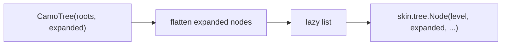
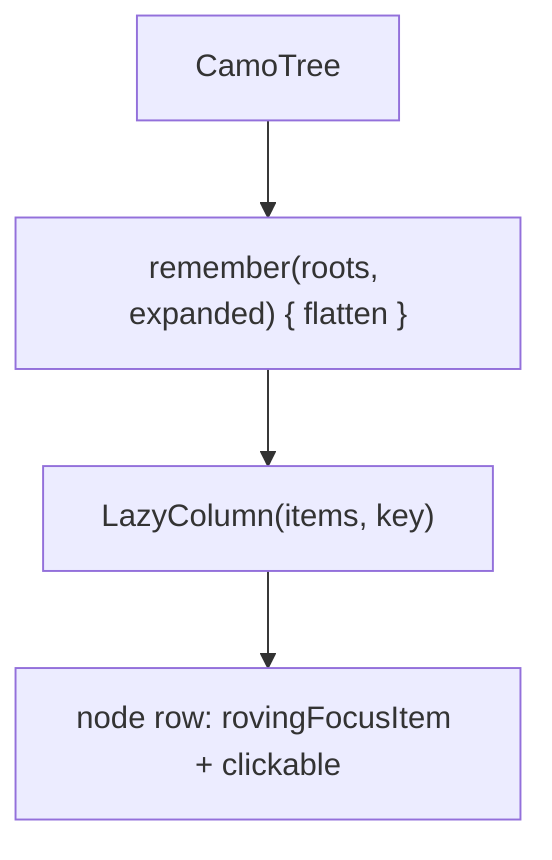
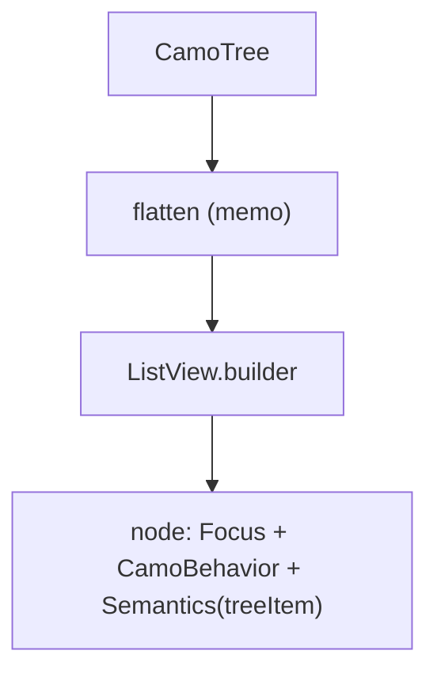

{/* Generated by docs/internal/scripts/sync_vault.py from the Camouflage design notes. Edit the notes and re-run the script; changes made here are overwritten. */}

# CamoTree

## Concept {#concept}

### 1. Why

A tree shows **hierarchical data you can expand and collapse**: a file explorer, a settings outline, an org chart (Fluent Tree, Carbon's tree view, macOS outline views). Nodes may load their children on demand. It is not navigation (that is the drawer, whose groups are one level) and not an accordion (independent sections).

### 2. Shape



**Split of duties**

| Core | Skin (renderer) |
|---|---|
| the node model, flattening the expanded nodes into a lazy list, expansion and selection (app-owned sets), lazy children (`onExpand`), keyboard (Up, Down, Left, Right, Home, End, typing), semantics (tree, level, expanded) | indent, the chevron, icons, the row look, the selected and focus states, lines between levels |

**Material mapping preview:** the M3 has no tree; rows follow list items with a chevron.
- Row 40 tall, indent 24 per level, selected `secondaryContainer`.

### 3. API

#### Contract

```kotlin
data class CamoTreeNode<T>(
    val key: Any,
    val value: T,
    val children: List<CamoTreeNode<T>>? = null,   // null: a leaf; empty: loaded, nothing in it
    val hasChildren: Boolean = children != null,   // true with null children: not loaded yet
)

fun <T> CamoTree(
    roots: List<CamoTreeNode<T>>,
    expanded: Set<Any>, onExpandedChange: (Set<Any>) -> Unit,
    selected: Set<Any>, onSelectedChange: (Set<Any>) -> Unit,
    multiSelect: Boolean = false,
    onLoadChildren: ((CamoTreeNode<T>) -> Unit)? = null,   // called once when a not-yet-loaded node expands
    label: (T) -> String,
    icon: ((T, expanded: Boolean) -> Slot)? = null,
    caption: String,
)
```

**State → renderer:** `TreeNodeState(level, expanded, hasChildren, loading, selected, interaction)`. **Slots:** `TreeNodeSlots(icon, label, trailing)`. The renderer draws one row; core does the indentation inputs (`level`) and the list.

#### Tokens used

- `colors.surface`, `secondaryContainer` (selected), `onSurface`, `onSurfaceVariant` (chevron)
- `typography.bodyMedium`; `spacing.s`, `spacing.m`

#### Component theme

`theme.components.tree`. Every field is nullable in the theme. The skin's `defaults(theme)` fills whatever isn't set (Material defaults shown). See [Theme](/guide/foundations/theme) §3.10.

| Field | Type | Material default | What it's for |
|---|---|---|---|
| `rowHeight` | Dp | 40 | node row height |
| `indent` | Dp | 24 | per level |
| `showLines` | Boolean | false | guide lines (Carbon, Fluent) |
| `chevron` | IconSource | chevron right | rotates when expanded |
| `iconSize` | Dp | 20 | node icons |
| `colors` | TreeColors(selected, hover, line, text, chevron) | M3 values | every color it uses |
| `strings` | TreeStrings | English | "expanded", "collapsed", "loading" |

#### Accessibility

- A **tree** with items announcing their **level** and **expanded or collapsed** ("Documents, collapsed, level 1, 2 of 5").
- One Tab stop; Down and Up move, Right expands (or enters the first child), Left collapses (or goes to the parent), Home and End jump, typing jumps to the next label, Enter or Space selects.
- A loading node announces "loading".

### 4. Build steps

1. `CamoTreeNode`, flattening, `TreeTheme` / `Style`, state, slots, renderer, the `CamoSkin` field.
2. `CamoTree`, the DebugSkin renderer.
3. Tests: flattening and levels, expand and collapse, lazy loading once, single and multi select, every key, semantics.

**Done when**
- [ ] The admin sample's file tree expands lazily and works by touch, keyboard and screen reader.

### 5. Edge cases

| Case | Decided behavior |
|---|---|
| Case | Decided behavior |
|---|---|
| Deep trees | Only the visible rows compose (lazy). |
| A node removed while expanded | Its key leaves the expanded set the next time the app sets it; stale keys are ignored. |
| Multi-select | Space toggles; Shift+arrows extend a range (desktop). |
| RTL | Indent and chevrons mirror; Left and Right swap. |

 > - **Drag and drop to move nodes** is v0.2.
 > - **Checkbox trees** (tri-state parents) are not in v0.1; say if you want them.

## Implementation {#implementation}

<KotlinOnly>

### 1. Why {#kotlin-1-why}

`LazyColumn` over the flattened visible nodes, `key = node.key`; the flatten is `remember`ed on `roots` and `expanded`.

### 2. Shape {#kotlin-2-shape}



### 3. API {#kotlin-3-api}

```kotlin
@Composable public fun <T> CamoTree(roots: List<CamoTreeNode<T>>, expanded: Set<Any>, onExpandedChange: (Set<Any>) -> Unit,
    selected: Set<Any>, onSelectedChange: (Set<Any>) -> Unit, label: (T) -> String, caption: String,
    modifier: Modifier = Modifier, multiSelect: Boolean = false, onLoadChildren: ((CamoTreeNode<T>) -> Unit)? = null,
    icon: ((T, Boolean) -> (@Composable () -> Unit))? = null)
```

- Semantics: `collectionInfo` on the list; per node `stateDescription` (Expanded or Collapsed), `selected`, and a `collectionItemInfo` with the level as the row span; `expand` / `collapse` custom actions for screen readers.
- Keys through `onPreviewKeyEvent` on the list with a `FocusRequester` per visible row.

### 4. Build steps {#kotlin-4-build-steps}

1. Flatten, list, keys, selection, lazy load, the renderer.
2. Tests: flatten, keys, semantics, lazy loading.

**Done when**
- [ ] Works by touch, mouse, keyboard and screen reader on all targets.

### 5. Edge cases {#kotlin-5-edge-cases}

| Case | Decided behavior |
|---|---|
| Focus on a collapsed child | When the parent collapses, focus moves to the parent. |

 > - None specific.

</KotlinOnly>

<DartOnly>

### 1. Why {#dart-1-why}

There is no tree in the widgets layer. `CamoTree` is a `SliverList.builder` over the flattened nodes with `SemanticsRole.tree` and `treeItem`.

### 2. Shape {#dart-2-shape}



### 3. API {#dart-3-api}

```dart
class CamoTree<T> extends StatefulWidget {
  const CamoTree({super.key, required this.roots, required this.expanded, required this.onExpandedChange,
      required this.selected, required this.onSelectedChange, required this.label, required this.caption,
      this.multiSelect = false, this.onLoadChildren, this.icon});
}
```

- Each node is a `Semantics(role: SemanticsRole.treeItem, expanded:, selected:, ...)` inside `Semantics(role: SemanticsRole.tree)`.
- Keys through `CallbackShortcuts` on a `FocusScope` with one `FocusNode` per visible row (disposed with the row).

### 4. Build steps {#dart-4-build-steps}

1. Flatten, list, keys, selection, lazy load, the renderer.
2. Widget tests: flatten, keys, semantics, lazy loading.

**Done when**
- [ ] Works by touch, mouse, keyboard and screen reader in the example.

### 5. Edge cases {#dart-5-edge-cases}

| Case | Decided behavior |
|---|---|
| Row focus nodes | They live in the row's state and are disposed with it. |

 > - None specific.

</DartOnly>
