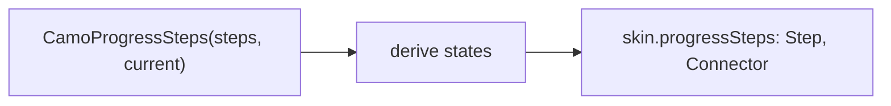
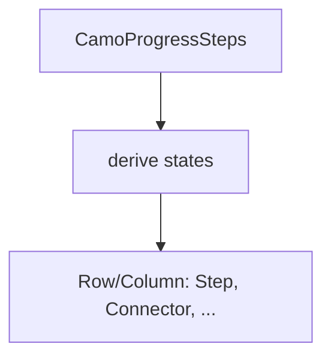
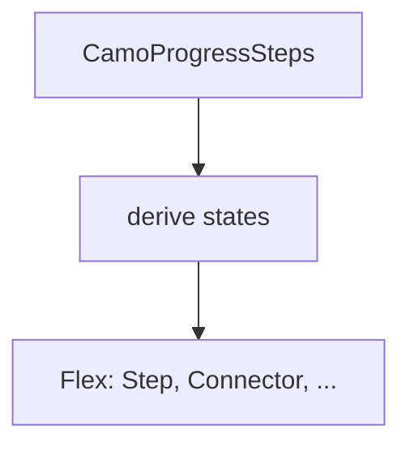

{/* Generated by docs/internal/scripts/sync_vault.py from the Camouflage design notes. Edit the notes and re-run the script; changes made here are overwritten. */}

# CamoProgressSteps

## Concept {#concept}

### 1. Why

Progress steps show **where you are in a multi-step process** and which steps are done: a checkout, an upload wizard, onboarding (Carbon's progress indicator, Fluent patterns, Material's stepper). It is an indicator, not the wizard's content: the app swaps the content and sets the current step.

### 2. Shape



**Split of duties**

| Core | Skin (renderer) |
|---|---|
| the step model and states (complete, current, upcoming, error), horizontal or vertical layout, optional clicking on reachable steps, keys, semantics ("Step 2 of 4, current") | the markers (numbers, check, error), the connectors, the labels, colors |

**Material mapping preview:** the M3 has no stepper component; Material's guidance draws circles and lines.
- 24 dp circles, `primary` for complete and current, `outlineVariant` for upcoming.

### 3. API

#### Contract

```kotlin
data class CamoStep(
    val key: Any,
    val label: String,
    val description: String? = null,
    val state: StepState? = null,            // null: derived from `current`; Error to flag a step
    val onClick: (() -> Unit)? = null,       // null: not clickable
)

fun CamoProgressSteps(
    steps: List<CamoStep>,
    current: Int,                            // zero-based; earlier steps are complete
    orientation: StepsOrientation = Horizontal,
    label: String = "Progress",
)
```

**State → renderer:** `StepsState(count, current, orientation)`; `StepState(index, state, clickable, interaction)` per step with `StepSlots(label, description)`; the connector is `ConnectorState(complete)`.

#### Tokens used

- `colors.primary`, `onPrimary`, `outlineVariant`, `error`
- `typography.labelLarge`, `bodySmall`; `spacing.s`

#### Component theme

`theme.components.progress steps`. Every field is nullable in the theme. The skin's `defaults(theme)` fills whatever isn't set (Material defaults shown). See [Theme](/guide/foundations/theme) §3.10.

| Field | Type | Material default | What it's for |
|---|---|---|---|
| `markerSize` | Dp | 24 | |
| `connectorWidth` | Dp | 2 | |
| `showNumbers` | Boolean | true | else dots |
| `checkIcon` / `errorIcon` | IconSource | check / alert | |
| `colors` | StepsColors(complete, current, upcoming, error, connector, text) | M3 values | every color it uses |
| `strings` | StepsStrings | English | "Step 2 of 4", "complete", "current", "error" |

#### Accessibility

- A **list** named `label`; each step announces "Step 2 of 4, Shipping, current" (or complete, upcoming, error); clickable steps are buttons; the current step is marked `selected`.
- One Tab stop across the clickable steps; Left and Right (or Up and Down when vertical) move; the state change is not a live region (the app's content change is).

### 4. Build steps

1. `CamoStep`, `StepState`, theme, state, renderer, the `CamoSkin` field.
2. `CamoProgressSteps`, the DebugSkin renderer.
3. Tests: derived states, an error step, clickable steps, keys, vertical, semantics.

**Done when**
- [ ] The upload wizard sample's steps follow its pages.

### 5. Edge cases

| Case | Decided behavior |
|---|---|
| Case | Decided behavior |
|---|---|
| Narrow width, horizontal | Labels hide except the current one; the markers stay. |
| Jumping ahead | Only steps with `onClick` are clickable; the app decides which. |
| RTL | Horizontal order mirrors. |

:::info[Changed in the M10 build (2026-11-02)]

- The renderer has one part, `Step`, which also draws the connector to the next step (`StepItemState.last` says whether there is one); `StepsColors` has nine roles (complete, onComplete, current, onCurrent, upcoming, error, connector, text, mutedText). The theme is `StepsTheme` in code (`progressSteps` on the component themes).
- Horizontal steps share the width equally except the last; vertical ones use their own height. A step announces "Step 2 of 4, current" (or complete, upcoming, error); steps with a click action are buttons, and the arrow keys move between them.
- Not built: hiding labels on narrow widths and built-in strings.

:::

 > - **Optional steps** (a "Optional" caption) are the step's `description`; say if you want a flag.

## Implementation {#implementation}

<KotlinOnly>

### 1. Why {#kotlin-1-why}

A `Row` or `Column` of steps and connectors with `rememberRovingFocus` over the clickable ones.

### 2. Shape {#kotlin-2-shape}



### 3. API {#kotlin-3-api}

```kotlin
@Composable public fun CamoProgressSteps(steps: List<CamoStep>, current: Int, modifier: Modifier = Modifier,
    orientation: StepsOrientation = StepsOrientation.Horizontal, label: String = "Progress")
```

### 4. Build steps {#kotlin-4-build-steps}

1. States, layout, keys, renderer.
2. Tests: states, keys, semantics.

**Done when**
- [ ] Works by touch, mouse, keyboard and screen reader on all targets.

### 5. Edge cases {#kotlin-5-edge-cases}

| Case | Decided behavior |
|---|---|
| Long labels | They wrap (vertical) or ellipsize (horizontal). |

:::info[Changed in the M10 build (2026-11-02)]

- `StepAt` composes each step with its weight in the row; the status is derived unless `CamoStep.status` is set.

:::

 > - None specific.

</KotlinOnly>

<DartOnly>

### 1. Why {#dart-1-why}

A `Flex` (Row or Column) of steps; the connectors are `Expanded` in horizontal mode.

### 2. Shape {#dart-2-shape}



### 3. API {#dart-3-api}

```dart
class CamoProgressSteps extends StatelessWidget {
  const CamoProgressSteps({super.key, required this.steps, required this.current,
      this.orientation = StepsOrientation.horizontal, this.semanticLabel = 'Progress'});
}
```

### 4. Build steps {#dart-4-build-steps}

1. States, layout, keys, renderer.
2. Widget tests: states, keys, semantics.

**Done when**
- [ ] Works by touch, mouse, keyboard and screen reader in the example.

### 5. Edge cases {#dart-5-edge-cases}

| Case | Decided behavior |
|---|---|
| Long labels | Same. |

:::info[Changed in the M10 build (2026-11-02)]

- `CamoStep(id, label, description, status, onPressed)`; the status words reach screen readers as the step's value.

:::

 > - None specific.

</DartOnly>
