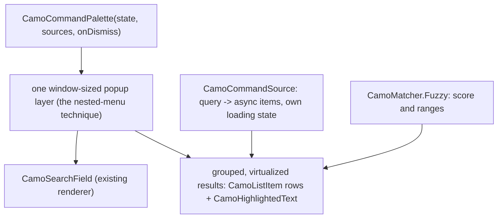

{/* Generated by docs/internal/scripts/sync_vault.py from the Camouflage design notes. Edit the notes and re-run the script; changes made here are overwritten. */}

# CamoCommandPalette

:::info[Milestone: M16 (v0.2), raised by Graft (srctool/camouflage#76)]

:::

## 1. Why

A "Find Action" and "Search Everywhere" popup: one field, results grouped by source (actions, files, items), keyboard-first, shortcuts shown. Common in desktop apps (VS Code, JetBrains, Slack). It builds on CamoSpeedSearch's matcher and highlighting.

## 2. Shape



**No new renderer.** The surface is the menu's panel, the field is the search field, the rows are list items: all existing renderers.

## 3. API

```kotlin
@Composable fun CamoCommandPalette(
    state: CamoCommandPaletteState,           // open or not, the query, the history (app-owned)
    sources: List<CamoCommandSource>,
    modifier,
)

class CamoCommandSource(
    val title: String,                        // the group heading: "Actions", "Files"
    val search: suspend (query: String) -> List<CamoCommandItem>,   // async; cancelled on the next keystroke
    val matchKind: MatchKind = Fuzzy,
    val limit: Int = 8,
)
data class CamoCommandItem(
    val id: Any, val title: String, val subtitle: String? = null,
    val icon: Slot? = null, val shortcut: String? = null,        // "Ctrl+Shift+P": a hint on action rows
    val onSelect: () -> Unit,
)
class CamoCommandPaletteState { var open: Boolean; var query: String; val recent: List<Any>; fun snapshot(): … }
```

- **Recent items first**: with an empty query each source lists its recents (ids the state remembers); the app persists `snapshot()`.
- **Keyboard**: Up and Down move through all rows, Tab and Shift+Tab jump between groups, Enter runs the row (the palette closes, then the action runs, as in menus), Esc closes. The trigger (double-Shift, Ctrl+K) is the app's.
- **Semantics**: the field is a combobox that controls a listbox; each row an option with its group and "n of m"; the active row is the field's active descendant.

## 4. Build steps

1. Fuzzy scoring in `CamoMatcher` (subsequence with bonuses for word starts and consecutive characters), tests including ten thousand items.
2. The popup layer, the field, the grouped results and the keys.
3. Async sources with per-source loading and cancellation; recents.
4. Semantics, both platforms; a sample with three sources.

## 5. Edge cases

| Case | Decided behavior |
|---|---|
| A slow source | Its group shows a loading row; the others show at once; a stale result for an old query is dropped. |
| 10,000 items | A source returns at most `limit` rows per query (scored in the source, off the main thread); the list is virtualized. |
| No results anywhere | One "No results" row. |
| The palette opens under a dialog | It is its own layer above the app; focus returns to what had it when it closes. |
| Touch | A phone gets the same popup, full width (the layer is window-sized). |
