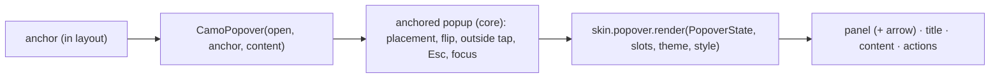
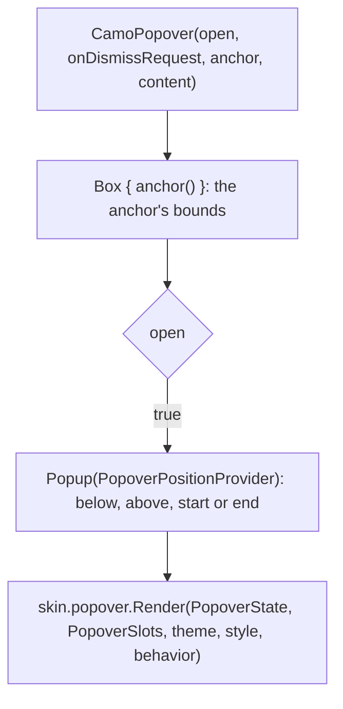
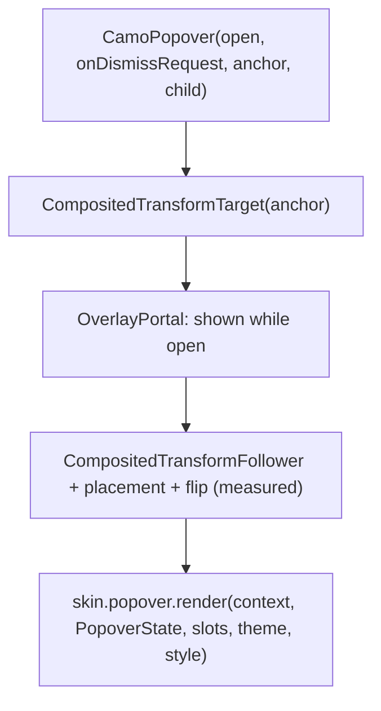

{/* Generated by docs/internal/scripts/sync_vault.py from the Camouflage design notes. Edit the notes and re-run the script; changes made here are overwritten. */}

# CamoPopover

## Concept {#concept}

### 1. Why

A popover is a **non-modal panel anchored to a control**, for content that is richer than a menu and lighter than a dialog: a few lines of text, a small form, an inline picker, one or two actions (Apple's popover, Fluent's Popover and TeachingPopover, Material's rich tooltip). Unlike a dialog it doesn't dim the screen, and unlike a menu its content is arbitrary. It opens next to its anchor, closes on an outside tap or Esc, and hands focus back to the anchor.

### 2. Shape



**Split of duties**

| Core (popover) | Skin (renderer) |
|---|---|
| anchoring and edge flipping (the anchored-popup primitive, ADR-30), the `open` state, outside tap and Esc, focus in and back, semantics | container color, shape and depth, the arrow, title and action placement, padding |

**Material mapping preview:** the M3 rich tooltip (there is no popover in Material).
- Container `surfaceContainer`, `shapes.medium`, `level2`, max width 320.
- Title `titleSmall`, body `bodyMedium` in `onSurfaceVariant`, actions as ghost buttons at the end.
- No arrow.

### 3. API

#### Contract

```kotlin
fun CamoPopover(
    open: Boolean,
    onDismissRequest: () -> Unit,
    anchor: Slot,                           // the element the popover points at; it stays in the layout
    title: String? = null,
    actions: Slot? = null,                  // buttons at the bottom end (CamoButton Ghost / Solid)
    placement: PopoverPlacement = Auto,     // Auto | Bottom | Top | Start | End
    content: Slot,                          // arbitrary layout content
)

// building block (ADR-30): the skin's popover surface and semantics for content you position yourself
fun CamoPopoverPanel(title: String? = null, actions: Slot? = null, content: Slot)
```

Visibility is **state** (`open`), not a route: the app's button toggles it, like every controlled component (ADR-30). `Auto` opens below the anchor, flips above when there is no room, and tries the sides when asked (`Start`/`End`). The renderer is told where the anchor is so it can draw an arrow.

**State → renderer:** `PopoverState(placement, arrowOffset)` (`placement` is the one actually used after flipping; `arrowOffset` is where the anchor's center is along the edge, for the arrow). **Slots:** `PopoverSlots(title?, content, actions?)`.

#### Tokens used

- `colors.surfaceContainer`, `onSurface`, `onSurfaceVariant`, `outlineVariant` (the hairline skins draw)
- `shapes.medium`, `elevation.level2`, `typography.titleSmall` / `bodyMedium`
- `spacing.l` padding, `spacing.s` between title, content and actions
- `motion.durationShort` (scale and fade in from the anchor side)

#### Component theme

`theme.components.popover: PopoverTheme?`. Every field is nullable in the theme. The skin's `defaults(theme)` fills whatever isn't set (Material defaults shown). See [Theme](/guide/foundations/theme) §3.10.

| Field | Type | Material default | What it's for |
|---|---|---|---|
| `shape` | Shape | `shapes.medium` | container corners |
| `maxWidth` | Dp | 320 | the widest the panel gets |
| `padding` | Padding | 16 | around the content |
| `showArrow` | Boolean | false | an arrow pointing at the anchor (Apple and Fluent: true) |
| `arrowSize` | Size | 16 × 8 | the arrow |
| `elevation` | ElevationLevel | `Level2` | depth |
| `titleStyle` | CamoTextStyle | `titleSmall` | the title |
| `gap` | Dp | 8 | space between anchor and panel |
| `colors` | PopoverColors(container, title, content, border?) | `surfaceContainer`, `onSurface`, `onSurfaceVariant`, none | every color it uses |

#### Accessibility

- The anchor announces "has popup" and expanded or collapsed.
- The panel is a non-modal **group** named by its title; it is announced when it opens.
- **Keyboard:** opening moves focus into the panel (the first focusable child, or the panel itself); Tab stays inside while it is open; Esc closes it and **returns focus to the anchor**. An outside tap or the screen-reader dismiss action closes it.
- It never traps a pointer: taps outside close it and still reach what is under them only when the app wants that (default: they just close it).

### 4. Build steps

1. `PopoverPlacement` and the placement rules on the anchored-popup primitive (side placement, the arrow offset).
2. `CamoPopover`, `CamoPopoverPanel`, `PopoverRenderer`, the DebugSkin renderer.
3. Sample: a popover from a toolbar button with a title, a small form and two actions.
4. Tests: open and close by tap, outside tap and Esc; focus in and back; placement flips at the window edge; the arrow follows the anchor; semantics.

**Done when**
- [ ] A popover opens from a button, closes on an outside tap or Esc, returns focus to its anchor, and reads as a group.

### 5. Edge cases

| Case | Decided behavior |
|---|---|
| Not enough room on any side | It is clamped inside the window and may overlap the anchor; the arrow still points at the anchor's center. |
| The anchor scrolls away | The popover follows the anchor while it is visible and closes through `onDismissRequest` when the anchor leaves the viewport. |
| A popover inside a popover or a dialog | Allowed; each closes on its own Esc, innermost first. |
| Touch devices | Same behavior; the outside tap closes it. On phones, a bottom sheet is usually the better presentation, and the app chooses. |
| Rich tooltip (hover) | Later (`CamoRichTooltip` on the same panel). |

 > - **Controlled only?** `open` is state, with no uncontrolled trigger helper in v0.1 (a button's `onClick` toggles it). A `CamoPopoverAnchor { toggle -> … }` convenience like the menu's is cheap to add if you want it.
 > - **Arrow default:** off in the core default, on for Apple and Fluent, per their guidelines.

:::info[Changed in the M9 build (2026-11-02)]

- `PopoverState(placement, arrowOffset)`: `placement` is the side it really opened on after flipping, and `arrowOffset` is where the anchor's center is along the panel's edge (from its top for the side placements, from its left for above and below). The arrow is drawn by the renderer in a margin of `arrowSize.height` on the facing edge, so the gap between the anchor and the panel includes it.
- Placement is one pure function (below, then above; the side asked for, then the opposite, then below; centered on the anchor and kept inside the window) so it is tested without a window.
- The anchor must be one control: its semantics are merged to announce "has popup", expanded or collapsed.
- Opening and closing are state changes the app makes; an outside tap, back and Esc only call `onDismissRequest`. Focus moves into the panel when it opens and back to the anchor when it closes.
- The panel follows its anchor when the page scrolls (Flutter) and is placed again on a resize. Minimal draws a hairline panel with no arrow; Fluent a panel with shadow16 and an arrow.

:::

## Implementation {#implementation}

<KotlinOnly>

### 1. Why {#kotlin-1-why}

Compose's `Popup` is the primitive; core's anchored popup already flips below or above and handles outside taps and Esc for menus. The popover adds side placement, the arrow offset, and the controlled `open`.

### 2. Shape {#kotlin-2-shape}



### 3. API {#kotlin-3-api}

```kotlin
@Composable
public fun CamoPopover(
    open: Boolean,
    onDismissRequest: () -> Unit,
    anchor: @Composable () -> Unit,
    modifier: Modifier = Modifier,
    title: String? = null,
    actions: (@Composable RowScope.() -> Unit)? = null,
    placement: PopoverPlacement = PopoverPlacement.Auto,
    content: @Composable ColumnScope.() -> Unit,
)
```

- The anchor sits in a `Box`; the popup is positioned from its bounds by a `PopupPositionProvider` that returns the chosen `PopoverPlacement` back through state, so the renderer draws the arrow on the right edge.
- `PopupProperties(focusable = true, dismissOnClickOutside = true, dismissOnBackPress = true)`; Esc through `onPreviewKeyEvent`. Focus moves in with a `FocusRequester`, and when `open` becomes false core requests focus on the anchor (the anchor modifier carries a `FocusRequester`).
- Semantics: the anchor gets `stateDescription` and a popup action; the panel `paneTitle = title` and `isTraversalGroup`.

### 4. Build steps {#kotlin-4-build-steps}

1. `PopoverPlacement`, the position provider, `PopoverTheme` / `Style`, state, slots, renderer, the `CamoSkin` field.
2. `CamoPopover`, `CamoPopoverPanel`, the DebugSkin renderer.
3. Tests: open and close by outside tap, back and Esc; focus returns to the anchor; the flip at the bottom edge; the side placements and RTL (Start and End mirror); the arrow offset.

**Done when**
- [ ] The Compose sample's popover works by touch, mouse, keyboard and screen reader on all targets.

### 5. Edge cases {#kotlin-5-edge-cases}

| Case | Decided behavior |
|---|---|
| `open` flips while the anchor recomposes | The popup is keyed on `open`; no flicker. |
| RTL | `Start` and `End` mirror. |
| Reduced motion | The scale-in becomes instant (the provider's reduced motion). |

 > - None specific.

</KotlinOnly>

<DartOnly>

### 1. Why {#dart-1-why}

Flutter has no popover in the widgets layer. `CamoPopover` is an `OverlayPortal` with a `CompositedTransformFollower`, so the panel follows its anchor, plus outside-tap and Esc handling and focus return.

### 2. Shape {#dart-2-shape}



### 3. API {#dart-3-api}

```dart
class CamoPopover extends StatefulWidget {
  const CamoPopover({super.key, required this.open, required this.onDismissRequest, required this.anchor,
      required this.child, this.title, this.actions, this.placement = PopoverPlacement.auto});
}
```

- Needs an `Overlay` above it (inside a route), like the menu and the modal drawer; `OverlayPortal.show` runs after the frame, never during build.
- An outside tap is a full-screen transparent `GestureDetector` under the panel; Esc is a `CallbackShortcuts`; focus moves into a `FocusScope` and returns to the anchor's `FocusNode` on close.
- Semantics: `Semantics(container: true, label: title)` for the panel; the anchor reports expanded.

### 4. Build steps {#dart-4-build-steps}

1. Placement, the follower with flipping, `CamoPopoverTheme` / `Style`, state, slots, renderer, the `CamoSkin` field.
2. `CamoPopover`, the DebugSkin renderer.
3. Widget tests: open and close by outside tap and Esc; focus returns to the anchor; flip near the bottom edge; the side placements and RTL; the arrow offset; semantics.

**Done when**
- [ ] The Flutter example's popover works by touch, mouse, keyboard and screen reader.

### 5. Edge cases {#dart-5-edge-cases}

| Case | Decided behavior |
|---|---|
| No Overlay above | An assertion in debug with the fix ("place it inside a route"). |
| The anchor moves while open | The follower tracks it every frame. |

 > - None specific.

:::info[Changed in the M9 build (2026-11-02)]

- `OverlayPortal.show` and `hide` can't run while the tree builds, so both happen in a post-frame callback (closing it from `didUpdateWidget` first crashed the sample). The panel is invisible until its first layout has reported where it ended up.
- The anchor sits in its own `FocusScope`, whose last focused child gets focus back on close. The overlay's `FocusScope` autofocuses, so Tab stays in the panel.

:::

</DartOnly>
