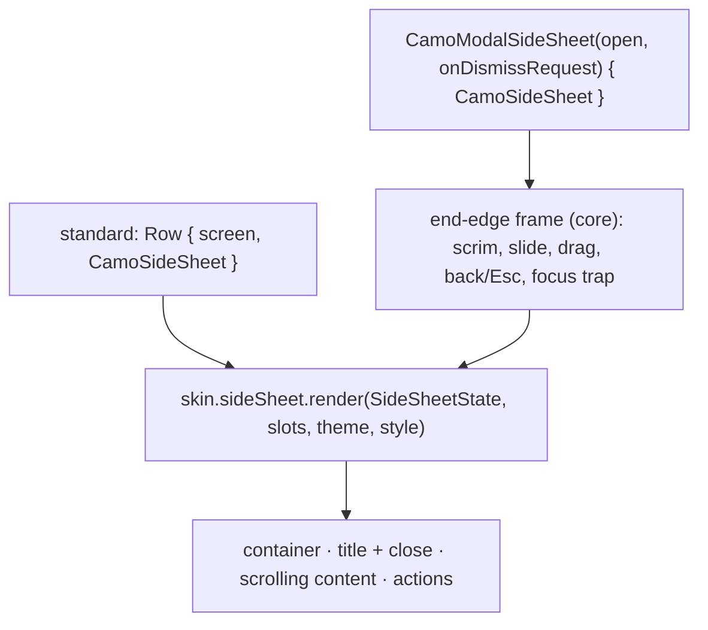
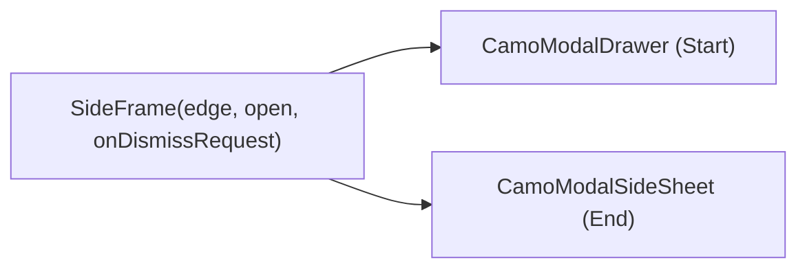
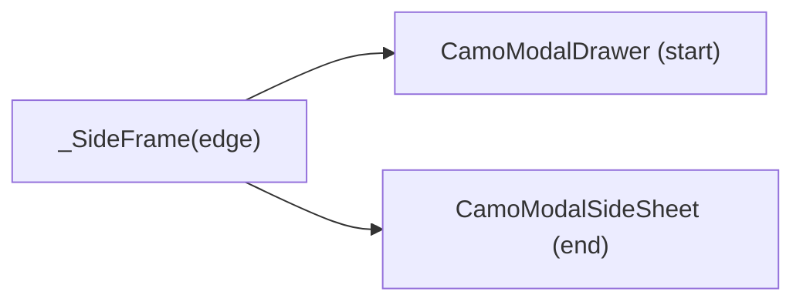

{/* Generated by docs/internal/scripts/sync_vault.py from the Camouflage design notes. Edit the notes and re-run the script; changes made here are overwritten. */}

# CamoSideSheet

## Concept {#concept}

### 1. Why

A side sheet is a **panel on the end edge** that holds secondary content next to the main screen: properties of the selected item, filters, details, a help pane (Material side sheets, Fluent's side Drawer, macOS inspectors). It has two modes: **standard** (docked, non-modal: it takes part of the layout and the main content stays usable) and **modal** (slides over the content with a scrim, on narrow windows). It reuses the modal-drawer machinery from M8, from the end edge.

### 2. Shape



**Split of duties**

| Core (frame + component) | Skin (renderer) |
|---|---|
| the modal frame (scrim, slide from the end edge, drag to dismiss, back and Esc, focus in and back, insets), standard-mode layout, close button wiring, semantics | container color, shape and depth, title bar, divider, padding, close icon |

**Material mapping preview:** the M3 side sheets.
- Standard: `surface`, 256 to 400 wide, a 1 dp `outlineVariant` start edge. Modal: `surfaceContainerLow`, `shapes.large` start corners, `scrim` at 32%.
- Title `titleLarge`, close button at the top end, actions at the bottom.

### 3. API

#### Contract

```kotlin
fun CamoSideSheet(
    title: String? = null,
    onClose: (() -> Unit)? = null,          // non-null → a close button; also what Esc calls in modal mode
    actions: Slot? = null,                  // pinned at the bottom
    content: Slot,                          // scrolls
)

// the modal frame: visibility is state, like the modal drawer (ADR-30)
fun CamoModalSideSheet(open: Boolean, onDismissRequest: () -> Unit, content: Slot)   // a CamoSideSheet inside
```

A **standard** side sheet is just placed in the layout (`Row { Screen(); CamoSideSheet(…) }`); a **modal** one goes in `CamoModalSideSheet`. `CamoAdaptiveNavigation`-style switching between the two is the app's choice by window size (`Camouflage.environment.windowSize`).

**State → renderer:** `SideSheetState(modal, hasClose)`. **Slots:** `SideSheetSlots(title?, content, actions?, close?)` (`close` is the button core builds).

#### Tokens used

- `colors.surface` / `surfaceContainerLow` (modal), `onSurface`, `outlineVariant`, `scrim`
- `shapes.large` (modal start corners), `typography.titleLarge`
- `spacing.l` padding
- `motion.durationMedium` + `easingEmphasized` (slide)

#### Component theme

`theme.components.side sheet: SideSheetTheme?`. Every field is nullable in the theme. The skin's `defaults(theme)` fills whatever isn't set (Material defaults shown). See [Theme](/guide/foundations/theme) §3.10.

| Field | Type | Material default | What it's for |
|---|---|---|---|
| `width` | Dp | 360 | sheet width (at most 80% of a phone window) |
| `modalShape` | Shape | `shapes.large` (start corners) | modal container |
| `padding` | Padding | 24 | around the content |
| `titleStyle` | CamoTextStyle | `titleLarge` | the title |
| `showDivider` | Boolean | true | the edge line in standard mode, the title divider |
| `showCloseButton` | Boolean | true | a close button when `onClose` is set |
| `scrimAlpha` | Float | 0.32 | the modal scrim |
| `colors` | SideSheetColors(container, modalContainer, title, divider) | `surface`, `surfaceContainerLow`, `onSurface`, `outlineVariant` | every color it uses |

#### Accessibility

- A **complementary** region named by its title (standard), or a **pane** (modal), announced when it opens.
- Modal: focus moves in and is trapped; back, Esc, the scrim and a drag toward the end edge close it and return focus to what opened it. It is never drag-only.
- Standard: it is in the reading order after the main content, reachable by Tab; nothing is trapped.

### 4. Build steps

1. The end-edge side frame (reuse the modal drawer's scrim, slide, drag and focus code, generalized by edge).
2. `CamoSideSheet`, `CamoModalSideSheet`, `SideSheetRenderer`, the DebugSkin renderer.
3. Sample: a properties sheet beside a document (standard) that becomes modal on a narrow window.
4. Tests: open and close by button, scrim, back, Esc and drag; focus restored; the close button; RTL slides in from the left; standard mode takes part of the layout.

**Done when**
- [ ] A properties side sheet works docked on wide windows and modal on narrow ones, with the same content.

### 5. Edge cases

| Case | Decided behavior |
|---|---|
| Both a drawer and a side sheet modal at once | Allowed; each has its own scrim, topmost closes first. |
| Long content | The content scrolls; the title and the actions stay. |
| Resizing from wide to narrow while open | The app switches the mode; the content keeps its state (like the adaptive navigation). |
| RTL | The sheet is on the left; the slide and the drag mirror. |

 > - **Edge:** the sheet is on the **end** edge only in v0.1 (the start edge is the navigation drawer's). A `side` parameter is easy later.
 > - **Resizable inspector** (a drag handle on the standard sheet's edge): Later.

:::info[Changed in the M9 build (2026-11-02)]

- The end-edge frame is the modal drawer's frame, now shared (`SideFrame` / `CamoSideFrame`, internal): scrim, slide, drag toward the edge, back, Esc, focus in. The drawer and the sheet pass only the edge, the width and the scrim.
- `SideSheetState(modal, title, onClose)`: the renderer draws the title row and the close button (the style carries `closeIcon`), the scrolling content and the pinned actions. The standard sheet is `width` wide and fills the height; the modal one fills the frame.
- Fixed while extracting it: a drag toward the edge moved the panel the wrong way on Kotlin and a short drag threw on Flutter (the restore animation had no duration). Both are tested in both directions and in RTL.
- Minimal draws a hairline start edge; Fluent the Drawer: inline with a subtle fill, an overlay with shadow64 and rounded corners when modal.

:::

## Implementation {#implementation}

<KotlinOnly>

### 1. Why {#kotlin-1-why}

The modal side sheet is the modal drawer from M8 mirrored to the end edge: one frame, parameterized by edge, so the drawer and the sheet share the slide, drag, scrim and focus code.

### 2. Shape {#kotlin-2-shape}



### 3. API {#kotlin-3-api}

```kotlin
@Composable public fun CamoSideSheet(modifier: Modifier = Modifier, title: String? = null, onClose: (() -> Unit)? = null,
    actions: (@Composable RowScope.() -> Unit)? = null, content: @Composable ColumnScope.() -> Unit)
@Composable public fun CamoModalSideSheet(open: Boolean, onDismissRequest: () -> Unit, modifier: Modifier = Modifier,
    content: @Composable () -> Unit)
```

- The frame is extracted from `CamoModalDrawer` (a `SideFrame(edge)`), so the drawer keeps its behavior and the sheet gets the same tests.
- The content column scrolls with `verticalScroll`; the title and actions are outside it.
- Standard mode needs nothing from core but the renderer's surface, so it composes inside any `Row`.

### 4. Build steps {#kotlin-4-build-steps}

1. Extract the side frame from the modal drawer; the drawer's tests stay green.
2. `SideSheetTheme` / `Style`, state, slots, renderer, the `CamoSkin` field, `CamoSideSheet`, `CamoModalSideSheet`, the DebugSkin renderer.
3. Tests as in the base note, plus the drawer's tests re-run on the shared frame.

**Done when**
- [ ] Standard and modal modes work on all targets; the modal drawer still passes its tests.

### 5. Edge cases {#kotlin-5-edge-cases}

| Case | Decided behavior |
|---|---|
| Popup focus on iOS and web | Same as the modal drawer (a focusable popup). |
| Drag in RTL | The drag direction mirrors with the edge. |

 > - None specific.

</KotlinOnly>

<DartOnly>

### 1. Why {#dart-1-why}

The modal side sheet is the modal drawer mirrored to the end edge: an `OverlayPortal` frame parameterized by edge, shared with `CamoModalDrawer`.

### 2. Shape {#dart-2-shape}



### 3. API {#dart-3-api}

```dart
class CamoSideSheet extends StatelessWidget {
  const CamoSideSheet({super.key, this.title, this.onClose, this.actions, required this.child});
}
class CamoModalSideSheet extends StatefulWidget {
  const CamoModalSideSheet({super.key, required this.open, required this.onDismissRequest, required this.child});
}
```

- The frame is extracted from `CamoModalDrawer`; `PositionedDirectional(end: …)` so RTL mirrors on its own.
- Needs an `Overlay` above it; it shows in a post-frame callback (as the drawer does); back is a `PopScope`; focus is an autofocus `FocusScope`.

### 4. Build steps {#dart-4-build-steps}

1. Extract the side frame; the drawer's tests stay green.
2. Theme, style, state, slots, renderer, the `CamoSkin` field, the two widgets, the DebugSkin renderer.
3. Widget tests as in the base note.

**Done when**
- [ ] Standard and modal modes work; the modal drawer still passes its tests.

### 5. Edge cases {#dart-5-edge-cases}

| Case | Decided behavior |
|---|---|
| No Overlay above | An assertion in debug. |

 > - None specific.

</DartOnly>
