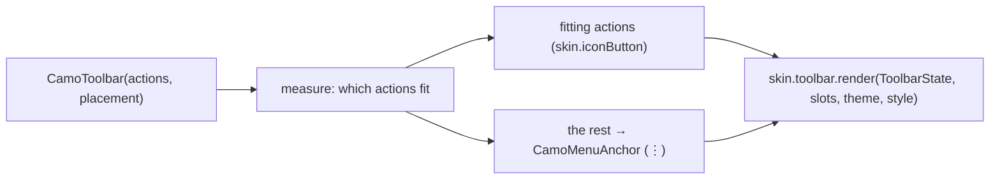
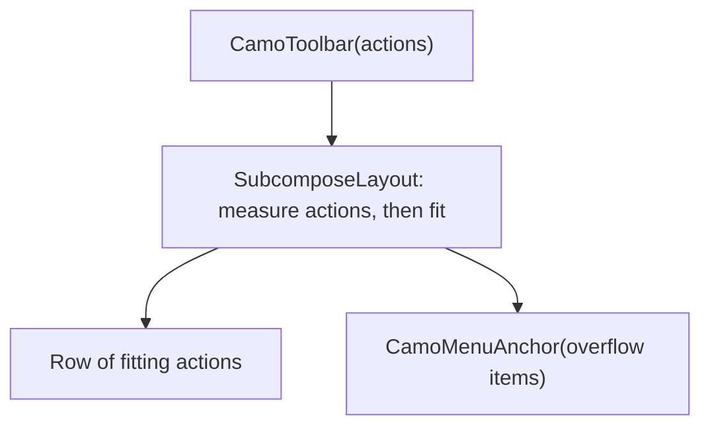
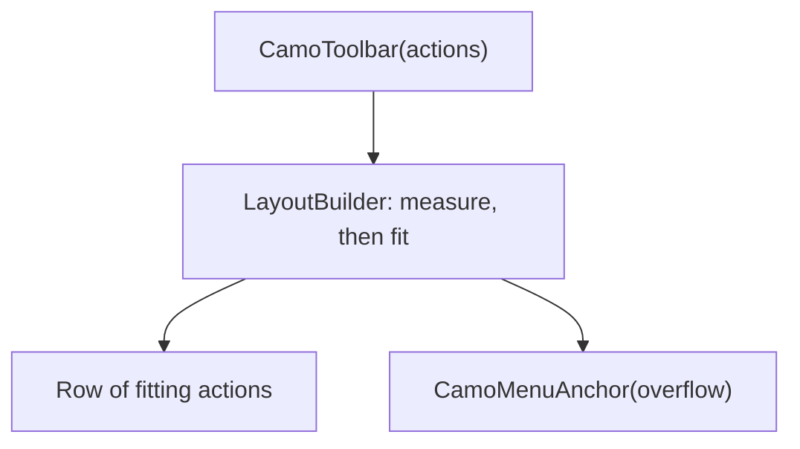

{/* Generated by docs/internal/scripts/sync_vault.py from the Camouflage design notes. Edit the notes and re-run the script; changes made here are overwritten. */}

# CamoToolbar

## Concept {#concept}

### 1. Why

A toolbar is a **row of actions for the current context**: formatting buttons in an editor, a bottom bar of a message list, a floating toolbar over a canvas (Material docked and floating toolbars and the bottom app bar, Apple's toolbars, Fluent's Toolbar). It is not navigation (that is the bar, rail and drawer) and not a title bar (`CamoTopBar`). Actions that don't fit move into an overflow menu.

### 2. Shape



**Split of duties**

| Core | Skin (renderer) |
|---|---|
| the action model, overflow measuring and the overflow menu (reusing `CamoMenuAnchor`), roving focus and the toolbar role, insets for the docked bottom placement | container color, shape, depth, spacing, the action look (icon, icon + label), the separator |

**Material mapping preview:** the M3 docked and floating toolbars.
- Docked: 64 tall, `surfaceContainer`, full width. Floating: 64 tall, `shapes.full`, `level3`, detached by 16.
- Actions are 48 icon buttons in `onSurfaceVariant`; the overflow is a "⋮" at the end.

### 3. API

#### Contract

```kotlin
data class CamoToolbarAction(
    val key: Any,
    val label: String,                    // names the action, shows in the overflow menu and beside the icon when asked
    val icon: Widget,
    val onClick: () -> Unit,
    val enabled: Boolean = true,
    val selected: Boolean? = null,        // non-null → a toggle (Bold, Italic): pressed state
    val tone: Tone = Default,
)

fun CamoToolbar(
    actions: List<CamoToolbarAction>,
    placement: ToolbarPlacement = Docked, // Docked | Floating
    leading: Widget? = null,              // a menu button, a title
    trailing: Widget? = null,             // a FAB-like primary action
    overflowLabel: String = "More",
)

// building block (ADR-30): the skin's toolbar surface, the toolbar role and arrow keys, for custom content
fun CamoToolbarContainer(placement: ToolbarPlacement = Docked, content: Slot)
```

**Overflow:** actions are measured in order; those that don't fit collapse into a trailing "⋮" `CamoMenuAnchor` whose items are the actions' labels, icons and toggles. `CamoButtonGroup`s and `CamoSplitButton`s can also be placed in `leading`/`trailing` or in the container.

**State → renderer:** `ToolbarState(placement, count, overflowing)`. The renderer draws the container; each action is drawn by `skin.iconButton` (a toggle uses its `checked` look) unless the skin's `ToolbarRenderer.Action` overrides. **Slots:** `ToolbarSlots(leading?, trailing?)`.

#### Tokens used

- `colors.surfaceContainer`, `onSurfaceVariant`, `outlineVariant`
- `shapes.full` (floating), `elevation.level3` (floating)
- `spacing.s` between actions, `spacing.l` side padding
- `motion.durationShort` (a floating toolbar shows and hides)

#### Component theme

`theme.components.toolbar: ToolbarTheme?`. Every field is nullable in the theme. The skin's `defaults(theme)` fills whatever isn't set (Material defaults shown). See [Theme](/guide/foundations/theme) §3.10.

| Field | Type | Material default | What it's for |
|---|---|---|---|
| `placement` | `Docked` \| `Floating` | `Docked` | docked: edge to edge on the inset; floating: detached |
| `height` | Dp | 64 | toolbar height (plus the bottom inset when docked at the bottom) |
| `floatingMargin` / `floatingShape` | Dp / Shape | 16 / `shapes.full` | the floating container |
| `floatingElevation` | ElevationLevel | `Level3` | the floating depth |
| `showLabels` | LabelVisibility | `Never` | labels beside icons (Apple and Fluent can show them) |
| `actionSpacing` | Dp | 4 | between actions |
| `showDivider` | Boolean | false | a hairline on the docked edge |
| `colors` | ToolbarColors(container, icon, selected, divider) | `surfaceContainer`, `onSurfaceVariant`, `primary`, `outlineVariant` | every color it uses |

#### Accessibility

- Role **toolbar**, named by the app (`contentDescription`/`semanticLabel`), with the actions as buttons ("Bold, toggle button, pressed").
- **One Tab stop**; the arrow keys move between actions, Home and End jump, and a disabled action is skipped.
- The overflow button announces "More, has popup" and its items are menu items.

### 4. Build steps

1. `CamoToolbarAction`, the measuring overflow, `ToolbarTheme` / `Style`, state, slots, renderer, the `CamoSkin` field.
2. `CamoToolbar`, `CamoToolbarContainer`, the DebugSkin renderer.
3. Sample: an editor toolbar with grouped and split buttons, a popover and a properties side sheet (the milestone screen).
4. Tests: overflow at narrow widths (and back), toggles, roving focus, the menu items, the bottom inset, floating placement.

**Done when**
- [ ] The editor sample's toolbar overflows gracefully, works by touch, keyboard and screen reader.

### 5. Edge cases

| Case | Decided behavior |
|---|---|
| Nothing fits | Only the overflow button shows. |
| Vertical toolbars | Later (`orientation`). |
| A toggle in the overflow | A checkable menu item with the same state. |
| Hide on scroll | `visible` like the bar and the FAB (`rememberHideOnScroll`). |

 > - **Actions as data vs. children:** the data form gives automatic overflow; custom children (button groups, split buttons) go in `leading`/`trailing` or the building-block container and do not overflow. Say if you want children to overflow too (it needs a measured custom layout).
 > - **Vertical toolbars** are Later.

## Implementation {#implementation}

<KotlinOnly>

### 1. Why {#kotlin-1-why}

Compose has no toolbar below Material's. Core measures with a `SubcomposeLayout` to decide which actions fit, draws those with the skin's icon button and moves the rest into the overflow menu.

### 2. Shape {#kotlin-2-shape}



### 3. API {#kotlin-3-api}

```kotlin
@Composable public fun CamoToolbar(actions: List<CamoToolbarAction>, modifier: Modifier = Modifier,
    placement: ToolbarPlacement = ToolbarPlacement.Docked, leading: (@Composable () -> Unit)? = null,
    trailing: (@Composable () -> Unit)? = null, overflowLabel: String = "More", visible: Boolean = true)
@Composable public fun CamoToolbarContainer(modifier: Modifier = Modifier, placement: ToolbarPlacement = Docked,
    content: @Composable RowScope.() -> Unit)
```

- `SubcomposeLayout` measures every action once, reserves the overflow button and the leading and trailing slots, and composes only the actions that fit; resizing recomposes the split.
- Roving focus (`rememberRovingFocus`) across the fitting actions and the overflow button; `Role.Button`, and `toggleable` for toggles.
- Docked placement pads by the bottom navigation-bar inset; `visible` slides it like the navigation bar.

### 4. Build steps {#kotlin-4-build-steps}

1. The overflow layout, `ToolbarTheme` / `Style`, state, slots, renderer, the `CamoSkin` field.
2. `CamoToolbar`, `CamoToolbarContainer`, the DebugSkin renderer.
3. Tests: overflow at widths, toggle semantics, arrows, the inset, the menu items.

**Done when**
- [ ] Overflow, toggles and keyboard work on all targets.

### 5. Edge cases {#kotlin-5-edge-cases}

| Case | Decided behavior |
|---|---|
| Window resize | The split recomputes; focus stays on the same action when it is still visible, else on the overflow button. |
| RTL | The row and the overflow mirror. |

 > - None specific.

</KotlinOnly>

<DartOnly>

### 1. Why {#dart-1-why}

Flutter's `OverflowBar` doesn't give a menu. Core uses a `CustomMultiChildLayout`/`LayoutBuilder` pass to decide which actions fit and moves the rest into a `CamoMenuAnchor`.

### 2. Shape {#dart-2-shape}



### 3. API {#dart-3-api}

```dart
class CamoToolbar extends StatelessWidget {
  const CamoToolbar({super.key, required this.actions, this.placement = ToolbarPlacement.docked, this.leading, this.trailing,
      this.overflowLabel = 'More', this.visible = true, this.semanticLabel});
}
class CamoToolbarContainer extends StatelessWidget { /* the building block */ }
```

- Widths are measured with a hidden `Offstage` pass keyed on the actions (or fixed per skin, since the renderer's icon button has a known size), so the split is exact without a layout loop.
- `CamoRovingFocus` across the actions; `Semantics(role: SemanticsRole.toolbar)` when available.

### 4. Build steps {#dart-4-build-steps}

1. The overflow, `CamoToolbarTheme` / `Style`, state, slots, renderer, the `CamoSkin` field.
2. `CamoToolbar`, `CamoToolbarContainer`, the DebugSkin renderer.
3. Widget tests as in the base note.

**Done when**
- [ ] Overflow, toggles and keyboard work on all platforms.

### 5. Edge cases {#dart-5-edge-cases}

| Case | Decided behavior |
|---|---|
| Needs an Overlay for the overflow menu | As the menu does (inside a route). |

 > - None specific.

</DartOnly>
