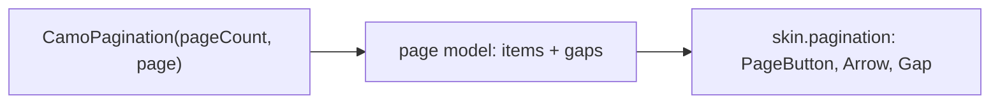
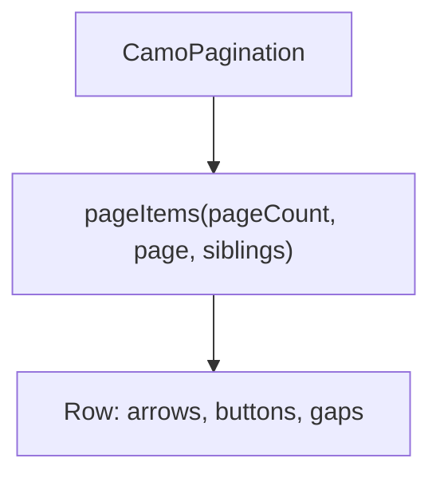
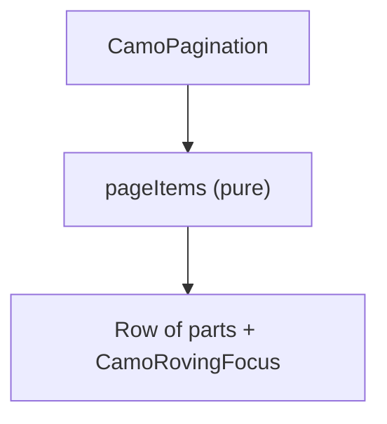

{/* Generated by docs/internal/scripts/sync_vault.py from the Camouflage design notes. Edit the notes and re-run the script; changes made here are overwritten. */}

# CamoPagination

## Concept {#concept}

### 1. Why

Pagination **moves through pages of a long result**: a table's pages, search results (Material's none, Fluent and Carbon's Pagination, Apple's page control). It has two forms: **numbered** (previous, 1 2 3 … 9, next) and **page control** (dots, for carousels and onboarding).

### 2. Shape



**Split of duties**

| Core | Skin (renderer) |
|---|---|
| the page model (count, current, siblings, the ellipsis rule), the keys (Left and Right, Home, End), `onPageChange`, semantics (a navigation landmark, "page 3, current"), compact mode by width | the page button look (current, hover), the arrows, the dots, spacing |

**Material mapping preview:** the M3 has no pagination; the dots follow the carousel indicator.
- 40 dp buttons, the current page `secondaryContainer`.

### 3. API

#### Contract

```kotlin
fun CamoPagination(
    pageCount: Int,
    page: Int,                               // zero-based
    onPageChange: (Int) -> Unit,
    variant: PaginationVariant = Numbered,   // Numbered | Compact ("Page 3 of 9") | Dots
    siblings: Int = 1,                       // pages next to the current one
    enabled: Boolean = true,
    label: String = "Pagination",
)
```

**State → renderer:** `PaginationState(pageCount, page, variant)`; `PageButtonState(index, current, enabled, interaction)` and `PageArrowState(direction, enabled, interaction)` for each part; the ellipsis is `PageGapState`. **Slots:** none.

#### Tokens used

- `colors.secondaryContainer`, `onSurface`, `onSurfaceVariant`
- `typography.labelLarge`; `shapes.small`; `spacing.xs`

#### Component theme

`theme.components.pagination`. Every field is nullable in the theme. The skin's `defaults(theme)` fills whatever isn't set (Material defaults shown). See [Theme](/guide/foundations/theme) §3.10.

| Field | Type | Material default | What it's for |
|---|---|---|---|
| `buttonSize` | Dp | 40 | |
| `shape` | Shape | `shapes.small` | |
| `dotSize` | Dp | 8 | the dots form |
| `previousIcon` / `nextIcon` | IconSource | chevrons | |
| `colors` | PaginationColors(current, text, dot, activeDot) | M3 values | every color it uses |
| `strings` | PaginationStrings | English | "Previous page", "Next page", "Page 3 of 9", "current" |

#### Accessibility

- A **navigation** landmark named `label`; page buttons "Page 3" and the current one "Page 3, current page" (selected).
- One Tab stop; Left and Right move between pages and select, Home and End jump to the first and last.
- Dots announce "Page 3 of 9" as one adjustable value.

### 4. Build steps

1. The page model (the ellipsis rule as a pure function), theme, state, renderer, the `CamoSkin` field.
2. `CamoPagination`, the DebugSkin renderer.
3. Tests: the page model for many sizes, keys, compact and dots, semantics.

**Done when**
- [ ] The admin table pages with it.

### 5. Edge cases

| Case | Decided behavior |
|---|---|
| Case | Decided behavior |
|---|---|
| One page | Renders nothing (or a disabled single page when `alwaysShow`). |
| Narrow window | Numbered becomes Compact by width. |
| RTL | Arrows mirror. |

:::info[Changed in the M10 build (2026-11-02)]

- The renderer has seven parts: `Container`, `Button`, `Arrow`, `Gap`, `Dot` and `Summary`, with `PageButtonState`, `PageArrowState` and `PageDotState`; `PaginationColors(currentContainer, currentContent, content, dot, activeDot)`.
- The numbered form's items come from one pure function (`pageItems`): always the first and last page, the siblings around the current one, and gaps, with a fixed length of `2 * siblings + 5` once there are more pages than that.
- The arrow keys move focus between the parts without selecting (Enter or Space picks), unlike the segmented control: changing the page on each arrow would shift the items under the focus. **Changing to Compact on a narrow window is the app's choice** (`LayoutBuilder` or the window size): core stays free of intrinsic-size traps. Not built: `alwaysShow`, built-in strings.

:::

 > - **A page-size selector and a "go to page" field** are the app's (`CamoSelect`, `CamoTextField`); say if you want them built in.

## Implementation {#implementation}

<KotlinOnly>

### 1. Why {#kotlin-1-why}

A `Row` of renderer-drawn parts with `rememberRovingFocus`; `selectable` for the current page.

### 2. Shape {#kotlin-2-shape}



### 3. API {#kotlin-3-api}

```kotlin
@Composable public fun CamoPagination(pageCount: Int, page: Int, onPageChange: (Int) -> Unit, modifier: Modifier = Modifier,
    variant: PaginationVariant = PaginationVariant.Numbered, siblings: Int = 1, enabled: Boolean = true,
    label: String = "Pagination")
```

- `internal fun pageItems(pageCount, page, siblings): List<PageItem>` is pure and tested alone.

### 4. Build steps {#kotlin-4-build-steps}

1. `pageItems`, row, keys, renderer.
2. Tests: `pageItems` for edges, keys, semantics.

**Done when**
- [ ] Works by touch, mouse, keyboard and screen reader on all targets.

### 5. Edge cases {#kotlin-5-edge-cases}

| Case | Decided behavior |
|---|---|
| Page count change | A `page` beyond the new count clamps and reports `onPageChange` once. |

:::info[Changed in the M10 build (2026-11-02)]

- Parts use `rovingFocusItem(…, onSelect = {})`, `clickable` and `minimumTouchTarget`; the arrows are disabled at the ends.

:::

 > - None specific.

</KotlinOnly>

<DartOnly>

### 1. Why {#dart-1-why}

A `Row` with `CamoRovingFocusItem`s and `Semantics(selected:)`.

### 2. Shape {#dart-2-shape}



### 3. API {#dart-3-api}

```dart
class CamoPagination extends StatelessWidget {
  const CamoPagination({super.key, required this.pageCount, required this.page, required this.onPageChanged,
      this.variant = PaginationVariant.numbered, this.siblings = 1, this.enabled = true, this.semanticLabel = 'Pagination'});
}
```

### 4. Build steps {#dart-4-build-steps}

1. `pageItems`, row, keys, renderer.
2. Tests: `pageItems`, keys, semantics.

**Done when**
- [ ] Works by touch, mouse, keyboard and screen reader in the example.

### 5. Edge cases {#dart-5-edge-cases}

| Case | Decided behavior |
|---|---|
| Page count change | Same. |

:::info[Changed in the M10 build (2026-11-02)]

- Each part is a `CamoRovingFocusItem` around a `CamoBehavior`; the container gets the parts as a list.

:::

 > - None specific.

</DartOnly>
