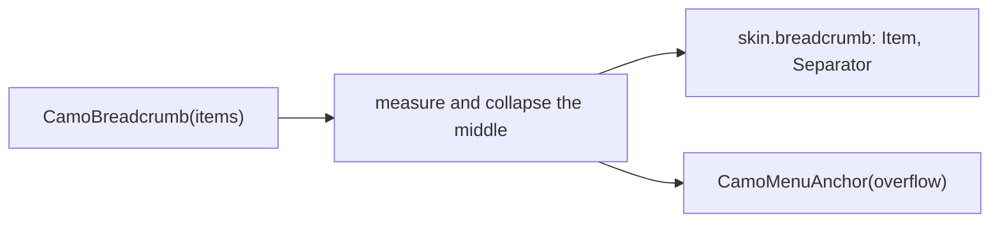
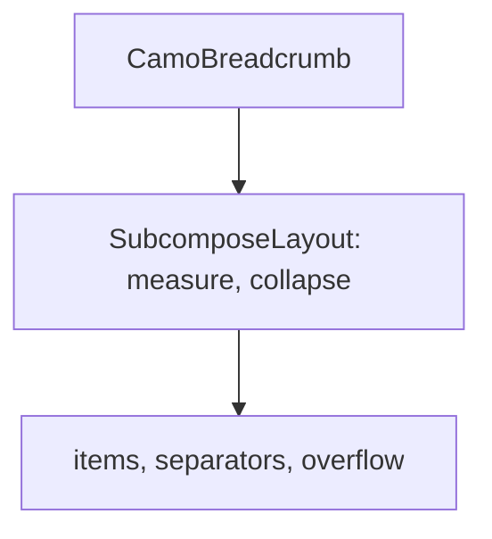
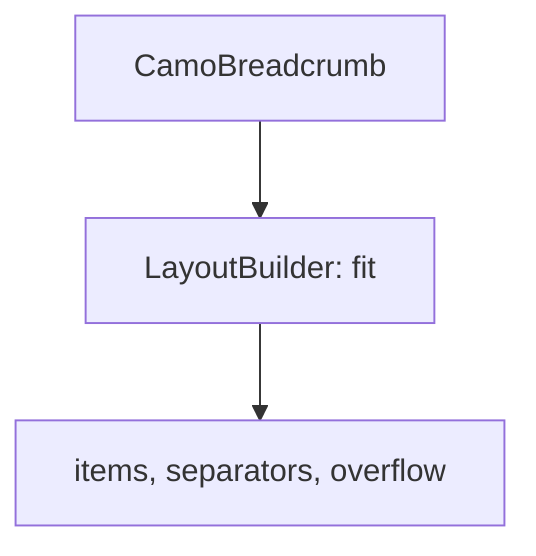

{/* Generated by docs/internal/scripts/sync_vault.py from the Camouflage design notes. Edit the notes and re-run the script; changes made here are overwritten. */}

# CamoBreadcrumb

## Concept {#concept}

### 1. Why

A breadcrumb shows **where you are in a hierarchy and lets you go up it**: a folder path, a category trail (Fluent and Carbon's Breadcrumb, macOS path controls). The last item is the current location. When the trail is too long, the middle collapses into an overflow menu.

### 2. Shape



**Split of duties**

| Core | Skin (renderer) |
|---|---|
| the items, measuring and collapsing the middle into a menu (the toolbar's fit logic and `CamoMenuAnchor`), separators, keys (Left and Right, Home, End), semantics (navigation, the current item) | the item look (link or text), the separator, the overflow button, spacing |

**Material mapping preview:** the M3 has none.
- `bodyMedium` links in `primary`, the current item `onSurface`, a chevron separator.

### 3. API

#### Contract

```kotlin
data class CamoBreadcrumbItem(
    val key: Any,
    val label: String,
    val icon: Slot? = null,
    val onClick: (() -> Unit)? = null,       // null: not a link
)

fun CamoBreadcrumb(
    items: List<CamoBreadcrumbItem>,         // root first; the last is the current location
    maxVisible: Int? = null,                 // null: collapse only when it doesn't fit
    label: String = "Breadcrumb",
)
```

**State → renderer:** `BreadcrumbItemState(current, link, interaction)`, `SeparatorState`; the overflow is a ghost icon button from the skin plus `CamoMenuAnchor`. **Slots:** label, icon.

#### Tokens used

- `colors.primary` (link), `onSurface` (current), `onSurfaceVariant` (separator)
- `typography.bodyMedium`; `spacing.xs`

#### Component theme

`theme.components.breadcrumb`. Every field is nullable in the theme. The skin's `defaults(theme)` fills whatever isn't set (Material defaults shown). See [Theme](/guide/foundations/theme) §3.10.

| Field | Type | Material default | What it's for |
|---|---|---|---|
| `separator` | IconSource | chevron right | mirrors in RTL |
| `itemPadding` | Dp | 4 | |
| `overflowIcon` | IconSource | more | |
| `colors` | BreadcrumbColors(link, current, separator, hover) | M3 values | every color it uses |
| `strings` | BreadcrumbStrings | English | "More", "current page" |

#### Accessibility

- A **navigation** landmark named `label`; links are buttons, the current item is announced "current page" and is not a button.
- One Tab stop; Left and Right move, Enter activates, the overflow opens with Enter or Down.

### 4. Build steps

1. `CamoBreadcrumbItem`, the fit (reusing the toolbar's pure function), theme, state, renderer, the `CamoSkin` field.
2. `CamoBreadcrumb`, the DebugSkin renderer.
3. Tests: collapsing and the menu items, `maxVisible`, keys, RTL, semantics.

**Done when**
- [ ] The admin sample's file tree has a breadcrumb that collapses on narrow windows.

### 5. Edge cases

| Case | Decided behavior |
|---|---|
| Case | Decided behavior |
|---|---|
| One item | Just the current item. |
| A very long label | It ellipsizes; the first and last items keep at least a minimum width. |
| RTL | Order and separators mirror. |

:::info[Changed in the M10 build (2026-11-02)]

- The renderer has `Container`, `Item` and `Separator`; the overflow is the skin's ghost icon button with a `CamoMenuAnchor`. `BreadcrumbColors(link, current, separator, hover)`; items are at least 48 tall for touch.
- The fit is one pure function (`planBreadcrumb`): everything when it fits (and within `maxVisible`), else the first item, the overflow and as many of the last items as fit. Below that shortest form the end is clipped. The current item is not a link and announces "current page".
- Not built: built-in strings and per-item tooltips. **Flutter measures the labels with `TextPainter`** in the ambient style (the current item semibold), keeps 8 px of slack and has no intrinsic size; a skin that adds more padding than `itemPadding` per item can make the estimate short.

:::

 > - **Which items collapse:** the middle ones, keeping the first and the last two; say if you prefer only the last.

## Implementation {#implementation}

<KotlinOnly>

### 1. Why {#kotlin-1-why}

A `SubcomposeLayout` measures the items and decides what collapses, like the toolbar.

### 2. Shape {#kotlin-2-shape}



### 3. API {#kotlin-3-api}

```kotlin
@Composable public fun CamoBreadcrumb(items: List<CamoBreadcrumbItem>, modifier: Modifier = Modifier,
    maxVisible: Int? = null, label: String = "Breadcrumb")
```

### 4. Build steps {#kotlin-4-build-steps}

1. Layout, items, overflow, renderer.
2. Tests: collapsing, keys, semantics.

**Done when**
- [ ] Works by touch, mouse, keyboard and screen reader on all targets.

### 5. Edge cases {#kotlin-5-edge-cases}

| Case | Decided behavior |
|---|---|
| Measuring | The collapse needs the items' widths; they are measured once per label change. |

:::info[Changed in the M10 build (2026-11-02)]

- A `SubcomposeLayout` measures silent copies of the items (their semantics cleared), then composes only what shows; the roving focus covers the shown parts.

:::

 > - None specific.

</KotlinOnly>

<DartOnly>

### 1. Why {#dart-1-why}

A `LayoutBuilder`-free approach is needed so it works in intrinsic contexts; a measuring `RenderObject`, or a `LayoutBuilder` with the documented no-intrinsics limit (as the toolbar).

### 2. Shape {#dart-2-shape}



### 3. API {#dart-3-api}

```dart
class CamoBreadcrumb extends StatelessWidget {
  const CamoBreadcrumb({super.key, required this.items, this.maxVisible, this.semanticLabel = 'Breadcrumb'});
}
```

### 4. Build steps {#dart-4-build-steps}

1. Layout, items, overflow, renderer.
2. Widget tests: collapsing, keys, semantics.

**Done when**
- [ ] Works by touch, mouse, keyboard and screen reader in the example.

### 5. Edge cases {#dart-5-edge-cases}

| Case | Decided behavior |
|---|---|
| Intrinsic sizing | None, like the toolbar. |

:::info[Changed in the M10 build (2026-11-02)]

- A `LayoutBuilder` over the estimated widths; the container sits in a clipped `UnconstrainedBox`.

:::

 > - None specific.

</DartOnly>
