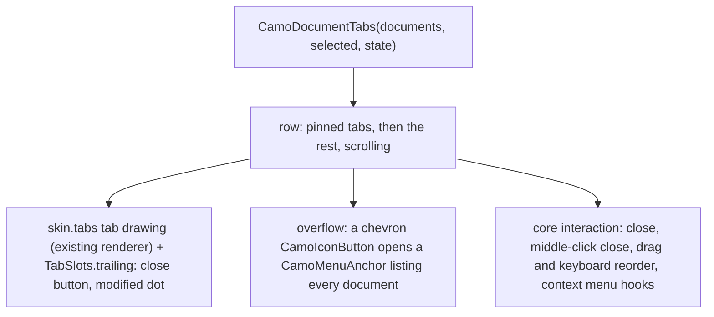

{/* Generated by docs/internal/scripts/sync_vault.py from the Camouflage design notes. Edit the notes and re-run the script; changes made here are overwritten. */}

# CamoDocumentTabs

:::info[Milestone: M16 (v0.2), raised by Graft (srctool/camouflage#74)]

:::

## 1. Why

Editor-style tabs for open documents (Graft's repository tabs and its diff tabs): closable, reorderable, with overflow and pinning. CamoTabs switches between views and keeps its tablist semantics and one-content model; it has no close, reorder, pin or overflow. Document tabs are a different component that **reuses the tab's drawing**.

## 2. Shape



**No new renderer.** `TabState` gains `modified`, `pinned` and `dragging`, and `TabSlots` a `trailing` slot, all defaulted; core fills the slot with a `CamoIconButton` (the close button), so every skin that draws tabs draws document tabs. Carbon draws compact line or contained tabs, as `CamoTabs` already does.

## 3. API

```kotlin
@Composable fun CamoDocumentTabs(
    documents: List<CamoDocument>,
    selected: Any,                                   // a document id
    onSelect: (Any) -> Unit,
    onClose: (Any) -> Unit,
    state: CamoDocumentTabsState,                    // app-owned: order and pinned ids; snapshot() to persist
    onContextMenu: ((CamoDocument) -> List<CamoMenuEntry>)? = null,   // "Close others", "Close to the right", "Pin"
    modifier,
)
data class CamoDocument(val id: Any, val title: String, val icon: Slot? = null, val modified: Boolean = false, val closable: Boolean = true)
class CamoDocumentTabsState(order: List<Any>, pinned: Set<Any> = emptySet()) { fun move(id: Any, to: Int); fun pin(id: Any); fun unpin(id: Any); fun snapshot(): … }
```

- **Close**: a button on hover and on the selected tab, middle-click, Ctrl+W (the app binds it); a modified dot takes the button's place until hover.
- **Reorder**: drag; keyboard with Alt+Left and Alt+Right on the focused tab; pinned tabs stay at the start and reorder among themselves.
- **Overflow**: the row scrolls (mouse wheel and the scrollbar) and a chevron lists every document, the selected one first.
- **Semantics**: tablist and tab as `CamoTabs`; each tab has "Close" and "Move left or right" actions; the modified dot is in the tab's description ("modified").

## 4. Build steps

1. `CamoDocumentTabsState` with the ordering and pinning rules as pure functions, tested without a window.
2. The renderer extensions (`TabState`, `TabSlots`) in core and the five skins (defaulted, so existing skins compile).
3. The row, close, reorder and overflow; the context menu hook.
4. Sample: twenty tabs; tests for close, reorder by key and drag, overflow, pinning, RTL, screen reader actions.

## 5. Edge cases

| Case | Decided behavior |
|---|---|
| Closing the selected tab | The app decides the next selection in `onClose` (the component never selects for it). |
| A very long title | Ellipsized to a maximum width; the full title is the tooltip and the semantic label. |
| Twenty tabs | Scroll plus the list-all menu; the selected tab is scrolled into view. |
| Dragging a tab past the visible edge | The row scrolls while the pointer is near the edge. |
| Right to left | The row mirrors; Alt+Left still moves the tab visually left. |
