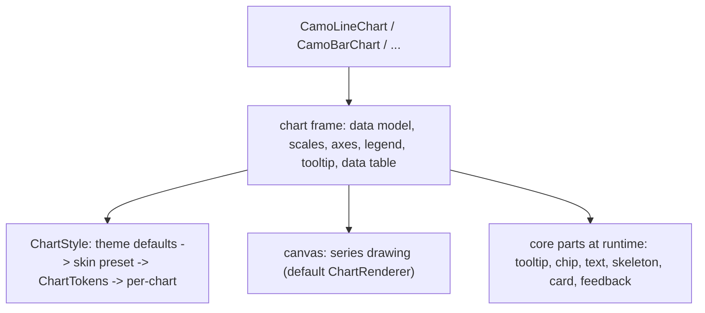
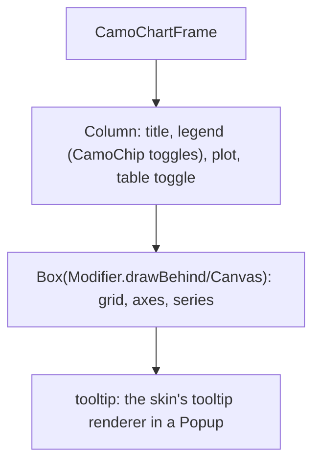
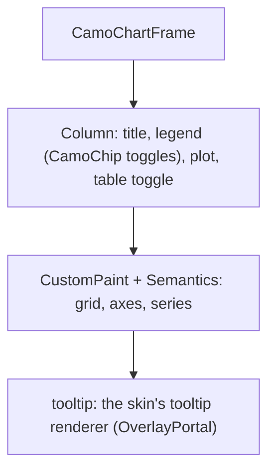

{/* Generated by docs/internal/scripts/sync_vault.py from the Camouflage design notes. Edit the notes and re-run the script; changes made here are overwritten. */}

# Chart Frame

## Concept {#concept}

### 1. Why

Every chart needs the same things around the drawing: **axes, a grid, a legend, a tooltip, series colors, an animation, right-to-left support and a way to read the data without seeing it**. The chart frame is that shared part, and the package `camouflage-charts` / `camouflage_charts` (ADR-40) is built on it. The package sits in layer 1 (it depends only on core, and no skin depends on it); charts are not part of the skin contract (`CamoSkin` and `CamoComponentThemes` gain no chart fields). They are drawn without a third-party chart library.

### 2. Shape



**Split of duties**

| Frame (core of the package) | A chart | A skin's influence |
|---|---|---|
| the data model, the scales and nice ticks, axes and grid, the legend (series toggles), the tooltip and the crosshair, keyboard traversal of points, the data table fallback, loading and empty states, the draw-in animation, RTL | turns series into marks (lines, areas, bars, slices) from the scales | none through the skin contract: through tokens, the parts the frame reuses, and a preset per skin name |

**How a skin reaches a chart** without either package importing the other: (1) the theme's tokens (series palette from the color families, typography, shapes, spacing, motion); (2) the active skin's parts at runtime: the tooltip renderer, the legend as `CamoChip`s, `CamoText`, `CamoSkeleton` while loading, `CamoCard` as an optional frame, the skin's feedback and surface treatment; (3) a **`ChartStyle` preset per skin name**, shipped as data in the charts package (minimal, fluent now; material, cupertino and carbon with their skins), for what tokens can't say; (4) overrides.

**Other libraries' mapping:** Charting libraries style through a theme object; here the preset per skin name plays that part, so a chart matches its skin without a dependency.

### 3. API

#### Contract

```kotlin
// the data model shared by every chart
data class ChartSeries(
    val name: String,
    val values: List<Double?>,               // one per category; null is a gap
    val color: Color? = null,                // null: the next palette color
)

data class ChartAxis(
    val title: String? = null,
    val min: Double? = null, val max: Double? = null,   // null: from the data
    val tickCount: Int = Auto,
    val format: (Double) -> String = ::defaultFormat,
)

// resolving the style
data class ChartStyle(/* gridlines, lineWidth, markers, areaOpacity, barRadius, barGap, donutThickness, palette, axisText, plotPadding, ... */)
object CamoCharts { fun registerPreset(skinName: String, style: ChartStyle) }
data class ChartTokens(...) : CamoTokenSet<ChartTokens>   // a brand's chart tokens (ADR-32)

fun CamoChartsProvider(renderer: ChartRenderer? = null, content: Slot)  // full control: replace the drawing

// building blocks (ADR-30)
fun CamoChartFrame(title: String, summary: String, legend: List<LegendItem>, content: Slot)
fun CamoChartDataTable(categories: List<String>, series: List<ChartSeries>)
```

**Style resolution:** theme-derived defaults, then the preset for `Camouflage.skin.name`, then `ChartTokens`, then the chart's own parameters; an unknown skin name uses the theme-derived defaults. **Series colors** come from the theme's color families in order (primary, secondary, tertiary, success, warning, error, info), checked for contrast against the surface; a series may set its own. **Scales:** `niceTicks(min, max, count)` is one pure function (1, 2, 5 times a power of ten) used by every chart.

#### Tokens used

- `colors.*` families for the series, `outlineVariant` (grid), `onSurfaceVariant` (axis text), `surface`
- `typography.labelSmall` (ticks), `labelLarge` (titles)
- `motion.durationLong` (draw-in), `spacing.*`, `shapes.small` (bar corners)

#### Chart style

`ChartStyle` fields this chart reads (see Chart Frame for how the style is resolved: theme-derived defaults, the skin's preset, `ChartTokens`, then this chart's parameters).

| Field | Type | Default | What it's for |
|---|---|---|---|
| `gridLines` | Boolean / dash | horizontal, solid | the grid |
| `lineWidth` / `markerSize` | Dp | 2 / 6 | lines and points |
| `areaOpacity` | Float | 0.18 | filled areas |
| `barRadius` / `barGap` | Dp | 4 / 4 | bars |
| `donutThickness` | Float | 0.35 | the donut's ring, as a share of the radius |
| `palette` | List&lt;Color> | from the theme | series colors |
| `animate` | Boolean | true | the draw-in |

#### Accessibility

- A chart is **an image with a summary and data behind it**: its semantics are a container named by the title and described by a generated summary ("Line chart, 2 series, 12 points, 3 to 97"), never a pile of unlabeled canvas.
- **Keyboard:** one Tab stop on the plot; the arrow keys move between points (Left and Right along the categories, Up and Down between series), announcing "Jan, Sales, 42" and showing the tooltip; Esc hides it. Pointer: hover or press shows the tooltip for the nearest point.
- **Data table fallback:** every chart can show its data as a `CamoDataTable` (a toggle in the frame, or `showTable`), so nothing is available only visually. Color is never the only difference: series also differ by marker shape or dash when `patterns` is on.
- The legend items are toggle buttons ("Sales, shown").

### 4. Build steps

1. The `camouflage-charts` module and `camouflage_charts` package, the layer rules (ADR-27) and the BOM entry.
2. The data model, the scales and `niceTicks`, `ChartStyle`, the preset registry and `ChartTokens`.
3. The frame (axes, grid, legend, tooltip, crosshair, animation, RTL), the data table fallback and the semantics summary.
4. Presets for Minimal and Fluent; the debug preset for tests.
5. Tests: `niceTicks`, scale mapping and inversion, style resolution order, the summary text, keyboard traversal, the legend toggles, RTL mirroring.

**Done when**
- [ ] A chart follows the skin, the theme and dark mode, and can be read as a table.

:::note[Changed in the M11 build (2026-11-03)]

- `camouflage-charts` / `camouflage_charts` exist as layer-1 packages (core only; skins are test dependencies); BOM and layer checks include them.
- Style is two public types: `ChartStyle` (every field optional, `null` keeps the layer below) and `ResolvedChartStyle` (every field set). `ChartTokens` wraps a `ChartStyle`. Presets: `minimal` and `fluent`, plus `CamoCharts.registerPreset(skinName, style)`.
- The palette runs primary, info, success, warning, error, secondary, tertiary and leaves out colors under 3:1 contrast with the surface; it is not a color-blind-safe palette; `ChartStyle.palette` replaces it.
- The data table is sized to `plotHeight` inside the frame, so it scrolls in the space the plot had.
- `ChartRenderer` has `drawSparkline` / `paintSparkline` for now; each chart adds its own method in its batch. `CamoChartsProvider` replaces the drawing.
- The tooltip, crosshair and keyboard traversal of points arrive with the first plotted chart (CamoLineChart), since the sparkline has no points to move between. The legend toggles and the table switch are in the frame now.

:::

### 5. Edge cases

| Case | Decided behavior |
|---|---|
| Case | Decided behavior |
|---|---|
| No data | The empty slot, announced as "no data". |
| Loading | A `CamoSkeleton` of the chart's shape. |
| All values equal | The axis widens around the value (no zero-height scale). |
| Negative values | Axes include zero for bars and areas; lines may float. |
| Reduced motion | The draw-in is skipped when the platform asks. |
| RTL | The x axis runs from the right, the y axis sits on the right; pies keep clockwise. |

 > - **Time axes, zoom and pan, brush selection** are later (v0.2 of the package); say if the dashboard needs a time axis now.
 > - **Series colors by contrast:** the palette is checked against the surface in the theme validator; say if you want a color-blind-safe palette as the default.

## Implementation {#implementation}

<KotlinOnly>

### 1. Why {#kotlin-1-why}

The frame is a Compose layout around a `Canvas`: axes and grid are drawn in the same `DrawScope` pass as the series, with text from `TextMeasurer`, so one layer carries everything and the tooltip is the only popup.

### 2. Shape {#kotlin-2-shape}



### 3. API {#kotlin-3-api}

```kotlin
@Composable public fun CamoChartFrame(title: String, summary: String, modifier: Modifier = Modifier,
    legend: List<LegendItem> = emptyList(), table: (@Composable () -> Unit)? = null, content: @Composable () -> Unit)
public object CamoCharts { public fun registerPreset(skinName: String, style: ChartStyle) }
```

- Style: `rememberChartStyle(overrides)` resolves the four layers and remembers it on the skin, theme and tokens.
- Drawing: `Canvas` with `TextMeasurer` for ticks and labels; animation through `Animatable` (the series' progress 0 to 1).
- Interaction: `pointerInput` finds the nearest point; `onKeyEvent` and one `focusable` plot; semantics: `contentDescription = summary` on the container, `collectionInfo` over the points.

### 4. Build steps {#kotlin-4-build-steps}

1. The module, `ChartStyle` and its resolution, the scales, `CamoChartFrame`, the data table fallback.
2. Tests: the scales (pure), the style order, keys, the summary.

**Done when**
- [ ] Works by touch, mouse, keyboard and screen reader.

:::note[Changed in the M11 build (2026-11-03)]

- `rememberChartStyle(overrides)` resolves the four layers (it reads `Camouflage.skin.name` and `theme.tokens<ChartTokens>()`).
- `CamoChartFrame` takes `isEmpty`, `plotHeight`, `table`, `showTable`, `onShowTableChange`; `CamoChartDataTable` builds on `CamoDataTable`. Golden scenes live in the charts module's `jvmTest` (a charts module may not depend on the skin-testing module's galleries, which are in the same layer for tests only).

:::

### 5. Edge cases {#kotlin-5-edge-cases}

| Case | Decided behavior |
|---|---|
| Text on the canvas | Measured once per style and size (`TextMeasurer` cache); text of axes is not in the semantics tree (the summary and the table carry it). |

 > - None specific.

</KotlinOnly>

<DartOnly>

### 1. Why {#dart-1-why}

The frame is a `CustomPaint` plot in a column with the legend and the title; Flutter's `TextPainter` measures ticks and labels, and the tooltip is the skin's tooltip renderer in an overlay.

### 2. Shape {#dart-2-shape}



### 3. API {#dart-3-api}

```dart
class CamoChartFrame extends StatelessWidget {
  const CamoChartFrame({super.key, required this.title, required this.summary, this.legend = const [], this.table, required this.child});
}
abstract final class CamoCharts { static void registerPreset(String skinName, ChartStyle style); }
```

- The plot is one `Focus` with `CallbackShortcuts` for the arrow keys; `Semantics(container: true, label: title, value: summary)`.
- Painters are `CustomPainter`s with `shouldRepaint` on the data, style and animation value; the animation is an `AnimationController` (the motion token).
- A chart has no intrinsic size: give it a size (it fills what it is given).

### 4. Build steps {#dart-4-build-steps}

1. The package, `ChartStyle` and its resolution, the scales, `CamoChartFrame`, the data table fallback.
2. Widget tests: the scales (pure), the style order, keys, the summary.

**Done when**
- [ ] Works by touch, mouse, keyboard and screen reader.

:::note[Changed in the M11 build (2026-11-03)]

- `CamoCharts.styleOf(context, overrides: ...)` resolves the four layers. The frame's plot has `excludeSemantics`, so only the title and summary are read.
- Goldens: `test/charts_golden_test.dart`, four scenes (Minimal and Fluent, light and dark), with motion set to zero so the draw-in is finished.

:::

### 5. Edge cases {#dart-5-edge-cases}

| Case | Decided behavior |
|---|---|
| Text painters | Laid out once per style and text scale and reused across frames. |

 > - None specific.

</DartOnly>
