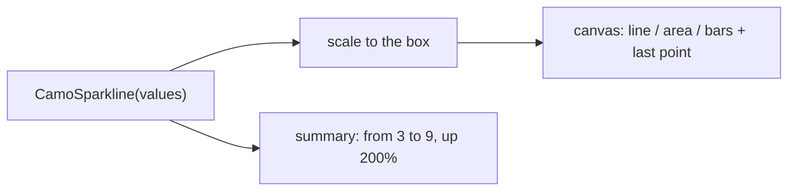
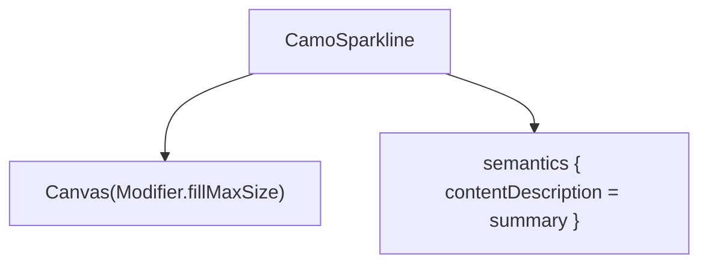
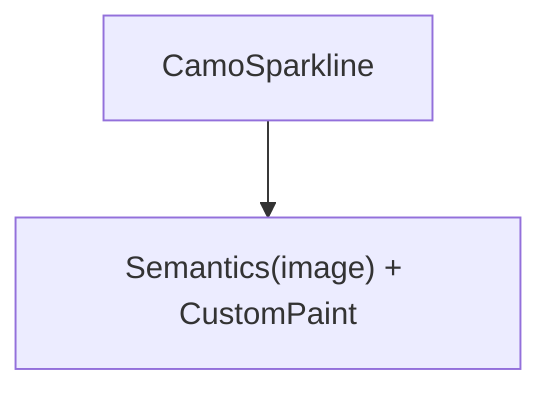

{/* Generated by docs/internal/scripts/sync_vault.py from the Camouflage design notes. Edit the notes and re-run the script; changes made here are overwritten. */}

# CamoSparkline

## Concept {#concept}

### 1. Why

A sparkline is **a small trend line inside a sentence, a row or a card**: the last 30 days next to a number, a row's activity (Apple's small charts, Fluent's tiles, Carbon's mini charts). It has no axes, no grid and no legend, and it must still be readable by a screen reader.

### 2. Shape



**Split of duties**

| Sparkline | Style |
|---|---|
| the scale (min and max or a given range), drawing the line, area or bars, the highlight on the last or the extreme points, the generated summary | line width, area opacity, bar radius, the palette color, the highlight marker |

**Other libraries' mapping:** Apple's inline charts, Carbon's mini charts, Fluent's tile trends.

### 3. API

#### Contract

```kotlin
fun CamoSparkline(
    values: List<Double?>,
    kind: SparklineKind = Line,              // Line | Area | Bars
    modifier: Modifier = Modifier,           // the size: the chart fills it
    range: ClosedFloatingPointRange<Double>? = null,   // null: from the data
    highlight: SparklineHighlight = Last,    // None | Last | Extremes
    tone: Tone = Default,                    // the series color family
    description: String? = null,             // names it ("Signups, last 30 days")
)
```

**Summary:** when `description` is `null` the sparkline announces "Trend from 3 to 9, up 200%" (first to last value and the change); with a description: "Signups, last 30 days: from 3 to 9, up 200%". It is a single image node, not focusable.

#### Tokens used

- the tone's family (`strong`) for the line, `container` for the area
- `ChartStyle.lineWidth`, `areaOpacity`, `barRadius`, `markerSize`

#### Chart style

`ChartStyle` fields this chart reads (see [Chart Frame](/components/charts/chart-frame) for how the style is resolved: theme-derived defaults, the skin's preset, `ChartTokens`, then this chart's parameters).

| Field | Type | Default | What it's for |
|---|---|---|---|
| `lineWidth` | Dp | 2 | the line |
| `areaOpacity` | Float | 0.18 | the area form |
| `barRadius` / `barGap` | Dp | 2 / 2 | the bars form |
| `markerSize` | Dp | 5 | the highlight |

#### Accessibility

- One **image** node with the generated summary (or the description plus it); it is not interactive and not focusable.
- The trend direction is in the text, never only in the color.

### 4. Build steps

1. `SparklineKind`, the scale, drawing, the summary function (pure), the style reads.
2. Tests: the summary (up, down, flat, gaps), the scale with a given range, one value, all equal.

**Done when**
- [ ] The dashboard's tiles show their trends and read aloud as text.

:::note[Changed in the M11 build (2026-11-03)]

- `sparklineSummary`, `downsample`, `sparklinePoints`, segments and extremes are public pure functions with their own tests.
- A single value draws a dot; an isolated point between gaps draws a dot too.
- Size: 100 x 28 when the parent gives no constraint, otherwise what it gives (a `layout` fallback in Compose, `CustomPaint.size` in Flutter).
- The draw-in is a clip that grows from the start edge over `motion.durationLong`; it is skipped when the duration is zero (reduced motion) or `ChartStyle.animate` is off.

:::

### 5. Edge cases

| Case | Decided behavior |
|---|---|
| Case | Decided behavior |
|---|---|
| One value | A dot (no line). |
| Gaps (`null`) | The line breaks; bars skip. |
| All equal | A flat line in the middle. |
| Hundreds of points | Downsampled to the pixel width (min and max per bucket) so peaks stay. |

 > - **Reference band** (a normal range behind the line) is later.

## Implementation {#implementation}

<KotlinOnly>

### 1. Why {#kotlin-1-why}

A sparkline is one `Canvas` with `Modifier.semantics`; no axes, no text, so it needs no `TextMeasurer`.

### 2. Shape {#kotlin-2-shape}



### 3. API {#kotlin-3-api}

```kotlin
@Composable public fun CamoSparkline(values: List<Double?>, modifier: Modifier = Modifier, kind: SparklineKind = SparklineKind.Line,
    range: ClosedFloatingPointRange<Double>? = null, highlight: SparklineHighlight = SparklineHighlight.Last,
    tone: Tone = Tone.Default, description: String? = null)
internal fun sparklineSummary(values: List<Double?>, description: String?): String   // pure, tested alone
```

### 4. Build steps {#kotlin-4-build-steps}

1. Scale, drawing, summary, style reads.
2. Tests: the summary, the scale, downsampling.

**Done when**
- [ ] Works by touch, mouse, keyboard and screen reader.

:::note[Changed in the M11 build (2026-11-03)]

- `style: ChartStyle?` parameter added for per-chart overrides.

:::

### 5. Edge cases {#kotlin-5-edge-cases}

| Case | Decided behavior |
|---|---|
| Size | Defaults to 100 x 28 dp when the caller gives none. |

 > - None specific.

</KotlinOnly>

<DartOnly>

### 1. Why {#dart-1-why}

A sparkline is one `CustomPaint` in a `Semantics` image; no axes, no text.

### 2. Shape {#dart-2-shape}



### 3. API {#dart-3-api}

```dart
class CamoSparkline extends StatelessWidget {
  const CamoSparkline({super.key, required this.values, this.kind = SparklineKind.line, this.range, this.highlight = SparklineHighlight.last,
      this.tone = Tone.defaultTone, this.description});
}
```
`sparklineSummary(values, description)` is a pure function, tested alone. It sizes to what it is given (default 100 x 28).

### 4. Build steps {#dart-4-build-steps}

1. Scale, painter, summary, style reads.
2. Widget tests: the summary, the scale, downsampling.

**Done when**
- [ ] Works by touch, mouse, keyboard and screen reader.

:::note[Changed in the M11 build (2026-11-03)]

- `range` is a `(min, max)` record; `style: ChartStyle?` for per-chart overrides.

:::

### 5. Edge cases {#dart-5-edge-cases}

| Case | Decided behavior |
|---|---|
| Size | A `SizedBox` of 100 x 28 when the parent gives no constraint. |

 > - None specific.

</DartOnly>
