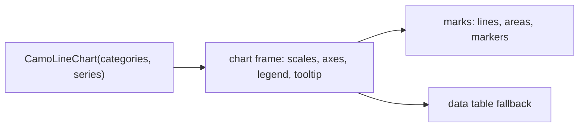
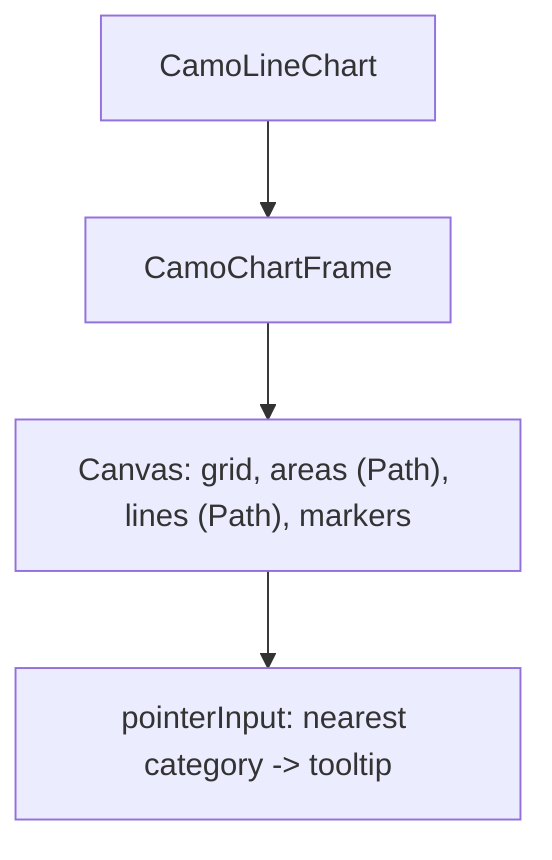
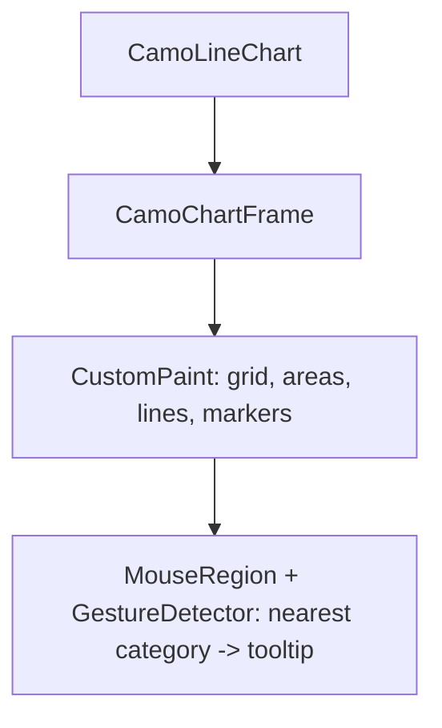

{/* Generated by docs/internal/scripts/sync_vault.py from the Camouflage design notes. Edit the notes and re-run the script; changes made here are overwritten. */}

# CamoLineChart

## Concept {#concept}

### 1. Why

A line chart shows **how one or more values change across an ordered axis**: sales per month, latency per minute (Swift Charts' line and area marks, Carbon's line and area charts). It covers three forms: **line**, **area** and **stacked area**.

### 2. Shape



**Split of duties**

| Frame | Line chart |
|---|---|
| scales, ticks, axes, grid, legend, tooltip, keyboard, data table, animation | the line paths (linear, smooth, step), the areas and their stacking, the markers, nearest-x hit testing, the crosshair |

**Other libraries' mapping:** Swift Charts line and area marks, Carbon line, area and stacked area charts, Fluent's chart tokens.

### 3. API

#### Contract

```kotlin
fun CamoLineChart(
    categories: List<String>,                // the x labels
    series: List<ChartSeries>,
    modifier: Modifier = Modifier,
    kind: LineKind = Line,                   // Line | Area | StackedArea
    curve: LineCurve = Linear,               // Linear | Smooth | Step
    markers: MarkerVisibility = OnHover,     // Always | OnHover | Never
    xAxis: ChartAxis = ChartAxis(), yAxis: ChartAxis = ChartAxis(),
    title: String, loading: Boolean = false, empty: Slot? = null,
    showTable: Boolean = false,
)
```

**Tooltip:** the nearest category lists each visible series' value with its color; with `StackedArea` it adds the total. **Legend:** toggles series (a hidden series leaves the stack and the scale recomputes).

#### Tokens used

- the frame's tokens; `ChartStyle.lineWidth`, `areaOpacity`, `markerSize`, `curveTension`

#### Chart style

`ChartStyle` fields this chart reads (see [Chart Frame](/components/charts/chart-frame) for how the style is resolved: theme-derived defaults, the skin's preset, `ChartTokens`, then this chart's parameters).

| Field | Type | Default | What it's for |
|---|---|---|---|
| `lineWidth` | Dp | 2 | |
| `areaOpacity` | Float | 0.18 | `Area` and `StackedArea` |
| `curveTension` | Float | 0.4 | the `Smooth` curve |
| `markerSize` | Dp | 6 | |
| `gridLines` | Boolean | horizontal | |

#### Accessibility

- The frame's summary plus, per point, "Jan, Sales, 42" (keyboard traversal); `StackedArea` also announces the total.
- A data table is one press away (`showTable`), with the series as columns and the categories as rows.
- Lines also differ by dash or marker shape when `patterns` is on, never by color alone.

### 4. Build steps

1. Line geometry (linear, smooth by monotone cubic, step), the stacking function, hit testing.
2. `CamoLineChart` on the frame, the Minimal and Fluent presets.
3. Tests: stacking sums, smoothing never overshoots (monotone), nearest-x, gaps, hidden series, the summary.

**Done when**
- [ ] The dashboard's revenue chart switches between line, area and stacked area, reads as a table and follows the skin.

### 5. Edge cases

| Case | Decided behavior |
|---|---|
| Case | Decided behavior |
|---|---|
| `null` values | The line breaks; areas close at the gap. |
| One category | Markers only. |
| Many categories | Tick labels thin out to fit; the tooltip still lists the nearest. |
| Stacked negative values | Stacked areas treat negatives as zero and say so in the docs (use lines). |

:::note[Decided in review (2026-11-03)]

- **A time axis is in M11:** `ChartAxis` gets a time scale (ticks at nice calendar steps: minutes, hours, days, months), used by the line chart (batch 2). Zoom, pan and brush selection stay later.
- **Smoothing:** monotone cubic and Catmull-Rom both ship (`LineCurve.Smooth` and `LineCurve.CatmullRom`).
- The default palette is not color-blind-safe; a safe palette is a `ChartStyle.palette` away.

:::

 > - **Smoothing:** monotone cubic only (no overshoot); say if you want Catmull-Rom as well.
 > - **Dual y axes** are later.

## Implementation {#implementation}

<KotlinOnly>

### 1. Why {#kotlin-1-why}

One `Canvas` draws grid, axes, areas, lines and markers from the frame's scales; hit testing is the nearest x among the categories.

### 2. Shape {#kotlin-2-shape}



### 3. API {#kotlin-3-api}

```kotlin
@Composable public fun CamoLineChart(categories: List<String>, series: List<ChartSeries>, title: String, modifier: Modifier = Modifier,
    kind: LineKind = LineKind.Line, curve: LineCurve = LineCurve.Linear, markers: MarkerVisibility = MarkerVisibility.OnHover,
    xAxis: ChartAxis = ChartAxis(), yAxis: ChartAxis = ChartAxis(), loading: Boolean = false, empty: (@Composable () -> Unit)? = null,
    showTable: Boolean = false)
internal fun stack(series: List<List<Double?>>): List<List<Pair<Double, Double>>>   // pure
internal fun monotonePath(points: List<Offset>): Path
```

### 4. Build steps {#kotlin-4-build-steps}

1. Geometry, stacking, the canvas, interaction.
2. Tests: stacking, monotone smoothing, hit testing, summary.

**Done when**
- [ ] Works by touch, mouse, keyboard and screen reader.

### 5. Edge cases {#kotlin-5-edge-cases}

| Case | Decided behavior |
|---|---|
| Recomposition | The paths are rebuilt only when data, size or visibility changes (`remember` keys), not per animation frame. |

 > - None specific.

</KotlinOnly>

<DartOnly>

### 1. Why {#dart-1-why}

A `CustomPainter` draws the plot; a `Listener` and `Focus` handle the pointer and the keys.

### 2. Shape {#dart-2-shape}



### 3. API {#dart-3-api}

```dart
class CamoLineChart extends StatelessWidget {
  const CamoLineChart({super.key, required this.categories, required this.series, required this.title, this.kind = LineKind.line,
      this.curve = LineCurve.linear, this.markers = MarkerVisibility.onHover, this.xAxis = const ChartAxis(), this.yAxis = const ChartAxis(),
      this.loading = false, this.empty, this.showTable = false});
}
```
`stackSeries` and `monotonePath` are pure functions, tested alone.

### 4. Build steps {#dart-4-build-steps}

1. Geometry, stacking, the painter, interaction.
2. Widget tests: stacking, monotone smoothing, hit testing, summary.

**Done when**
- [ ] Works by touch, mouse, keyboard and screen reader.

### 5. Edge cases {#dart-5-edge-cases}

| Case | Decided behavior |
|---|---|
| Repaint | `shouldRepaint` compares data, style, visibility and the animation value. |

 > - None specific.

</DartOnly>
