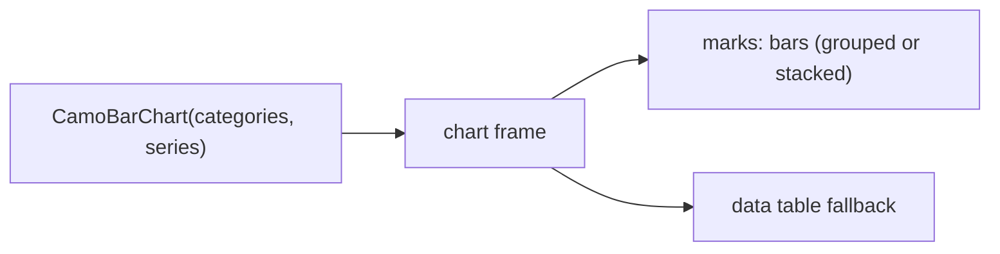
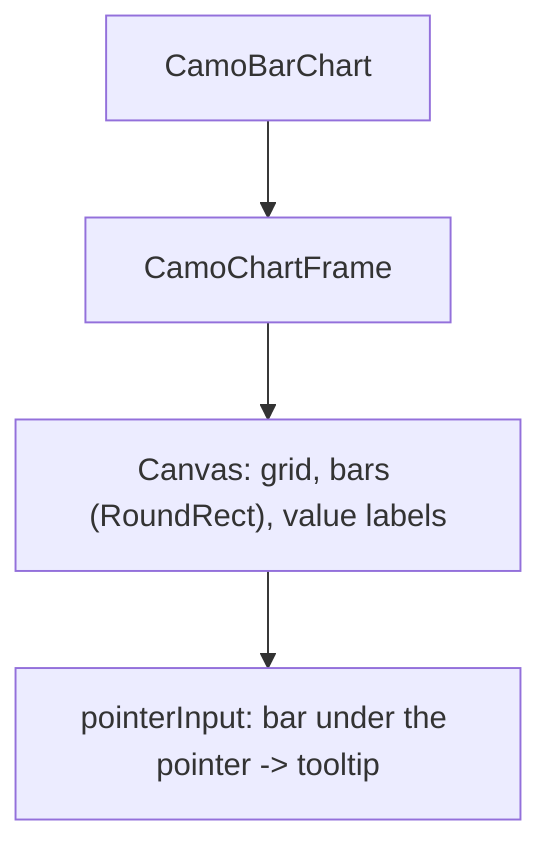
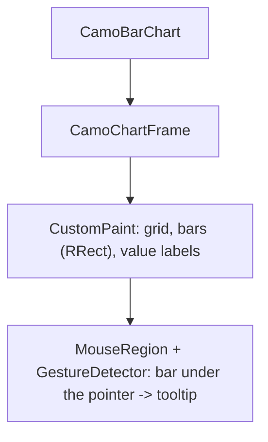

{/* Generated by docs/internal/scripts/sync_vault.py from the Camouflage design notes. Edit the notes and re-run the script; changes made here are overwritten. */}

# CamoBarChart

## Concept {#concept}

### 1. Why

A bar chart **compares values across categories**: revenue by region, tickets by status (Swift Charts' bar marks, Carbon's bar charts). It covers **vertical** and **horizontal** bars, **grouped** (side by side) and **stacked**.

### 2. Shape



**Split of duties**

| Frame | Bar chart |
|---|---|
| scales, axes, grid, legend, tooltip, keyboard, data table, animation | the bar geometry (group width, gaps, stacking, negatives), orientation, value labels, per-bar hit testing |

**Other libraries' mapping:** Swift Charts bar marks, Carbon simple, grouped and stacked bar charts.

### 3. API

#### Contract

```kotlin
fun CamoBarChart(
    categories: List<String>,
    series: List<ChartSeries>,
    modifier: Modifier = Modifier,
    orientation: BarOrientation = Vertical,  // Vertical | Horizontal
    mode: BarMode = Grouped,                 // Grouped | Stacked
    valueLabels: Boolean = false,
    xAxis: ChartAxis = ChartAxis(), yAxis: ChartAxis = ChartAxis(),
    title: String, loading: Boolean = false, empty: Slot? = null, showTable: Boolean = false,
)
```

**Tooltip:** the hovered bar's series and value (and for `Stacked` the total of its category). **Bars grow** from the baseline with the draw-in; negative bars go the other way from zero.

#### Tokens used

- the frame's tokens; `ChartStyle.barRadius`, `barGap`, `groupGap`

#### Chart style

`ChartStyle` fields this chart reads (see [Chart Frame](/components/charts/chart-frame) for how the style is resolved: theme-derived defaults, the skin's preset, `ChartTokens`, then this chart's parameters).

| Field | Type | Default | What it's for |
|---|---|---|---|
| `barRadius` | Dp | 4 | the free end of a bar (stacked: only the top segment) |
| `barGap` | Dp | 4 | between bars in a group |
| `groupGap` | Float | 0.3 | space between groups, as a share of a group |
| `valueLabelStyle` | text style | `labelSmall` | `valueLabels` |

#### Accessibility

- The frame's summary; per bar "Q1, North, 42" in keyboard traversal (Left and Right between categories, Up and Down between series).
- The data table fallback has the same shape as the chart.
- Bars carry value labels when `valueLabels` is on, so values never rely on reading the axis.

### 4. Build steps

1. Geometry (grouping, stacking, negatives), orientation, the canvas, interaction.
2. `CamoBarChart` on the frame, the presets.
3. Tests: group and stack geometry, negatives, horizontal mirror (including RTL), hit testing, hidden series, the summary.

**Done when**
- [ ] The dashboard's regional bars switch between grouped and stacked and between vertical and horizontal.

:::note[Changed in the M11 build (2026-11-03)]

- `yAxis` is always the value axis and `xAxis` the category axis, whichever way the bars run; their titles are drawn.
- The bar under the pointer is the one whose column (row, when horizontal) is nearest across the category axis, so the pointer above a short bar still finds it. Value labels sit at the free end; a stack shows its side's total there and draws them after the draw-in.

:::

### 5. Edge cases

| Case | Decided behavior |
|---|---|
| Case | Decided behavior |
|---|---|
| Many categories | Horizontal bars are the advice; vertical labels rotate or thin out. |
| Zero value | A zero-height bar (still focusable, still announced). |
| Mixed signs when stacked | Positives stack up, negatives down, separately. |
| RTL | Vertical bars run from the right; horizontal bars start at the right edge. |

 > - **Bar labels inside the bar** (for wide bars) are later; labels sit at the end.

## Implementation {#implementation}

<KotlinOnly>

### 1. Why {#kotlin-1-why}

One `Canvas` draws the bars; the geometry is pure (`barRects`) so grouping, stacking and negatives are tested without a window.

### 2. Shape {#kotlin-2-shape}



### 3. API {#kotlin-3-api}

```kotlin
@Composable public fun CamoBarChart(categories: List<String>, series: List<ChartSeries>, title: String, modifier: Modifier = Modifier,
    orientation: BarOrientation = BarOrientation.Vertical, mode: BarMode = BarMode.Grouped, valueLabels: Boolean = false,
    xAxis: ChartAxis = ChartAxis(), yAxis: ChartAxis = ChartAxis(), loading: Boolean = false, empty: (@Composable () -> Unit)? = null,
    showTable: Boolean = false)
internal fun barRects(plot: Rect, categories: Int, series: List<List<Double?>>, mode: BarMode, orientation: BarOrientation,
    style: ChartStyle, rtl: Boolean): List<BarRect>   // pure
```

### 4. Build steps {#kotlin-4-build-steps}

1. `barRects`, the canvas, interaction.
2. Tests: `barRects` for every mode and orientation and RTL, hit testing, summary.

**Done when**
- [ ] Works by touch, mouse, keyboard and screen reader.

:::note[Changed in the M11 build (2026-11-03)]

- `yAxis` is always the value axis and `xAxis` the category axis, whichever way the bars run; their titles are drawn.
- The bar under the pointer is the one whose column (row, when horizontal) is nearest across the category axis, so the pointer above a short bar still finds it. Value labels sit at the free end; a stack shows its side's total there and draws them after the draw-in.
- Bars mirror in right-to-left layouts (vertical bars run from the right, horizontal bars start at the right edge); the radius goes on the free end only (a stack's outermost segment).
- Keyboard walk and announcement as in the line chart ("Q1, North, 42"); `plotHeight` and `style` parameters added.

:::

### 5. Edge cases {#kotlin-5-edge-cases}

| Case | Decided behavior |
|---|---|
| Hit testing | The rect list from `barRects` is reused for drawing and for the pointer. |

 > - None specific.

</KotlinOnly>

<DartOnly>

### 1. Why {#dart-1-why}

A `CustomPainter` draws the bars; the geometry is a pure function (`barRects`), shared by painting and hit testing.

### 2. Shape {#dart-2-shape}



### 3. API {#dart-3-api}

```dart
class CamoBarChart extends StatelessWidget {
  const CamoBarChart({super.key, required this.categories, required this.series, required this.title, this.orientation = BarOrientation.vertical,
      this.mode = BarMode.grouped, this.valueLabels = false, this.xAxis = const ChartAxis(), this.yAxis = const ChartAxis(),
      this.loading = false, this.empty, this.showTable = false});
}
```

### 4. Build steps {#dart-4-build-steps}

1. `barRects`, the painter, interaction.
2. Widget tests: `barRects` for every mode and orientation and RTL, hit testing, summary.

**Done when**
- [ ] Works by touch, mouse, keyboard and screen reader.

:::note[Changed in the M11 build (2026-11-03)]

- `yAxis` is always the value axis and `xAxis` the category axis, whichever way the bars run; their titles are drawn.
- The bar under the pointer is the one whose column (row, when horizontal) is nearest across the category axis, so the pointer above a short bar still finds it. Value labels sit at the free end; a stack shows its side's total there and draws them after the draw-in.
- Bars mirror in right-to-left layouts (vertical bars run from the right, horizontal bars start at the right edge); the radius goes on the free end only (a stack's outermost segment).
- Keyboard walk and announcement as in the line chart ("Q1, North, 42"); `plotHeight` and `style` parameters added.

:::

### 5. Edge cases {#dart-5-edge-cases}

| Case | Decided behavior |
|---|---|
| Hit testing | Shares `barRects` with the painter. |

 > - None specific.

</DartOnly>
