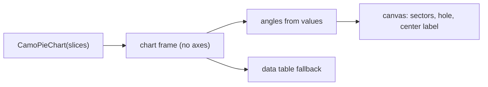
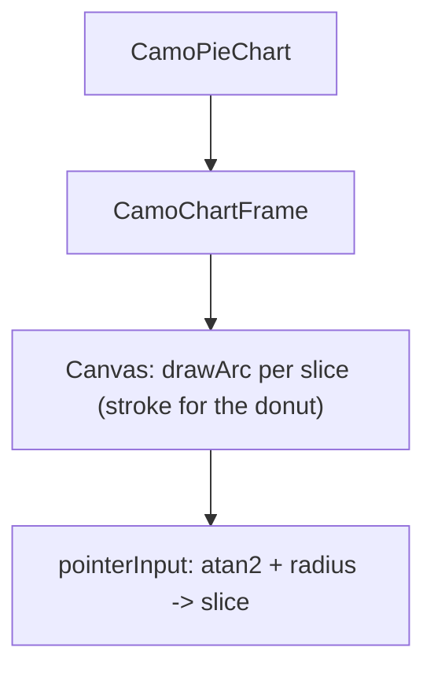
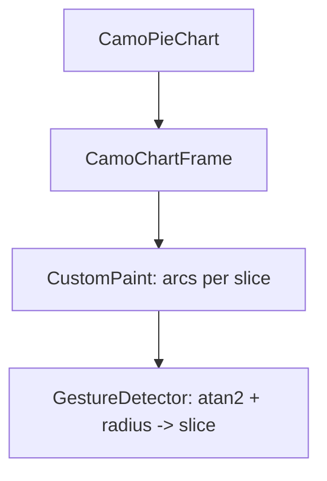

{/* Generated by docs/internal/scripts/sync_vault.py from the Camouflage design notes. Edit the notes and re-run the script; changes made here are overwritten. */}

# CamoPieChart

## Concept {#concept}

### 1. Why

A pie chart shows **parts of a whole**: share of traffic by source, budget by category (Swift Charts' sector marks, Carbon's pie and donut charts). It has two forms: **pie** and **donut** (with a label in the hole). It is for a few slices; more than about six belong in a bar chart.

### 2. Shape



**Split of duties**

| Frame | Pie chart |
|---|---|
| legend (slice toggles), tooltip, keyboard, data table, animation | the angles and radii, the donut hole, the slice labels (percent), the selected slice's offset, the center content |

**Other libraries' mapping:** Swift Charts sector marks, Carbon pie and donut charts.

### 3. API

#### Contract

```kotlin
data class PieSlice(val label: String, val value: Double, val color: Color? = null)

fun CamoPieChart(
    slices: List<PieSlice>,
    modifier: Modifier = Modifier,
    donut: Boolean = false,
    center: Slot? = null,                    // in the hole (a total, a title)
    selected: Int? = null, onSelect: ((Int?) -> Unit)? = null,
    startAngle: Float = -90f,                // degrees; 12 o'clock
    title: String, loading: Boolean = false, empty: Slot? = null, showTable: Boolean = false,
)
```

**Labels:** each slice shows its share when it is wide enough (at least 5%); the legend always lists label, value and share. **Selection** is the app's (`selected`, `onSelect`): the slice moves out a little.

#### Tokens used

- the frame's palette; `ChartStyle.donutThickness`, `sliceGap`, `selectedOffset`

#### Chart style

`ChartStyle` fields this chart reads (see [Chart Frame](/components/charts/chart-frame) for how the style is resolved: theme-derived defaults, the skin's preset, `ChartTokens`, then this chart's parameters).

| Field | Type | Default | What it's for |
|---|---|---|---|
| `donutThickness` | Float | 0.35 | ring width as a share of the radius (donut) |
| `sliceGap` | Dp | 2 | the gap between slices (a line in the surface color) |
| `selectedOffset` | Dp | 6 | how far a selected slice moves out |
| `labelThreshold` | Float | 0.05 | the smallest share that gets a label |

#### Accessibility

- The frame's summary ("Pie chart, 4 slices, largest: Search 45%"); per slice "Search, 45%, 4,500" in keyboard traversal (Left and Right or Up and Down move along the slices clockwise; Enter or Space selects).
- The legend lists every slice with its value and share, so a slice too thin to label is still readable.
- Slices are separated by a gap, not by color alone.

### 4. Build steps

1. The angle function (pure), the sectors, the hole and center, selection, the canvas.
2. `CamoPieChart` on the frame, the presets.
3. Tests: angles sum to a full turn, thresholds, a single slice, zero and negative values, hit testing by angle and radius, selection, RTL.

**Done when**
- [ ] The dashboard's traffic donut shows a total in its center and selects slices by touch and keys.

### 5. Edge cases

| Case | Decided behavior |
|---|---|
| Case | Decided behavior |
|---|---|
| Zero values | The slice has no angle but stays in the legend. |
| Negative values | Rejected in debug builds; treated as zero in release. |
| One slice | A full circle (a full ring for the donut), without a gap. |
| All zero | The empty state. |
| RTL | Clockwise is kept (angles don't mirror); the legend mirrors. |

 > - **Semi-circle gauges** are later (a gauge chart type).

## Implementation {#implementation}

<KotlinOnly>

### 1. Why {#kotlin-1-why}

One `Canvas` draws the sectors with `drawArc`; the angles come from a pure function and hit testing converts the pointer to an angle and a radius.

### 2. Shape {#kotlin-2-shape}



### 3. API {#kotlin-3-api}

```kotlin
@Composable public fun CamoPieChart(slices: List<PieSlice>, title: String, modifier: Modifier = Modifier, donut: Boolean = false,
    center: (@Composable () -> Unit)? = null, selected: Int? = null, onSelect: ((Int?) -> Unit)? = null, startAngle: Float = -90f,
    loading: Boolean = false, empty: (@Composable () -> Unit)? = null, showTable: Boolean = false)
internal fun sliceAngles(values: List<Double>, startAngle: Float): List<Pair<Float, Float>>   // pure
```

### 4. Build steps {#kotlin-4-build-steps}

1. Angles, sectors, the hole and center, selection, interaction.
2. Tests: angles, hit testing, selection, summary.

**Done when**
- [ ] Works by touch, mouse, keyboard and screen reader.

### 5. Edge cases {#kotlin-5-edge-cases}

| Case | Decided behavior |
|---|---|
| Center content | A `Box` over the canvas, so it is a normal composable (text, an icon, a number). |

 > - None specific.

</KotlinOnly>

<DartOnly>

### 1. Why {#dart-1-why}

A `CustomPainter` draws the sectors with `drawArc`; angles and hit testing are pure functions.

### 2. Shape {#dart-2-shape}



### 3. API {#dart-3-api}

```dart
class CamoPieChart extends StatelessWidget {
  const CamoPieChart({super.key, required this.slices, required this.title, this.donut = false, this.center, this.selected, this.onSelected,
      this.startAngle = -90, this.loading = false, this.empty, this.showTable = false});
}
```
`sliceAngles` and `sliceAt(point, size, ...)` are pure functions, tested alone. The center is a `Center` over the painter, so it is a normal widget.

### 4. Build steps {#dart-4-build-steps}

1. Angles, the painter, the hole and center, selection, interaction.
2. Widget tests: angles, hit testing, selection, summary.

**Done when**
- [ ] Works by touch, mouse, keyboard and screen reader.

### 5. Edge cases {#dart-5-edge-cases}

| Case | Decided behavior |
|---|---|
| Center content | A normal child laid over the painter. |

 > - None specific.

</DartOnly>
