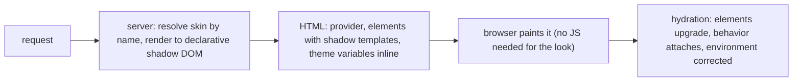

{/* Generated by docs/internal/scripts/sync_vault.py from the Camouflage design notes. Edit the notes and re-run the script; changes made here are overwritten. */}

# SSR and Hydration

:::info[Web only]

Kotlin and Flutter have no server rendering, so this note has no base note. It records the plan and the fallback, and the spike tests every claim in it.

:::

:::tip[Decided at W0 (ADR-47)]

Lit's server rendering is the choice. The spike's findings are in ADR-47 and the repository's `docs/spike-findings.md`; Next.js 16 App Router is proven (see §3.3). The status of Lit's server rendering (`@lit-labs/ssr`, a labs package), its context support, and Next.js support changes. The points below come from the documentation and package pages at the time of writing. Re-check them against the current docs before relying on them.

:::

## 1. Why {#web-1-why}

Camouflage for web should work in server-rendered apps (Next.js, plain Node, Astro-style setups): a page should arrive with its components already drawn, with the right skin and theme, and then become interactive. Server rendering is also what makes first paint fast and keeps content visible to crawlers.

## 2. Shape {#web-2-shape}



**What the server does:** renders each custom element's Lit template into a `<template shadowrootmode="open">` (declarative shadow DOM), with the skin's styles included in the template and the theme as CSS variables on the provider.

**What stays on the client:** event handlers, focus management, popovers and dialogs, `ElementInternals` registration, and measured values (window size, pointer type, blur support).

## 3. API {#web-3-api}

### 3.1 What makes it work: the design rules {#web-31-what-makes-it-work-the-design-rules}

| Rule | Where it comes from |
|---|---|
| **Components use shadow DOM** | Lit's server rendering supports only shadow DOM components. |
| **Renderers are pure** | the Skin Contract: no `window`, `document` or timers in `render`. |
| **No async work in rendering** | Lit's server rendering does not support async component work. Skins are imported synchronously and registered before rendering. |
| **The skin is known up front** | `<camo-provider skin="cupertino">` names it as an attribute; the server resolves it from the registry (the skin's `register` entry is imported on the server). |
| **Theme is CSS, not JS** | variables on the provider element; first paint is correct with scripts off. |
| **Initial state comes from attributes** | server and client must produce the same markup. Anything measured later (window size, pointer, blur support) is a **correction after hydration**, not an input to the first render. |
| **Server defaults for measured values** | the provider's `window-size`, `input` and `platform` attributes (with defaults) replace what can't be measured on the server. |

### 3.2 Context on the server {#web-32-context-on-the-server}

The skin and environment arrive through context. Lit's server rendering has basic support for it, enabled with a flag (`litSsrCallConnectedCallback`, per its documentation), because connected callbacks are skipped by default on the server. The spike confirms that a nested provider, a skin override and a component reading both render correctly. If it falls short, the fallback below removes the dependency.

### 3.3 Using it {#web-33-using-it}

```ts
// Node (sketch)
import { render } from "@lit-labs/ssr";
import "@srctool/camouflage-core/define";
import "@srctool/camouflage-skin-cupertino/register";
import { html } from "lit";

const page = html`
  <camo-provider skin="cupertino" scheme="light" window-size="compact" input="touch">
    <camo-button appearance="solid">Save</camo-button>
  </camo-provider>`;
for (const chunk of render(page)) response.write(chunk);   // a stream of HTML
```

For Next.js, `@lit-labs/nextjs` is not used (it supports Next 13 to 15, as a webpack plugin). The proven pattern: a **Server Component** renders the Lit template with `@lit-labs/ssr` and places the HTML with `dangerouslySetInnerHTML`; a **Client Component** defines the elements in `useEffect` (hydration support, then the skins' `register` entries, then `define` last, so the first client render finds its skin). `@lit-labs/ssr` and Lit are `serverExternalPackages`. Plain JSX tags render the host only, with no server shadow DOM.

### 3.4 Hydration and the client {#web-34-hydration-and-the-client}

1. The browser parses the declarative shadow DOM; the page looks right at once.
2. The element definitions load (`define` entry) and the elements upgrade; Lit attaches to the existing shadow roots rather than re-rendering.
3. The provider measures the environment and, if it differs from the server's defaults, updates attributes. Components re-render only where the value changed (for example, `input` changes the touch target density).
4. Behavior (focus, dialogs, popovers, `ElementInternals`) attaches during upgrade.

A visible layout jump after hydration is a bug. The sample app tests it (a screenshot before and after the upgrade must match, except for corrections that are expected and listed).

### 3.5 Fallback: our own renderer {#web-35-fallback-our-own-renderer}

Because every skin renderer is a pure function from `(state, slots, theme, style)` to a template, we can render to declarative shadow DOM **without Lit's server package**: a small renderer walks the component tree, calls each element's renderer with the state read from its attributes, and writes the `<template shadowrootmode>` markup. It removes the dependency on a labs package and on context in SSR, at the cost of maintaining the walker. It is the plan B if the spike finds that Lit's server rendering can't carry the skin and provider model.

## 4. Build steps {#web-4-build-steps}

1. W0 spike: server-render provider, button and dialog in Minimal and Cupertino, hydrate, and compare the markup before and after.
2. Add the `ssr-sample` app: plain Node first, then Next.js (and note the App Router status).
3. A render-to-string test for every renderer: the output contains the expected declarative shadow DOM, and matches the client render after hydration.
4. A no-JS test: with scripts disabled, the page shows the right skin, theme and scheme.
5. Decide Lit's server rendering or our own renderer at the end of W0, and record it as an ADR.

**Done when**
- [x] A page with a nested provider and two skins renders correctly on the server and hydrates with no layout jump (Chromium and WebKit; Firefox in CI).
- [x] The same page works with scripts disabled (look only).
- [x] The decision between Lit's server rendering and our own renderer is recorded (ADR-47).
- [x] The same in Next.js 16 (App Router).

## 5. Edge cases {#web-5-edge-cases}

| Case | Decided behavior |
|---|---|
| A skin with an SVG-filter material (Liquid Glass) | The server renders the fallback surface (opaque or blur); the client upgrades to refraction only where `capabilities.runtimeShaders` is true. The first paint is the safe one. |
| The dark scheme from `prefers-color-scheme` | The server can't know it. The CSS media query in the theme handles it without JS; an explicit `scheme` attribute avoids any flash. |
| Streaming HTML and slow children | Rendering is synchronous per element; streaming works at the page level, not inside a component. |
| Right-to-left | `dir` is read from the `dir` attribute on the document or provider; logical CSS properties mirror without JavaScript. |
| A custom element used before its definition loads | The shadow template is already in the HTML, so it is visible; it just isn't interactive until upgrade. |
| Security | Text values from attributes and slots are escaped by the template engine; renderers never use raw HTML insertion. |
