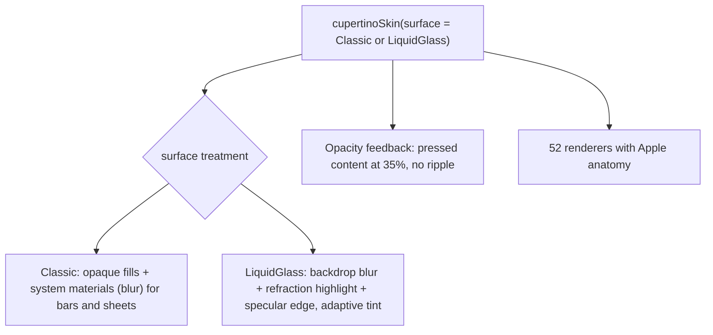
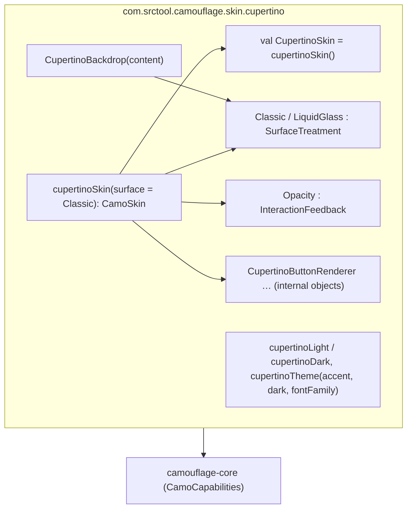
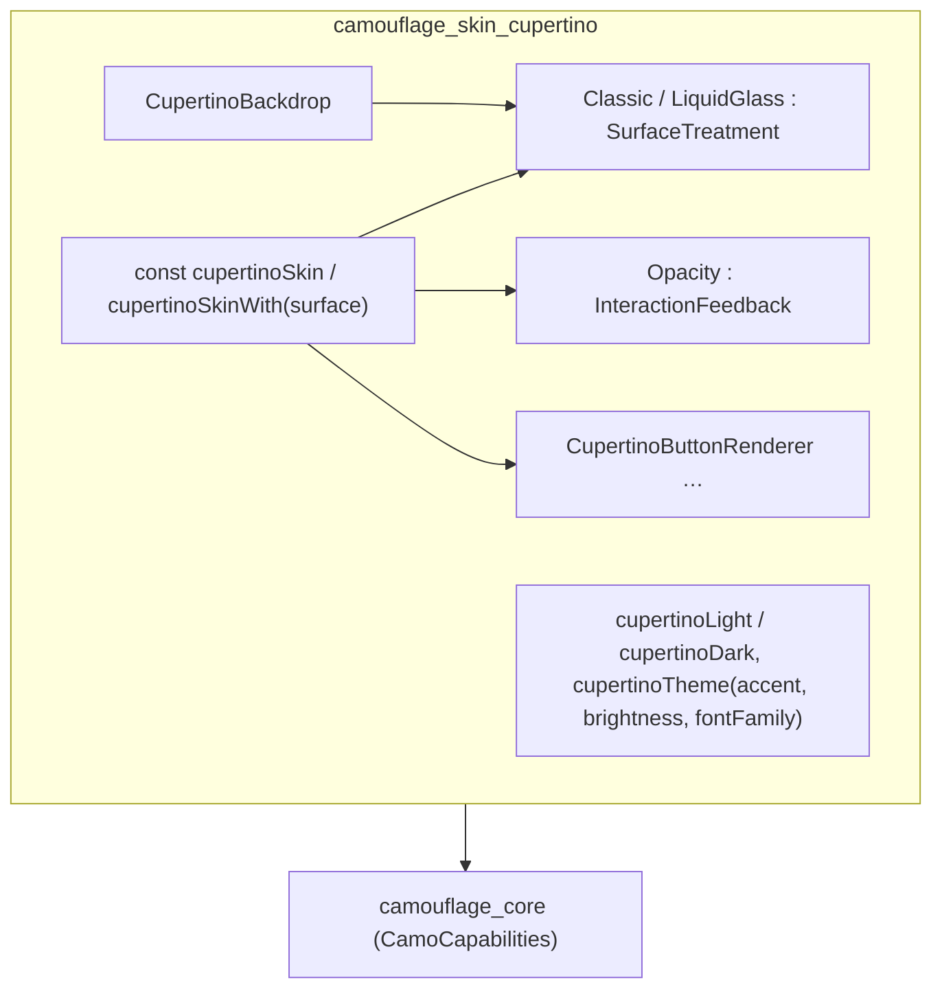

{/* Generated by docs/internal/scripts/sync_vault.py from the Camouflage design notes. Edit the notes and re-run the script; changes made here are overwritten. */}

# Cupertino Skin

## Concept {#concept}

:::info[Milestone: M13, in v0.1 (ADR-40)]

Documented first so the contract is proven against Apple's language (ADR-22); ADR-40 puts it in v0.1. It is built whole in one pass after Minimal, Fluent and Material (the M12 ruling: `CamoSkin` has no defaults, so a partial skin can't compile).

:::

### 1. Why

`CupertinoSkin` renders Camouflage in **Apple's Human Interface Guidelines** dialect (iOS, iPadOS, macOS look). It's the dialect that differs most in **structure** from Material and Minimal:
- alerts stack their buttons;
- selects become wheel pickers;
- tabs become segmented controls;
- lists become inset grouped sections;
- the FAB has no Apple equivalent.

That makes it the real stress test of the Skin contract: same components, same parameters, different anatomy. It has two surface options:
- **Classic**: flat fills and system blur materials (pre-iOS 26);
- **Liquid Glass**: Apple's iOS 26+ translucent, refracting glass for bars, sheets and controls.

### 2. Shape



**Surface treatments**

| Treatment | How it's drawn | Platform notes |
|---|---|---|
| `Classic` | opaque fills. Bars, sheets and menus use a blurred translucent material (`surface` at ~80% + a 20–30 backdrop blur). | Flutter: `BackdropFilter(ImageFilter.blur)`. Compose: a backdrop blur needs a graphics-layer approach (Android 12+ `RenderEffect`, or a library such as Haze on all targets), falling back to an opaque fill. |
| `LiquidGlass` | backdrop blur + a refraction/lensing shader at the edges + a specular highlight + a tint adapted to the content behind | Flutter: `BackdropFilter` + a fragment shader (`FragmentProgram`). Compose: runtime shaders (`RuntimeShader` on Android 13+, Skia `RuntimeEffect` on other targets) over a captured backdrop. The most expensive dialect to render; it degrades to `Classic` on low-end devices and under **Reduce Transparency**. |

**Interaction feedback: `Opacity`.** Pressed content fades to about 35% (no ripple, no overlay). Focus (keyboard, macOS/iPadOS) is a 3 px accent ring.

### 3. API

```kotlin
fun cupertinoSkin(surface: CupertinoSurface = Classic): CamoSkin   // Classic | LiquidGlass
fun cupertinoTheme(accent: Color = SystemBlue, dark: Boolean = false, fontFamily: FontFamily? = null): CamoTheme
```

**Starter theme:**
- Apple's system colors mapped to roles: `primary` = systemBlue (accent), `error` = systemRed, `success` = systemGreen, `warning` = systemOrange, `info` = systemTeal.
- Surfaces map to systemBackground / secondarySystemBackground / tertiarySystemBackground and the grouped variants.
- `onSurface` = label, and `onSurfaceVariant` = secondaryLabel.
- Typography uses the **system font** (SF Pro on Apple platforms; it may not be shipped elsewhere, so a Cupertino skin on Android or the web falls back to the platform font or an app-provided one), with Apple's text styles mapped to the 15 roles (largeTitle 34 → displaySmall, title1 28, title2 22, title3 20, headline 17 semibold → titleMedium, body 17 → bodyLarge, callout 16, subheadline 15, footnote 13, caption1 12, caption2 11).

Exact hex values are taken from Apple's current HIG color tables at implementation time, for light, dark and increased-contrast variants.

#### 3.1 Dialect alignment

| Appearance | Cupertino rendering |
|---|---|
| `Solid` | filled prominent button: accent fill, white label (`.borderedProminent`; Liquid Glass: `.glassProminent`) |
| `Soft` | tinted: accent at ~15% fill, accent label (`.bordered`; Liquid Glass: `.glass`) |
| `Raised` | → Soft |
| `Outline` | → Soft (Apple has no outlined buttons) |
| `Ghost` | plain accent text (`.borderless`) |
| `Link` | plain accent text (`.plain`) |

| Tone | Cupertino |
|---|---|
| Error | destructive role: systemRed text or fill |
| Success / Warning / Info | systemGreen / systemOrange / systemTeal |

#### 3.2 Component mapping (structure changes in bold)

| Component | Apple equivalent | Rendering |
|---|---|---|
| CamoButton | Button | capsule (Liquid Glass) or 12-radius rounded rect, 44 tall (regular), opacity press |
| CamoIconButton | Button (icon-only) | SF Symbol-sized icon, no container for Ghost, 44 target |
| CamoFab | – | **a circular prominent button**. Guidance: prefer a toolbar action. |
| CamoTextField | Text field | **rounded-rect filled field** (`tertiarySystemFill`), no border, label above or as a placeholder |
| CamoCheckbox | Toggle (checkbox, macOS) | iOS: **a checkmark** (circle-check style); macOS: checkbox |
| CamoSwitch | Toggle (switch) | 51 × 31, **`primary` (the accent) when on**. Apple's green is one line away: `SwitchTheme(colors = SwitchColors(trackOn = success))`. |
| CamoRadio | – | **a checkmark on the selected row** (iOS list style). A `Horizontal` group falls back to circle options in a row (a checkmark list only works vertically). |
| CamoSegmentedControl | Segmented control | gray track + **a sliding white thumb** |
| CamoSlider | Slider | thin track, a large round white thumb with shadow |
| CamoDatePicker | Date picker | **`style` Wheel** for single dates (the compact/inline calendar for ranges) |
| CamoTimePicker | Date picker (time) | **`style` Wheel** |
| CamoStepper | Stepper | the − / + pill; the value is shown beside it |
| CamoSearchField | Search field | rounded gray field with a magnifier, and a "Cancel" button when active |
| CamoSelect | Picker / pop-up button | **a menu on iPad/macOS, a wheel picker in a sheet on iPhone** |
| CamoCard | (group box / inset section) | a rounded rect on the grouped background, no shadow |
| CamoAccordion | Disclosure control | `indicatorPosition` Start, a rotating chevron |
| CamoListItem / Section | Lists and tables | **inset grouped sections** (rounded, `secondarySystemGroupedBackground`), chevron accessories |
| CamoChip | Token field (macOS) | rounded capsule tokens |
| CamoBadge | Badge | red count badge |
| CamoAvatar | – | circle, gray initials |
| CamoProgress | Progress indicators | thin bar; **the circle becomes an activity indicator** (spoke spinner) when indeterminate |
| CamoSnackbar | – | **a top or bottom rounded banner** with a material background (there's no Apple snackbar) |
| CamoBanner | – | an inset rounded message cell with an SF Symbol |
| CamoDialog | Alert | **centered alert, 270 wide, `titleAlign` Center, `actionsLayout` side by side (`Stacked` when a label doesn't fit); destructive in red** |
| CamoBottomSheet | Sheet | large-radius sheet with a grabber (`showHandle` true), medium/large detents on iPhone, **form sheet on iPad** (matches `widePresentation = Centered`) |
| CamoMenu | Menu / context menu | material-backed menu with separators, destructive items in red, `checkPosition` Leading |
| CamoTooltip | Help tag (macOS) | macOS only; iOS shows the tooltip on long-press |
| CamoTopBar | Navigation bar | `titleAlign` Center; **large title that collapses as `scrollOffset` grows** (over the large-title height), material background |
| CamoTabs | Segmented control | **rendered as a segmented control**; Solid and Ghost look the same. `scrollable = true` falls back to a scrolling underline row (a segmented control can't scroll). |
| CamoNavigationBar | Tab bar | material/glass tab bar, `indicator` None, accent tint on the selected item; `showLabels` default Always (HIG) |
| CamoNavigationRail | (sidebar, iPad) | → **a compact sidebar** |
| CamoNavigationDrawer | Sidebar | iPad/macOS sidebar list; the modal drawer becomes a sidebar overlay |
| CamoPagedList | List + refresh control | **UIRefreshControl-style spinner above the list**, inset-grouped rows when sectioned |
| CamoSkeleton | (redacted placeholders) | pulse, `systemFill` blocks |
| CamoDivider | Separator | hairline, inset 16 in lists |
| CamoPopover | Popover | material/glass panel with an arrow (`showArrow` true), radius 13, content padding 16 |
| CamoSideSheet | Sidebar-style inspector / panel | a glass panel on the end edge, hairline separator; modal sheets are drawn as a form-sheet-like panel |
| CamoToolbar | Toolbar | a glass bar, text or icon buttons in the accent color, `showLabels` optional; floating = a rounded glass capsule |
| CamoButtonGroup | Segmented control (for toggles) / grouped buttons | connected: a rounded group with hairline dividers; toggles use the accent tint |
| CamoSplitButton | Pull-down / pop-up button | **rendered as a pull-down button**: the whole button opens the menu; with an action, a split capsule |
| CamoDataTable | Table view | grouped grouped rows 44, hairline separators inset 16, the selected row a tinted fill |
| CamoTree | an outline view | disclosure triangles, rows 28 on macOS and 44 on iOS, the selected row a rounded accent fill |
| CamoCarousel | Carousel | a paged scroll with a page control; items radius 12 |
| CamoImage | Image | continuous corners (radius 12 by role), a `secondarySystemFill` placeholder |
| CamoRating | Rating | SF-style stars 20 in the accent color |
| CamoFileUploader | File uploader | a dashed rounded zone like an image well; a spinner or bar per file |
| CamoPagination | Pagination | **rendered as a page control**: dots (an iOS page control) by default; numbered on macOS |
| CamoBreadcrumb | a path control | a path control: segments separated by chevrons, the last one in primary label color |
| CamoProgressSteps | Progress indicator | numbered circles with a filled accent for complete steps; a vertical list on compact widths |

#### 3.3 Cupertino under ADR-42 (materials rule)

Cupertino is the second skin, after Fluent, that draws materials, so it reads `CamoCapabilities`. The chain is chosen at runtime, and **Reduce Transparency always wins**:

| Step | Condition | What is drawn |
|---|---|---|
| `LiquidGlass` | `surface = LiquidGlass`, `backdropBlur`, `runtimeShaders` and not `reduceTransparency` | blur + edge refraction + specular highlight + adaptive tint |
| glass without refraction | `LiquidGlass` chosen, `backdropBlur`, no `runtimeShaders` | blur + the specular edge and tint (the lensing is the only part lost) |
| `Classic` material | `backdropBlur` | `surface` at ~80% over a 20 to 30 blur of what is behind |
| opaque | no `backdropBlur`, or `reduceTransparency` | the plain `surface` fill (the end of every chain) |

The blur needs something to blur: like Fluent's `FluentBackdrop`, a `CupertinoBackdrop` wraps the app and records it; without one a material draws its opaque fill. Only bars, sheets, menus, popovers and the glass controls are materials; cards, lists and fields stay opaque (as on iOS).

#### 3.4 Chart preset

Charts reach skins through the preset registered for `skin.name == "cupertino"` ([Chart Frame](/components/charts/chart-frame)); like the others it ships in the charts package. Proposed values, from Apple's Charts (Swift Charts) defaults:

| `ChartStyle` field | Cupertino | Why |
|---|---|---|
| `lineWidth` | 2 | Swift Charts' thin, round-capped line |
| `markerSize` | 7 | a plain dot symbol |
| `areaOpacity` | 0.2 | a soft accent wash under the line |
| `barRadius` | 4 | bars have a small rounded top |
| `barGap` | 2 | tight grouped bars |
| `gridDashed` | false | hairline `separator` lines |
| `sliceGap` | 2 | a thin angular gap (sector marks) |
| `donutThickness` | 0.4 | Apple's default inner radius ratio |

The palette stays the theme's; the tooltip is a small material callout.

### 4. Build steps

1. `Opacity` feedback, and the `Classic` surface (including the blur material with an opaque fallback).
2. `cupertinoTheme` from the HIG color and type tables, snapshot-pinned.
3. The renderers with Apple anatomy (the structure changes above are the priority tests of the contract), the M9 to M11 ones included, and the `"cupertino"` chart preset (§3.4).
4. `LiquidGlass`: the backdrop capture + shader per platform, a device-capability check, and fallback to `Classic` under Reduce Transparency or on low-end devices.
5. The screenshot matrix, plus a manual comparison with native iOS screens.

**Done when**
- [ ] All 52 renderers work with the Classic surface, and the M9 to M11 components (dialog, sheet, popover, data table, charts …) render in Cupertino.
- [ ] Alerts, wheel-picker selects, inset grouped lists and the large-title top bar match native iOS structure.
- [ ] Liquid Glass runs at 60 fps on a current iPhone and a mid-range Android device, and falls back correctly.

### 5. Edge cases

| Case | Decided behavior |
|---|---|
| **Reduce Transparency** (iOS setting) | Glass and materials become opaque fills. |
| Glass where `runtimeShaders` is false (Android below 13, older web) | The chain in §3.3: blur with the specular edge, no refraction. |
| A material over content that changes every frame | The backdrop re-records each frame, so glass is the most expensive dialect; `Classic` is the cheaper choice (`cupertinoSkin(surface = Classic)`). |
| **Increase Contrast** | Uses the increased-contrast color variants and stronger separators. |
| Cupertino skin on Android | Allowed (it's just a skin). The system back gesture still works. Guidance: pick the skin per platform at the root. |
| A FAB requested under Cupertino | Rendered as a circular button (above). The docs recommend a toolbar action instead. |
| Contract gaps found | Record them as ADRs and add them to core (e.g. a `detents` option for sheets). |

| Switch color | Follows the brand accent (`primary`), like every other selected control in the skin (decided 2026-09-27). Apps that want the iOS green set `SwitchTheme.colors.trackOn` to `success`. |

:::info[Changed in the M13 build (2026-11-05)]

- **Colors are Apple's, as published.** Several system pairs are below WCAG AA (white on systemBlue 4.0, secondaryLabel on the grouped background 3.1); the skin keeps them and the theme tests pin the list of known pairs, so a new failing pair is a regression. A brand there may not add a failing pair.
- **Text styles:** `labelLarge` is the callout (16), so buttons stay compact; `bodyLarge` is the body (17).
- **Materials:** a bar inside the app blurs a recording of the app taken without the materials (`CupertinoBackdrop`, two passes); a material over a popup samples the same recording. Flutter needs no backdrop: `BackdropFilter` blurs what is painted behind.
- **Liquid Glass:** the refraction shader runs on Kotlin (`RuntimeShader` on Android 13+, Skia `RuntimeEffect` elsewhere). On Flutter it is **not built**: it needs `ImageFilter.shader` (Impeller only), so Flutter's glass is the "glass without refraction" step (blur, tint, specular edge).
- **Not built:** the search field's "Cancel" button (no slot in core), the alert's stacked layout when a label doesn't fit (`actionsLayout` is the app's choice; the default is side by side), the select as a wheel in a sheet on iPhone (core's select uses the menu), a sliding segmented thumb on Kotlin (it crossfades; Flutter's tabs thumb slides), the radio's checkmark-only look (an unselected option keeps a faint ring so a horizontal group still reads), and RTL-aware drawer corners on Flutter.
- **Defaults:** buttons 44 tall with 16 padding (capsules with glass); date and time pickers default to the wheel form; the top bar's large title shows at rest (the bar is 52 taller until content scrolls); list sections are not uppercased (iOS 26 mixed case); the popover is up to 360 wide.
- Both platforms ship the chart preset in §3.4 as `"cupertino"`.
- **Follow-ups built (Kotlin #140 and #141, Dart #141):** every step of the chain has a golden or a pixel assertion (glass without shaders, no blur, Reduce Transparency, no backdrop, below `Level2`; light and dark). The Android glass shader is compiled once per node and rebuilt only when its inputs change; a shader that fails degrades to the blur for good. Flutter's decision: the refraction stays out and the gap is documented here; Flutter has no backdrop widget, so "no backdrop" has no counterpart. **Still open:** #142, running glass on real devices (iOS, Android 12 and 13+, desktop, wasm), which needs hardware.
- **Found on devices (Galaxy A15 on Android 16, the iPhone 17 simulator):** selecting Cupertino Glass crashed the sample on both with a stack overflow in the renderer's render-node tree. A material that samples a layer containing its own ancestors is a cycle (the ancestors draw the material, which draws the layer). The desktop goldens never showed it because their layout has no layered ancestors. **Rule, on every target:** a material samples the backdrop only from **another root** (a popup, a menu, a dialog, a sheet); a material in the backdrop's own tree is its opaque fill, and so is one with no backdrop. So in-app bars are not blurred on any target yet; making them blur needs the source and the bars to be siblings (Haze's model, an `overlay` slot on `CupertinoBackdrop`): not built. Flutter is unaffected (`BackdropFilter` has no layer to cycle through). On the Galaxy A15 the sample scrolls at about 60 fps (p50 17 ms, 0.8% janky frames).
- **The samples never ran on a device before:** the Android sample didn't package its compose resources (crash on launch) and the iOS sample's Info.plist lacked `CADisableMinimumFrameDurationOnPhone` (Compose's launch check aborted). Both fixed in the sample projects.
- **In-app glass through an overlay (Kotlin):** `CupertinoBackdrop(overlay = { … }, content)`. The content is recorded; the bars in the overlay are siblings of it, so they blur it without the cycle (a floating toolbar, a top bar). The sample's top bar is in the overlay. Glass has a faint dark rim and a short shadow (radius 5 to 6, offset 1 to 2) so it shows on a light page, where its tint matches the page.
- **Device and emulator results for #142:** the sample runs Cupertino Glass without a crash on a Galaxy A15 (Android 16, about 60 fps), and on Android 13, 12, 11 and 7 emulators (arm64) and the iPhone 17 simulator and a real iPhone 17 Pro (it launched and stayed up; its frame rate is not measured). Not measured: frame rate on iOS, and anything on desktop and the web. The refraction path (Android 13+, Skia on iOS) draws on the real devices; I have not compared it pixel for pixel.

:::

## Implementation {#implementation}

<KotlinOnly>

:::info[Milestone: M13, in v0.1 (ADR-40)]

Read the base note first: Cupertino Skin. Fluent drew the first materials, so the module follows `camouflage-skin-fluent` (`CupertinoSkin.kt`, `CupertinoTheme.kt`, `Classic.kt`, `LiquidGlass.kt`, `Opacity.kt`, `renderer/Cupertino*.kt`). This note is the platform plan.

:::

### 1. Why {#kotlin-1-why}

`:camouflage-skin-cupertino` implements every renderer in Apple's HIG dialect using **only Compose foundation** plus `camouflage-core`'s public API. It is the skin that changes **structure** (stacked alerts, wheel pickers, inset grouped lists, a large title that collapses), and the second, after Fluent, that draws **materials** (blur, glass).

### 2. Shape {#kotlin-2-shape}



### 3. API {#kotlin-3-api}

```kotlin
public val CupertinoSkin: CamoSkin = cupertinoSkin()
public fun cupertinoSkin(surface: CupertinoSurface = CupertinoSurface.Classic): CamoSkin
public enum class CupertinoSurface { Classic, LiquidGlass }
public fun cupertinoTheme(accent: Color = SystemBlue, dark: Boolean = false, fontFamily: FontFamily? = null): CamoTheme
public val cupertinoLight: CamoTheme
public val cupertinoDark: CamoTheme
@Composable public fun CupertinoBackdrop(modifier: Modifier = Modifier, content: @Composable () -> Unit)
```

- **`Opacity`**: pressed content fades to 35% (an `IndicationNodeFactory` drawing the content at reduced alpha); a keyboard focus ring of 3 dp in `primary`. No hover layer on touch; a pointer gets a 4% overlay.
- **`Classic`**: the opaque surface for cards and fields; for material levels (bars, sheets, menus, popovers) the blur chain of the base note §3.3. `CupertinoBackdrop` is `FluentBackdrop`'s counterpart: a `GraphicsLayer` recording of the app that the materials blur with `BlurEffect`. The blur is `20 dp`, the tint `surface` at 80%.
- **`LiquidGlass`**: the `Classic` material plus edge refraction and a specular highlight. The refraction shader is an `expect`/`actual` (`RuntimeShader` on Android 13+, Skia `RuntimeEffect` on the skiko targets: desktop, iOS, web); where it can't run, the specular edge and tint remain (§3.3 of the base note). The shader is generated once at runtime; nothing is bundled.
- **Theme**: `cupertinoTheme` maps Apple's system colors to roles from the HIG tables (light, dark; increased-contrast variants through `cupertinoTheme(highContrast)`), pinned by a snapshot test like the Material literals. The system font is not bundled (ADR-33).

#### 3.1 Liquid Glass in Compose {#kotlin-31-liquid-glass-in-compose}

Liquid Glass is drawn by Camouflage, not by the OS, so it does not depend on the iOS version: on iOS it runs on Skia like on desktop and web. What it depends on is two capabilities: a backdrop blur and a runtime shader.

**Parts**

| Part | Where | What it does |
|---|---|---|
| `CupertinoBackdrop` | `CupertinoMaterial.kt` | records the app into a `GraphicsLayer`, which is what a material blurs and refracts |
| `glassEffect(size, cornerPx, depthPx, blurPx, refract)` | `GlassEffect.kt` (`expect`) | returns the `RenderEffect` for the sampled backdrop, or `null` when it can't refract |
| Android `actual` | `GlassEffect.android.kt` | `RuntimeShader` (AGSL) chained with the blur; Android 13+ |
| skiko `actual` | `GlassEffect.skiko.kt` | Skia `RuntimeEffect` (SkSL); desktop, iOS, web |
| `GLASS_SHADER` | `GlassEffect.kt` | one program for both runtimes (AGSL and SkSL read the same source) |

**The shader** is a rounded-rect distance field. Inside `depth` of the edge it samples the backdrop from a point moved toward the inside, with a quadratic falloff (`bend = (1 - t)² · depth · 0.6`), so the rim bends hardest and the center is untouched. The blur is applied after it. The specular highlight and the adaptive tint are drawn over the result and don't need a shader, so they survive when it is missing.

**Choosing a step.** The chain of the base note §3.3 runs at composition time from `CamoCapabilities` (`backdropBlur`, `runtimeShaders`, `reduceTransparency`), not from an OS version check. Each step drops only what the platform can't do; Reduce Transparency always ends in the opaque fill.

| Target | `backdropBlur` | `runtimeShaders` | `LiquidGlass` draws | `Classic` draws |
|---|---|---|---|---|
| Android 13+ | yes | yes | blur + refraction + specular + tint | blurred material |
| Android 12 | yes | no | blur + specular + tint | blurred material |
| Android 7 to 11 (minSdk 24) | no | no | opaque `surface` | opaque `surface` |
| Desktop, iOS, web (skiko) | yes | yes | blur + refraction + specular + tint | blurred material |
| Any target, Reduce Transparency on | forced off | forced off | opaque `surface` | opaque `surface` |

`LiquidGlass` never falls straight to `Classic`: where blur works, it keeps the blur even without the shader, because `Classic` there would be the same blur without the highlight. Below Android 12 `Classic` is opaque too, since a material has nothing to blur.

**Cost.** The backdrop is re-recorded every frame while a material is on screen, so glass is the most expensive dialect. Materials are limited to bars, sheets, menus, popovers and the glass controls (cards, lists and fields stay opaque, as on iOS). An app that targets low-end devices can pick `Classic` at the root.

**Tests.** Goldens for each step, driven through fake `CamoCapabilities` (all on, `runtimeShaders` off, `backdropBlur` off, Reduce Transparency on), so the fallbacks are covered on CI without a device.

### 4. Build steps {#kotlin-4-build-steps}

M13 is built in one pass (the M12 ruling), then reviewed as a whole; the task cards close together.

1. Copy Minimal's module as the starting point, then: `Opacity`, `Classic`, `CupertinoBackdrop`.
2. The theme, from the HIG color and type tables, with the pinned-literal test.
3. The renderers with Apple anatomy, structure first: dialog (centered alert 270 wide), select (wheel in a sheet on touch, menu on pointer), date and time pickers (wheel), list (inset grouped), top bar (large title), tabs (segmented control), pagination (page control), progress (spoke spinner).
4. The M9 to M11 renderers and the `"cupertino"` chart preset in `camouflage-charts` (values in the base note §3.4).
5. `LiquidGlass`: the shader per target, the capability chain, the Reduce Transparency fallback.
6. The sample switcher entry (Cupertino with a Classic/Glass toggle), goldens (light, dark, brand; Classic and Glass), `assertRendererAppliesBehavior` on every clickable renderer, the no-literals test.

**Done when**
- [ ] `:camouflage-skin-cupertino` has no Material dependency; it is at layer 1 (`checkModuleLayers`) and in the BOM.
- [ ] All 52 renderers pass the behavior and no-literals tests.
- [ ] Goldens for Classic and LiquidGlass are recorded; local macOS renders are replaced by CI's Linux ones.
- [ ] The sample switches Minimal / Fluent / Material / Cupertino live.
- [ ] `CamoCharts` has the `"cupertino"` preset.

### 5. Edge cases {#kotlin-5-edge-cases}

| Case | Decided behavior |
|---|---|
| No refraction shader on a target (Android 12, older web) | Blur with the specular edge (the chain), not `Classic`. |
| No backdrop blur (Android below 12) | Opaque `surface` for both `LiquidGlass` and `Classic`. |
| Shader fails to compile at runtime | `glassEffect` returns `null` and the target is treated as having no `runtimeShaders`, so it drops to blur + specular edge. |
| Material with no `CupertinoBackdrop` above it | Opaque fill (nothing is recorded to blur). |
| Wheel pickers | Drawn with a snapping scroll, not a platform picker; the semantics are the same as the Material pickers. |
| Cupertino on Android | Allowed; the Android back gesture keeps working. |

:::info[Changed in the M13 build (2026-11-05)]

- Module `camouflage-skin-cupertino`: `Classic`, `LiquidGlass`, `Opacity`, `CupertinoBackdrop`, `glassEffect` (`expect`/`actual`: skiko and Android), `cupertinoTheme(accent, dark, fontFamily)`, the 52 renderers. `cupertinoSkin(surface)` takes the glass option; the sample switcher has Cupertino and Cupertino Glass.
- See the base note's callout for the shared deviations (Apple's colors below AA, the glass shader on Flutter, what is not built).

:::

</KotlinOnly>

<DartOnly>

:::info[Milestone: M13, in v0.1 (ADR-40)]

Read the base note first: Cupertino Skin. The package follows `camouflage_skin_fluent` (`lib/src/cupertino_theme.dart`, `classic.dart`, `liquid_glass.dart`, `opacity.dart`, `renderer/cupertino_*.dart`). This note is the platform plan.

:::

### 1. Why {#dart-1-why}

`camouflage_skin_cupertino` implements every renderer in Apple's HIG dialect from the **`widgets` layer only**: it does not import `package:flutter/cupertino.dart` (that library carries its own theme and behaviors, which would double-handle what core owns), the same decision as Material and Kotlin. It needs no extra dependency; the layer check stays as it is.

### 2. Shape {#dart-2-shape}



### 3. API {#dart-3-api}

```dart
const CamoSkin cupertinoSkin = ...;                       // Classic
CamoSkin cupertinoSkinWith({CupertinoSurface surface = CupertinoSurface.classic});
CamoTheme cupertinoTheme({Color accent, Brightness brightness, String? fontFamily});
final cupertinoLight, cupertinoDark;                      // CamoTheme
class CupertinoBackdrop extends StatelessWidget { ... }
```

- **`Opacity`**: pressed content at 35% (an `AnimatedOpacity`-style wrapper driven by the interaction state); the 3 px keyboard focus ring in `primary`.
- **`Classic`**: opaque for cards and fields; materials use `BackdropFilter(ImageFilter.blur)` clipped to the shape (20 sigma, `surface` at 80%). `BackdropFilter` blurs what is already painted behind it, so no recording is needed; `CupertinoBackdrop` only marks the scope the filter reads and applies the Reduce Transparency override. The chain is the base note §3.3.
- **`LiquidGlass`**: the `Classic` material, lighter, plus the specular edge. The edge refraction (a `FragmentProgram` on the backdrop) is not built; see the callout below.
- **Theme**: the same HIG color and type tables as Kotlin, snapshot-pinned.

### 4. Build steps {#dart-4-build-steps}

Built in one pass with the Kotlin skin (the M12 ruling), starting from a copy of the Minimal package.

1. `Opacity`, `Classic`, `CupertinoBackdrop`, the theme and its pin test.
2. The renderers with Apple anatomy (structure first, then the M9 to M11 renderers), and the `'cupertino'` chart preset in `camouflage_charts`.
3. `LiquidGlass`: the shader, the capability chain, Reduce Transparency.
4. The example switcher, the CI goldens (Classic and Glass; light, dark), the behavior and no-literals tests.

**Done when**
- [ ] `camouflage_skin_cupertino` is at layer 1 in `tool/layers.yaml`; `check_no_material` passes with no exemption.
- [ ] All 52 renderers pass the tests; the example switches live; the `'cupertino'` chart preset exists.

### 5. Edge cases {#dart-5-edge-cases}

| Case | Decided behavior |
|---|---|
| Web without the shader backend | Glass without refraction (the chain). |
| Impeller vs Skia | The shader is plain SkSL-compatible GLSL, so it runs on both. |

:::info[Changed in the M13 build (2026-11-05)]

- Package `camouflage_skin_cupertino` (widgets layer only): `Classic`, `LiquidGlass`, `OpacityFeedback` (named so because Flutter has an `Opacity` widget), `cupertinoTheme`, the 52 renderers. `cupertinoSkinWith(surface:)` takes the glass option; there is no `CupertinoBackdrop` and no shader asset. The example switcher has Cupertino and Cupertino Glass.
- See the base note's callout for the shared deviations (Apple's colors below AA, the glass shader on Flutter, what is not built).

:::

</DartOnly>
