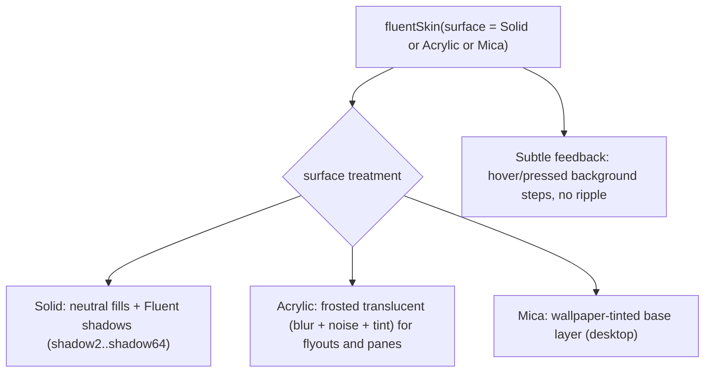
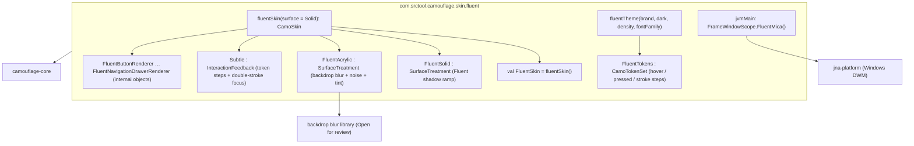
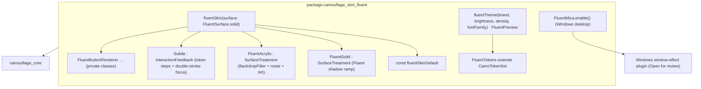

{/* Generated by docs/internal/scripts/sync_vault.py from the Camouflage design notes. Edit the notes and re-run the script; changes made here are overwritten. */}

# Fluent Skin

## Concept {#concept}

:::info[Milestone: v1, built alongside M3 to M8 (ADR-38)]

Fluent ships in v0.1 with Minimal, on Kotlin and Flutter. Each milestone adds the Fluent renderers for its components; Acrylic comes with the overlays (M6) and Mica with the navigation chrome (M8). Graft, the author's desktop git client, is its first app.

:::

### 1. Why

`FluentSkin` renders Camouflage in **Microsoft's Fluent 2** dialect: calm neutral surfaces, 4 px corners, subtle hover states, a brand color used sparingly, and the **Acrylic** and **Mica** materials on Windows. It's the natural dialect for desktop apps (Windows especially) and for enterprise tools. Structurally it's close to Minimal and Material, so it mostly swaps the surface treatment, feedback and proportions, which is the reuse the architecture was designed for.

### 2. Shape



**Interaction feedback: `Subtle`.** Hover and pressed shift the background one or two neutral steps (Fluent's `…Hover` / `…Pressed` tokens). The focus indicator is Fluent's **double stroke** (2 px dark outer + 1 px light inner).

**Surface treatments:**
- `Solid`: the default everywhere.
- `Acrylic`: blur + noise texture + tint, for menus, flyouts and dialogs.
- `Mica`: a wallpaper-tinted window background. It's desktop-only, and falls back to `Solid` elsewhere.

### 3. API

```kotlin
fun fluentSkin(surface: FluentSurface = Solid): CamoSkin      // Solid | Acrylic | Mica
fun fluentTheme(brand: Color = FluentBrandBlue, dark: Boolean = false, fontFamily: FontFamily? = null): CamoTheme
```

**Starter theme:** the Fluent 2 neutral ramp → surfaces (`neutralBackground1..6`), `neutralForeground1..3` → `onSurface`/`onSurfaceVariant`, `neutralStroke1/2` → `outline`/`outlineVariant`, and the brand ramp (from the brand color, Fluent's 16-step ramp) → the `primary` family. Status: `danger`/`success`/`warning` palettes, and `info` from the brand. Typography: **Segoe UI Variable** on Windows, the platform font elsewhere (not bundled; an app may add its own via `fluentTheme(fontFamily = …)`), with Fluent's type ramp (caption1 12, body1 14, subtitle2 16 semibold, subtitle1 20, title3 24, title2 28, title1 32, largeTitle 40, display 68). Values are taken from Fluent's published token set at implementation time.

#### 3.1 Dialect alignment

| Appearance | Fluent rendering |
|---|---|
| `Solid` | Primary button: brand fill, white text |
| `Soft` | Default/Secondary button: `neutralBackground1` + `neutralStroke1` border |
| `Raised` | → Soft |
| `Outline` | Outline button: transparent + stroke |
| `Ghost` | Subtle / Transparent button |
| `Link` | Link |

| Tone | Fluent |
|---|---|
| Error / Success / Warning | danger / success / warning palettes |
| Info | brand (Fluent has no separate info palette) |

#### 3.2 Component mapping

| Component | Fluent equivalent | Rendering |
|---|---|---|
| CamoButton / IconButton | Button (+ icon-only) | 32 tall (medium), radius 4 |
| CamoFab | – | a circular primary button (guidance: use a command bar instead) |
| CamoTextField | Input + Field | 32 tall, radius 4, **bottom-accent stroke** (brand on focus), label above |
| CamoCheckbox / Switch / Radio | Checkbox / Switch / Radio | 16 box, 40 × 20 switch, brand when on |
| CamoSegmentedControl | – (TabList or ToggleButtons) | toggle-button group |
| CamoSlider | Slider | 4 px rail, 20 thumb with an inner dot |
| CamoDatePicker | DatePicker / Calendar | `style` Calendar in an Acrylic flyout |
| CamoTimePicker | TimePicker | `style` Fields |
| CamoStepper | SpinButton | **`layout` Split** (field with ▲▼) |
| CamoSearchField | SearchBox | Input + search icon + dismiss |
| CamoSelect | Dropdown / Combobox | field + listbox flyout (Acrylic) |
| CamoCard | Card | radius 8, shadow4, `neutralBackground1` |
| CamoAccordion | Accordion | chevron at the start (`indicatorPosition` Start) |
| CamoListItem | List | 40–56 rows, subtle selection |
| CamoChip | Tag / InteractionTag | radius 4 tags, dismissible |
| CamoBadge | Badge / CounterBadge | brand or danger, rounded |
| CamoAvatar | Avatar / Persona | circle, brand-tinted initials, presence badge |
| CamoProgress | ProgressBar / Spinner | 2 px bar, a brand spinner |
| CamoSnackbar | Toast | a bottom-end toast card; `showToneIcon` true |
| CamoBanner | MessageBar | an intent-colored bar with an icon and actions |
| CamoDialog | Dialog | radius 8, shadow64, title 20 semibold, actions end-aligned, optional ✕ (`DialogTheme.showCloseButton`), shown only when `dismissible` |
| CamoBottomSheet | Drawer (bottom) | → an overlay drawer from the bottom, `showHandle` default false |
| CamoMenu | Menu | Acrylic flyout, 32 items, radius 4, `checkPosition` Leading |
| CamoTooltip | Tooltip | neutral or inverted, radius 4 |
| CamoTopBar | (app header) | 48 tall, title start-aligned |
| CamoTabs | TabList | a brand underline indicator, 2 px |
| CamoNavigationBar | – | a bottom bar in Fluent style (for mobile) |
| CamoNavigationRail / Drawer | Nav (collapsed / expanded) | 48 rail, 260 pane, `indicator` Line (a brand start-edge line) |
| CamoPagedList | List | no pull gesture on desktop (refresh from a command); Spinner for loading more |
| CamoSkeleton | Skeleton | shimmer, Fluent's skeleton colors |
| CamoDivider | Divider | 1 px `neutralStroke2` |

### 4. Build steps

By milestone (ADR-38). Every step runs Kotlin first, then Flutter.

1. **M3:** `Subtle` feedback, the double-stroke focus, and the `Solid` surface with Fluent's shadow ramp; `fluentTheme` from the Fluent token set (brand ramp + neutrals), snapshot-pinned; the **density** option (small 24 / medium 32 heights, through component themes); the renderers for text, icon, surface, divider, button and icon button.
2. **M4:** the theme swap demo also switches skin (Minimal ⇄ Fluent) live.
3. **M5:** the input renderers (text field with the bottom-accent stroke, checkbox, switch, radio, segmented control, slider, search field, date and time pickers, stepper in `Split` layout) and the form.
4. **M6:** the structure and overlay renderers, and the **`Acrylic`** surface (blur + noise + tint) for menus, flyouts, the select's listbox, the date picker's calendar and dialogs.
5. **M7:** chip, badge, avatar, progress, snackbar (Toast) and banner (MessageBar) renderers.
6. **M8:** tabs, navigation bar, rail and drawer (Nav), FAB, and the **`Mica`** window backdrop (Windows desktop; `Solid` elsewhere).

Most proportions differ from Minimal, but the structures stay close to it.

**Done when**
- [ ] M3: the M3 renderers pass the behavior and no-literals tests with `Solid`, at both densities.
- [ ] M5 to M8: every renderer added in the milestone passes the same tests.
- [ ] M6: Acrylic menus, flyouts and dialogs on desktop, with a `Solid` fallback where blur isn't available.
- [ ] M8: all 39 renderers done; Mica on the Windows desktop sample.

### 5. Edge cases

| Case | Decided behavior |
|---|---|
| Mica on non-Windows platforms | Falls back to `Solid` (a documented, silent fallback). |
| Fluent's compact density on desktop vs touch on mobile | Uses a density option via component themes: small 24 and medium 32 on desktop (the sizes Graft uses), 40 on touch. See [Theme](/guide/foundations/theme). |
| High contrast mode (Windows) | Uses the platform's high-contrast colors when the OS reports it. |

## Implementation {#implementation}

<KotlinOnly>

:::info[Milestone: v1, built alongside M3 to M8 (ADR-38)]

Read the base note first: Fluent Skin. This note adds the Compose Multiplatform plan: the module, the feedback and focus wiring, the three surface treatments, and what each milestone builds.

:::

### 1. Why {#kotlin-1-why}

`:camouflage-skin-fluent` renders every component in **Fluent 2**, the second v1 skin next to Minimal ([Minimal Skin](/guide/skins/minimal-skin#implementation)). Like Minimal, it draws everything on **Compose foundation** and `camouflage-core`'s public API, with no Material artifact. It's the first skin with platform-specific work: a backdrop blur for **Acrylic**, and Windows window interop for **Mica**. Graft, a Compose Desktop app, is its first user.

### 2. Shape {#kotlin-2-shape}



**Module and dependencies**

| Source set | Depends on | Why |
|---|---|---|
| `commonMain` | `projects.camouflageCore` (as `api`) | the contract and the theme |
| `commonMain` | a multiplatform backdrop-blur library, e.g. Haze (`dev.chrisbanes.haze`) | Acrylic: Compose has no backdrop blur of its own (Open for review) |
| `jvmMain` | `net.java.dev.jna:jna-platform` | Mica: `DwmSetWindowAttribute` on Windows 11 |
| `commonTest` | `projects.camouflageSkinTesting` | behavior and no-literals checks |

No `material3`, no `material-ripple`: `./gradlew :camouflage-skin-fluent:dependencies` must show neither.

### 3. API {#kotlin-3-api}

```kotlin
public val FluentSkin: CamoSkin = fluentSkin()

public enum class FluentSurface { Solid, Acrylic, Mica }   // Mica = Acrylic flyouts + a Mica window backdrop

public fun fluentSkin(surface: FluentSurface = FluentSurface.Solid): CamoSkin = CamoSkin(
    name = "fluent",
    surfaceTreatment = if (surface == FluentSurface.Solid) FluentSolid else FluentAcrylic,
    feedback = Subtle,
    text = FluentTextRenderer, icon = FluentIconRenderer, surface = FluentSurfaceRenderer, divider = FluentDividerRenderer,
    button = FluentButtonRenderer, iconButton = FluentIconButtonRenderer,
    // M5 to M8 add the rest; until then they're DebugSkin's, so the skin is usable from M3.
)

public enum class FluentDensity { Small, Medium, Touch }  // control heights 24 / 32 / 40

public fun fluentTheme(
    brand: Color = FluentBrandBlue,          // #0F6CBD
    dark: Boolean = false,
    density: FluentDensity = FluentDensity.Medium,
    fontFamily: FontFamily? = null,          // Segoe UI Variable on Windows by default; never bundled (ADR-33)
): CamoTheme

@Composable public fun FluentBackdrop(content: @Composable () -> Unit)                        // the Acrylic blur source (M6)
@Composable public fun FluentPreview(dark: Boolean = false, content: @Composable () -> Unit)   // for @Preview, like MinimalPreview
```

#### 3.1 Tokens and feedback {#kotlin-31-tokens-and-feedback}

Fluent's states are **explicit token steps** (`neutralBackground1` → `…Hover` → `…Pressed`), not an overlay. `fluentTheme` carries them as a typed token set (ADR-32):

```kotlin
public data class FluentTokens(
    val neutralBackground1Hover: Color, val neutralBackground1Pressed: Color,
    val brandBackgroundHover: Color, val brandBackgroundPressed: Color,
    val strokeFocus1: Color,   // inner, light
    val strokeFocus2: Color,   // outer, dark
    // … the remaining …Hover / …Pressed / …Selected steps the renderers read
) : CamoTokenSet<FluentTokens> {
    override fun lerp(other: FluentTokens, t: Float): FluentTokens   // animated theme switches blend it like the core groups
}
```

- **`Subtle`** is an `IndicationNodeFactory` whose node swaps the container's fill to the hover or pressed step, read with `theme.tokens<FluentTokens>()`. No ripple, no overlay alpha.
- The **focus indicator** is a separate draw node: a 2 dp `strokeFocus2` outer stroke and a 1 dp `strokeFocus1` inner stroke, shown only for keyboard focus.
- Under another theme (no `FluentTokens`), `Subtle` falls back to a 4% / 8% `onSurface` overlay, so `FluentSkin` still works with a brand theme that wasn't built from `fluentTheme`.

#### 3.2 Surface treatments {#kotlin-32-surface-treatments}

- **`FluentSolid`**: `background(color, shape)` plus Fluent's two-layer shadows (key + ambient) from `elevation`: shadow2, 4, 8, 16, 28, 64 via `Modifier.dropShadow`. Level0 and Level1 have none; cards use shadow4, flyouts shadow16, dialogs shadow64.
- **`FluentAcrylic`**: for flyouts, menus, the select's listbox, the date picker's calendar and dialogs; other containers stay Solid. It blurs the backdrop (30 dp), adds a luminosity tint and a noise layer (a small noise bitmap generated once at runtime, drawn at 2%; nothing is bundled). It needs the app's content marked as the blur source: apps wrap their root content in `FluentBackdrop { … }`, and `FluentPreview` does it for previews (core never knows about it).
- **Mica** (`jvmMain` only): `FrameWindowScope.FluentMica()` calls `DwmSetWindowAttribute(hwnd, DWMWA_SYSTEMBACKDROP_TYPE, DWMSBT_MAINWINDOW)` and extends the frame into the client area, then makes the Level0 background transparent so the backdrop shows. It's a no-op (Solid) on other platforms and on Windows before 11.

#### 3.3 Density {#kotlin-33-density}

`density` sets the component themes' heights: `Medium` 32 (buttons, fields, menu items 32; list rows 40), `Small` 24, `Touch` 40. An app that mixes sizes, like Graft (small toolbars, medium dialogs), scopes a nested `CamouflageProvider` with `fluentTheme(density = Small)`'s component themes around the toolbar.

### 4. Build steps {#kotlin-4-build-steps}

1. **M3:** the module (add it to `settings.gradle.kts`, the BOM and `srctool.layers` at layer 1); `FluentTokens` and `fluentTheme` from Fluent's published token set (brand ramp + neutrals), with a snapshot test pinning the values; `FluentSolid`; `Subtle` and the double-stroke focus; the density presets; the M3 renderers (text, icon, surface, divider, button, icon button).
2. **M4:** the sample's theme swap also switches skin, Minimal ⇄ Fluent.
3. **M5:** the input renderers and the form.
4. **M6:** the structure and overlay renderers; `FluentAcrylic` and `FluentBackdrop`.
5. **M7:** chip, badge, avatar, progress, snackbar and banner renderers.
6. **M8:** tabs, navigation bar, rail and drawer, FAB; `FluentMica` on the JVM desktop sample.
7. Every milestone: `assertRendererAppliesBehavior` on each new clickable renderer, the no-literals test per renderer, and screenshot goldens ([Testing](/guide/delivery/testing)).

**Done when**
- [ ] `:camouflage-skin-fluent` has no Material dependency, and `checkModuleLayers` passes with it at layer 1.
- [ ] Every renderer passes the behavior and no-literals tests, at `Medium` and `Small` density.
- [ ] Acrylic menus and dialogs render on desktop, Android 12+ and iOS, and fall back to Solid where blur isn't available.
- [ ] Mica shows on the Windows 11 desktop sample.
- [ ] Goldens are recorded for Android and desktop, and iOS where Roborazzi supports it.

### 5. Edge cases {#kotlin-5-edge-cases}

| Case | Decided behavior |
|---|---|
| Blur unavailable (Android below 12) | Acrylic draws its tint and noise over a Solid fill, which is Fluent's own fallback. |
| Acrylic inside a popup | Verify at M6 that the blur source reaches popups on every target. If it doesn't on one, that target uses Solid flyouts. |
| Mica on macOS, Linux, Windows 10 | Solid. The call is guarded by an OS-version check. |
| Mica and window decorations | The backdrop shows only where the window's own background is transparent. Verify at M8 whether that works with a decorated Compose window, or needs an undecorated window with an app title bar (Graft already draws its own). |
| `FluentSkin` with a non-Fluent theme | Works: renderers read core's roles, and `Subtle` falls back to an overlay (§3.1). |
| Windows high-contrast mode | Uses the OS high-contrast colors when the platform reports it (base note). |

</KotlinOnly>

<DartOnly>

:::info[Milestone: v1, built alongside M3 to M8 (ADR-38)]

Read the base note first: Fluent Skin. The Kotlin plan is Fluent Skin; this note keeps the same structure and records where Flutter differs.

:::

### 1. Why {#dart-1-why}

`camouflage_skin_fluent` renders every component in **Fluent 2**, the second v1 skin next to Minimal ([Minimal Skin](/guide/skins/minimal-skin#implementation)). Like Minimal, it's built from `widgets.dart` and `camouflage_core` only: no `material_ui`, no `fluent_ui` package (the design is followed, not a component library). Acrylic is easier than in Compose, because Flutter's `BackdropFilter` blurs whatever is painted behind it. Mica needs Windows window interop.

### 2. Shape {#dart-2-shape}



**Package and dependencies**

| `dependencies` | Why |
|---|---|
| `camouflage_core` | the contract and the theme |
| a Windows window-effect plugin, e.g. `flutter_acrylic` | Mica: sets the DWM backdrop and makes the runner window transparent (Open for review) |

`dev_dependencies`: `flutter_test`, `alchemist`, `camouflage_skin_testing`. `melos run no-material` and `melos run layers` (layer 1) cover the package.

### 3. API {#dart-3-api}

```dart
enum FluentSurface { solid, acrylic, mica }    // mica = acrylic flyouts + a Mica window backdrop
enum FluentDensity { small, medium, touch }    // control heights 24 / 32 / 40

CamoSkin fluentSkin({FluentSurface surface = FluentSurface.solid});

CamoTheme fluentTheme({
  Color brand = fluentBrandBlue,               // #0F6CBD
  Brightness brightness = Brightness.light,
  FluentDensity density = FluentDensity.medium,
  String? fontFamily,                          // Segoe UI Variable on Windows by default; never bundled (ADR-33)
});

class FluentPreview extends StatelessWidget { … }   // for widget previews and golden setup, like MinimalPreview

abstract final class FluentMica {
  static Future<bool> enable();                // false (and Solid) off Windows 11
}
```

#### 3.1 Tokens and feedback {#dart-31-tokens-and-feedback}

`FluentTokens extends CamoTokenSet<FluentTokens>` carries the explicit state steps (`neutralBackground1Hover`, `…Pressed`, `brandBackgroundHover`, `strokeFocus1`, `strokeFocus2`, …), with `copyWith` and `lerp`. Renderers read it with `CamoTokens.of<FluentTokens>(context)`.

- **`Subtle.wrap`** listens to the `CamoInteractionController` and swaps the fill to the hover or pressed step (an `AnimatedContainer`, 100 ms). No overlay alpha.
- The **double-stroke focus** is a `CustomPaint` around the child: 2 px `strokeFocus2` outside, 1 px `strokeFocus1` inside, for keyboard focus only (`FocusHighlightMode.traditional`).
- Without `FluentTokens` in the theme, `Subtle` falls back to a 4% / 8% `onSurface` overlay.

#### 3.2 Surface treatments {#dart-32-surface-treatments}

- **`FluentSolid.decorate`**: a `DecoratedBox` with the fill and Fluent's two-layer `BoxShadow`s (key + ambient) from `elevation`: shadow2 to shadow64.
- **`FluentAcrylic.decorate`**: for flyouts, menus, the select's listbox, the date picker's calendar and dialogs. `ClipRRect` + `BackdropFilter(ImageFilter.blur(30, 30))`, a luminosity tint, and a noise layer (a small noise image generated once at runtime, drawn at 2%). No blur source needs marking: overlays are in the same scene as the page.
- **Mica**: `FluentMica.enable()` (call it before `runApp`) sets the DWM backdrop through the plugin and makes Level0 transparent so it shows. Off Windows 11 it returns `false`, and Level0 stays Solid.

#### 3.3 Density {#dart-33-density}

As in Kotlin: `density` sets the component themes' heights (`medium` 32, `small` 24, `touch` 40). Mixed sizes use a nested `CamouflageProvider` around the smaller region.

### 4. Build steps {#dart-4-build-steps}

1. **M3:** the package (add it to the workspace `pubspec.yaml` and `tool/layers.yaml` at layer 1); `FluentTokens` and `fluentTheme` from Fluent's token set, with a test pinning the values; `FluentSolid`; `Subtle` and the double-stroke focus; the density presets; `FluentPreview`; the M3 renderers.
2. **M4:** the example's theme swap also switches skin, Minimal ⇄ Fluent.
3. **M5:** the input renderers and the form.
4. **M6:** the structure and overlay renderers; `FluentAcrylic`.
5. **M7:** chip, badge, avatar, progress, snackbar and banner renderers.
6. **M8:** tabs, navigation bar, rail and drawer, FAB; `FluentMica` on the Windows example.
7. Every milestone: the behavior and no-literals checks from `camouflage_skin_testing` for each new renderer, and goldens ([Testing](/guide/delivery/testing)).

**Done when**
- [ ] `flutter pub deps` for `camouflage_skin_fluent` shows no `material_ui` or `fluent_ui`; `melos run layers` and `melos run no-material` pass.
- [ ] Every renderer passes the behavior and no-literals checks, at `medium` and `small` density.
- [ ] Acrylic menus and dialogs render on every platform (web included).
- [ ] Mica shows on the Windows 11 example.
- [ ] Goldens are recorded (CI goldens on Linux; the full matrix nightly).

### 5. Edge cases {#dart-5-edge-cases}

| Case | Decided behavior |
|---|---|
| `BackdropFilter` cost on low-end Android | Acrylic is used only on overlays, which are small and short-lived. If profiling shows jank, the theme can turn it off (`FluentSurface.solid`). |
| Web | `BackdropFilter` works with the Wasm renderer; nothing differs. |
| Mica on macOS, Linux, Windows 10 | `FluentMica.enable()` returns `false`; Solid. |
| The plugin on mobile and web | Only `FluentMica` touches it, guarded by a Windows check, so other platforms never call it. |
| `fluentSkin` with a non-Fluent theme | Works: renderers read core's roles, and `Subtle` falls back to an overlay (§3.1). |

</DartOnly>
