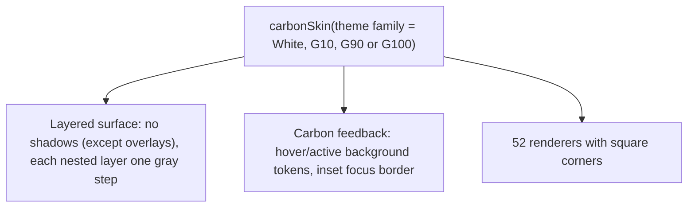
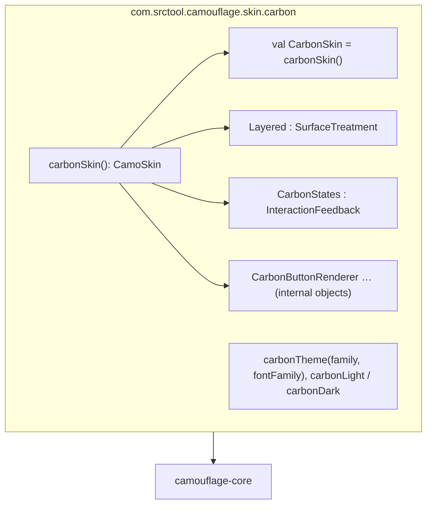
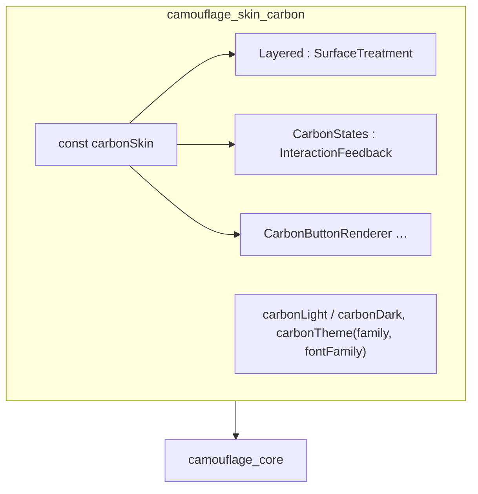

{/* Generated by docs/internal/scripts/sync_vault.py from the Camouflage design notes. Edit the notes and re-run the script; changes made here are overwritten. */}

# Carbon Skin

## Concept {#concept}

:::info[Milestone: M14, in v0.1 (ADR-40)]

Documented first (ADR-22); ADR-40 puts it in v0.1 as the last of the five skins. It is built whole in one pass after Minimal, Fluent, Material and Cupertino (the M12 ruling: `CamoSkin` has no defaults, so a partial skin can't compile).

:::

### 1. Why

`CarbonSkin` renders Camouflage in **IBM Carbon**'s dialect: **square corners**, flat layered surfaces, a strong grid, productive density, and a bold blue interactive color. It suits enterprise, data-heavy and desktop tools. It stresses the contract in two ways:
- **text fields with a bottom border only** (a different anatomy);
- **layers instead of elevation**, where depth is a different gray per nesting level.

### 2. Shape



**Surface treatment: `Layered`.** Surfaces use **layer tokens** (`layer-01` … `layer-03`), which map to Camouflage's surface levels. There are no shadows, except for overlays (dialogs and menus get Carbon's single overlay shadow).

**Interaction feedback: `CarbonStates`.** Background swaps to `…-hover` / `…-active` tokens. Focus is a **2 px inset focus border** (`focus` color), so it never changes the layout.

### 3. API

```kotlin
fun carbonSkin(): CamoSkin
fun carbonTheme(family: CarbonThemeFamily = White, fontFamily: FontFamily? = null): CamoTheme   // White | G10 (light) · G90 | G100 (dark)
```

**Starter theme:**
- Carbon's four themes map to roles: `background` → `surface`, `layer-01..03` → `surfaceContainerLow..High`, `text-primary/secondary` → `onSurface`/`onSurfaceVariant`, `border-strong/subtle` → `outline`/`outlineVariant`, `interactive`/`button-primary` → `primary` (blue 60), `support-error/success/warning/info` → the status families.
- Typography: **IBM Plex Sans** for the authentic look, **added by the app** (skins never bundle fonts): `carbonTheme(fontFamily = IbmPlexSans)`, falling back to the platform font, with Carbon's type sets mapped to the 15 roles (heading-07 54 → displayLarge … body-compact-01 14 → bodyMedium, label-01 12 → labelMedium, helper-text-01 12 → bodySmall).
- **Shapes: all 0**, except `full` for toggles and tags.
- Values come from Carbon's published tokens at implementation time.

#### 3.1 Dialect alignment

| Appearance | Carbon rendering |
|---|---|
| `Solid` | Primary button (blue 60 fill) |
| `Soft` | Secondary button (gray 80 fill, white text) |
| `Raised` | → Soft |
| `Outline` | Tertiary button (blue border and text) |
| `Ghost` | Ghost button |
| `Link` | → Link component style (blue, underline on hover) |

| Tone | Carbon |
|---|---|
| Error | Danger button, `support-error` |
| Success / Warning / Info | `support-success` / `support-warning` / `support-info` |

#### 3.2 Component mapping

| Component | Carbon equivalent | Rendering |
|---|---|---|
| CamoButton / IconButton | Button (+ icon-only) | 48 tall (productive 40), **square**, text start-aligned with the icon at the end |
| CamoFab | – | a square primary icon button (guidance: use a toolbar) |
| CamoTextField | Text input | **`field-01` fill + bottom border only**, label above, helper text below, 40 tall |
| CamoCheckbox / Radio | Checkbox / Radio button | 16 square box / circle |
| CamoSwitch | Toggle | 48 × 24, green (`support-success`) when on, with an "On/Off" label option |
| CamoSegmentedControl | Content switcher | square segments, selected = inverse fill |
| CamoSlider | Slider | 2 px track, 14 thumb, a number input beside it (optional) |
| CamoDatePicker | Date picker | `style` Calendar, square cells |
| CamoTimePicker | Time picker | `style` Fields with an AM/PM select |
| CamoStepper | Number input | **`layout` Split** |
| CamoSearchField | Search | `field` fill, magnifier, square |
| CamoSelect | Dropdown / Select | field look + a square menu |
| CamoCard | Tile | `layer` fill, square, optional clickable/selectable |
| CamoAccordion | Accordion | chevron at the end, bottom borders |
| CamoListItem | Structured list / Contained list | rows with bottom borders |
| CamoChip | Tag | pill tags (the one rounded element), in type colors |
| CamoBadge | – (tag) | a small pill with a count |
| CamoAvatar | – | `AvatarTheme.shape` default `Square` (circle allowed), gray initials |
| CamoProgress | Progress bar / Loading | 2 px bar; the circle becomes the Carbon loading spinner |
| CamoSnackbar | Toast notification | a square toast with a colored left border; `showToneIcon` true, `showDismiss` true |
| CamoBanner | Inline notification | a colored left border (the `accentBorder` option) + icon + actions |
| CamoDialog | Modal | square, `layer` fill, title 20, **`actionsLayout` FullWidthRow**, `showCloseButton` true (shown when `dismissible`) |
| CamoBottomSheet | – | → a side panel or modal from the bottom, square, `showHandle` default false |
| CamoMenu | Menu / Overflow menu | square, 40 items, overlay shadow |
| CamoTooltip | Tooltip / Toggletip | inverse, square with a caret |
| CamoTopBar | UI shell header | 48 tall, **gray 100 (dark) header** in every theme |
| CamoTabs | Tabs | Solid → contained tabs, Ghost → line tabs |
| CamoNavigationBar | – | a bottom bar in Carbon style (mobile) |
| CamoNavigationRail / Drawer | UI shell left panel (rail / expanded) | 48 rail, 256 panel, `indicator` Line (a blue start-edge line) |
| CamoPagedList | Structured list + Loading | inline loading row at the end |
| CamoSkeleton | Skeleton states | pulse, `skeleton-background` / `skeleton-element` |
| CamoDivider | (borders) | 1 px `border-subtle` |
| CamoPopover | Popover | square corners, a caret, `layer-01`, 1 px border |
| CamoSideSheet | Side panel | a 320 panel on the end edge, `layer-01`, a 1 px border; modal over a scrim |
| CamoToolbar | – | a 48 bar with square ghost buttons (guidance: use the global header for navigation) |
| CamoButtonGroup | Button set | square, connected with 1 px dividers; the selected button is the inverse fill |
| CamoSplitButton | Combo button | a square primary button with a 48 chevron part and a divider |
| CamoDataTable | Data table | a `layer-01` header, rows 48 (zebra optional), a bottom border per row, batch actions bar when rows are selected |
| CamoTree | Tree view | rows 32, a caret, a selected row with a 3 px left bar |
| CamoCarousel | Carousel | a content switcher style strip: square items, previous and next icon buttons |
| CamoImage | Image | square, an `layer-02` placeholder |
| CamoRating | Rating | stars 20 in `icon-primary` |
| CamoFileUploader | File uploader | a `layer-01` drop container with a dashed border, file rows with an inline status and a remove icon |
| CamoPagination | Pagination | a bar with an items-per-page area, a range text and previous/next icon buttons |
| CamoBreadcrumb | Breadcrumb | `bodyCompact01`, slash separators, an overflow menu, the current item bold |
| CamoProgressSteps | Progress indicator | 16 px circles on a line, a check for complete, a current ring, vertical option |

#### 3.3 Carbon under ADR-42 (materials rule)

Carbon has no materials: no blur, no glass, no shader. `Layered` is opaque everywhere, so the skin reads no `CamoCapabilities` (like Material) and needs no fallback chain. The only things that vary by environment are the input kind (a touch device keeps the 48 targets; a pointer may use the 40 productive heights through `CamoDensity`) and the platform font.

#### 3.4 Chart preset

Charts reach skins through the preset registered for `skin.name == "carbon"` ([Chart Frame](/components/charts/chart-frame)); like the others it ships in the charts package. Proposed values, from Carbon Charts' defaults (square, flat, dashed grid):

| `ChartStyle` field | Carbon | Why |
|---|---|---|
| `lineWidth` | 1.5 | Carbon Charts' thin line |
| `markerSize` | 6 | a point of radius 3 |
| `areaOpacity` | 0.3 | a flat fill under the line |
| `barRadius` | 0 | square, like the whole system |
| `barGap` | 1 | bars nearly touch |
| `gridDashed` | true | Carbon draws dashed grid lines |
| `sliceGap` | 1 | a hairline between slices |
| `donutThickness` | 0.35 | a ring thinner than Cupertino's |

The palette stays the theme's (Carbon's categorical palette is a brand choice, not a preset); the tooltip is a square `layer-02` box with a 1 px border.

#### 3.5 Density (M16, srctool/camouflage#70)

Carbon draws every control at 48 today (the "large" size). Carbon's own size tokens are `xs` 24, `sm` 32, `md` 40 and `lg` 48, and desktop apps live at 32 and 40. Without a density option an app overrides every component theme, which is what Fluent's `density` already avoids.

| Control | `xs` 24 | `sm` 32 | `md` 40 | `lg` 48 (today) |
|---|---|---|---|---|
| Button, icon button | 24 (`bodyCompact01`, 12) | 32 | 40 | 48 |
| Text field, search, select, number input | 24 | 32 | 40 | 48 (the field stays 40 today; see the callout) |
| Menu item, list row, tree row | 24 | 32 | 40 | 48 |
| Data table row | 24 | 32 | 40 | 48 |
| Tab, toolbar action | 24 | 32 | 40 | 48 |

Paddings, icon sizes (16 at `xs` and `sm`, 20 at `md`, 24 at `lg`) and the type size follow the size: Carbon's `body-compact-01` (14) at `sm` and above, 12 at `xs`. Heights are minimums, so 200% text still grows a control (the rule every component follows).

**How the skin follows the input.** `carbonTheme(density = null)` follows `CamoEnvironment.input` (ADR-41), the same rule as `fluentTheme(density)`: a pointer gets `md`, fingers get `lg`. An explicit value wins. The 48 touch target is never reduced: a 24 control with touch input still has a 48 hit area (`minimumTouchTarget` on Kotlin, `CamoTouchTarget` on Flutter), so `xs` costs nothing in accessibility.

### 4. Build steps

1. The `Layered` surface, `CarbonStates` feedback, and the inset focus border.
2. `carbonTheme` for the four families, with a `fontFamily` parameter (the sample app adds IBM Plex Sans).
3. The renderers. Bottom-border text fields and full-width modal button rows are the structural tests. The M9 to M11 ones are included, and the `"carbon"` chart preset (§3.4).
4. The screenshot matrix (White and G100 at least; G10 and G90 in the theme test), plus a manual comparison with Carbon's own components.

**Done when**
- [ ] All 52 renderers in the White and G100 themes, the M9 to M11 components (popover, side sheet, data table, charts …) included. The layer nesting (a card inside a card) steps gray correctly.

### 5. Edge cases

| Case | Decided behavior |
|---|---|
| **Layer nesting** | Carbon's rule: a component on `layer-01` uses `layer-02` for its own fill. Camouflage's `SurfaceLevel` handles this, and nested surfaces step up one level. |
| Square corners vs `shapes` tokens | The Carbon theme sets all shape roles to 0. A brand can still round them, and it's no longer strict Carbon. |
| The dark header in light themes | A Carbon convention: `TopBarTheme.colors` defaults to gray 100 in every family. |
| A material requested (a `Surface` marked blur) | Layered ignores it: every level is an opaque layer token. |
| Contract gaps found | Record them as ADRs and add them to core (e.g. a content switcher with an inverse selected fill). |
| Touch devices | Carbon is desktop-first. The 48 touch targets still apply (the component guarantees them). |

:::info[Changed in the M14 build (2026-11-05)]

- **Built whole on both platforms** (the M12 ruling), from a copy of Minimal: `camouflage-skin-carbon` / `camouflage_skin_carbon`, `Layered` (opaque layer tokens, no hairline, the one overlay shadow from `Level3`), `CarbonStates` (hover 8% and pressed 20% overlays; the focus is a 2 px `primary` border inside the bounds with a 1 px `surface` line inside it, so a filled button still shows it), `carbonTheme(family, accent, fontFamily)` for White, G10, G90 and G100, the 52 renderers, and the `"carbon"` chart preset (§3.4).
- **Brand:** `carbonTheme` takes an `accent` like the other skins (only the `primary` family changes), because the sample's brand switcher and the brand contrast test need it.
- **Colors are Carbon's published tokens, with three deviations for contrast:** the dark families' `primary` is blue 50 with gray 100 text (Carbon's dark button is blue 60 with white text; blue 60 on gray 100 is 3.0, below AA for the link role), the light success is green 60 and the toggle's on color is `success`. White, G10 and G100 pass every pair; **G90** fails only on text over its two highest layers (gray 60), which is how Carbon's own tokens fall (the theme test pins the list).
- **Anatomy as built:** buttons 48 tall, square, label at the start and the icon 32 away at the end; secondary is gray 80, tertiary a blue outline; icon buttons 48; text fields 40 on the `field` fill with a **bottom border only** (2 px inset border when focused or in error); 40 search; a 16 square checkbox; the 48 × 24 toggle (green when on); content-switcher segments (selected = inverse fill); the number input is the Split stepper; tags are pills (the one rounded element), avatars square; toasts and inline notifications carry a colored left border and an icon; the dialog is square with a full-width action row and a close button; line tabs by default (Solid is the contained tabs); a 48 gray 100 header in every family; a 48 icon rail and a 256 side panel with a start line; tiles with no border; 48 table rows; rows with bottom borders.
- **Not built:** an "On/Off" text beside the toggle (the app's), the batch-actions bar of the data table, a 3 px left bar on the selected tree row, the contained tab's dividers, the productive 40 button height, and Carbon's own loading spinner (the circle is the shared one, with butt caps).
- **Defaults:** `carbonLight` is White and `carbonDark` is G100; the sample and the example switch between them with the mode.

:::

:::info[M16 start (2026-11-11)]

Density (§3.5) is the first M16 item, raised by Graft (#70). It adds no renderer and changes no contract: it is a token set on the theme, read by the existing renderers.

:::

## Implementation {#implementation}

<KotlinOnly>

:::info[Milestone: M14, in v0.1 (ADR-40)]

Read the base note first: Carbon Skin. The module follows `camouflage-skin-minimal` and `camouflage-skin-material` (`CarbonSkin.kt`, `CarbonTheme.kt`, `Layered.kt`, `CarbonStates.kt`, `renderer/Carbon*.kt`). This note is the platform plan.

:::

### 1. Why {#kotlin-1-why}

`:camouflage-skin-carbon` implements every renderer in IBM Carbon's dialect using **only Compose foundation** plus `camouflage-core`'s public API. It is the skin with the plainest surface (no shadows, no materials) and the most structural differences in inputs: a text field with a bottom border only, a button whose label starts at the left and whose icon sits at the end, square everything.

### 2. Shape {#kotlin-2-shape}



### 3. API {#kotlin-3-api}

```kotlin
public val CarbonSkin: CamoSkin = carbonSkin()
public fun carbonSkin(): CamoSkin
public enum class CarbonThemeFamily { White, G10, G90, G100 }
public fun carbonTheme(family: CarbonThemeFamily = White, fontFamily: FontFamily? = null): CamoTheme
public val carbonLight: CamoTheme   // White
public val carbonDark: CamoTheme    // G100
```

- **`Layered`**: opaque fills only. A level maps to a layer token; a surface nested in a surface of the same level steps up one (`SurfaceLevel`). Only overlays (dialog, menu, popover, side sheet when modal) get the single overlay shadow.
- **`CarbonStates`**: a hover or pressed state swaps the fill to the `…-hover` / `…-active` token (an `IndicationNodeFactory` drawing the token over the content); focus is a 2 px inset border in `focus`, drawn inside the bounds so layout never moves; disabled uses `…-disabled` tokens. No ripple, no opacity change.
- **Theme**: `carbonTheme` maps the four families' published tokens to roles (base note §3), the shapes are all 0 except `full`, the motion is Carbon's productive/expressive curves, and the type set is mapped to the 15 roles. The font is not bundled (ADR-33): the sample adds IBM Plex Sans through `fontFamily`.
- **Pinned literals**: like Material and Cupertino, a snapshot test pins the token values (Carbon's own contrast pairs are AA, so the theme test asserts every foreground/background pair passes).
- **Chart preset**: `"carbon"` in `camouflage-charts` (values in the base note §3.4).

### 4. Build steps {#kotlin-4-build-steps}

M14 is built in one pass (the M12 ruling), then reviewed as a whole; the task cards close together.

1. Copy Minimal's module as the starting point, then `Layered`, `CarbonStates`, the inset focus border.
2. `carbonTheme` for the four families, with the pinned-literal and contrast tests.
3. The renderers with Carbon anatomy, structure first: text field (bottom border, label above), buttons (48, start-aligned label, icon at the end), dialog (square, full-width action row), data table, UI-shell header and side panel, toggle, content switcher, tabs.
4. The M9 to M11 renderers and the `"carbon"` chart preset.
5. The sample switcher entry (Carbon with a family choice on the theme page), goldens (White, G100, brand), `assertRendererAppliesBehavior` on every clickable renderer, the no-literals test.

**Done when**
- [ ] `:camouflage-skin-carbon` has no Material dependency; it is at layer 1 (`checkModuleLayers`) and in the BOM.
- [ ] All 52 renderers pass the behavior and no-literals tests.
- [ ] Goldens are recorded for White and G100 (light and dark); local macOS renders are replaced by CI's Linux ones.
- [ ] The sample switches Minimal / Fluent / Material / Cupertino / Carbon live.
- [ ] `CamoCharts` has the `"carbon"` preset.

### 5. Edge cases {#kotlin-5-edge-cases}

| Case | Decided behavior |
|---|---|
| Nested surface | Steps up one layer token (`layer-01` to `layer-02` to `layer-03`); at `layer-03` it stays. |
| A brand that rounds the shapes | Allowed, no longer strict Carbon. |
| The header in a light family | Gray 100 by default (`TopBarTheme.colors`). |
| Focus on a field with a bottom border | The 2 px inset border goes around the whole field, not only the bottom edge. |
| Carbon on mobile | Allowed. The 48 targets hold; Carbon's 40 productive height applies only when the density is Compact. |

:::info[Changed in the M14 build (2026-11-05)]

- Module `camouflage-skin-carbon`: `Layered`, `CarbonStates`, `carbonTheme(family, accent, fontFamily)` (the enum is `CarbonThemeFamily`), the 52 renderers; `CarbonSkin` is the skin and `carbonLight` / `carbonDark` are White and G100. The sample switcher has Carbon (White by day, G100 at night). Top-level theme values initialize in file order: the color constants come before `carbonLight`.
- See the base note's callout for the shared deviations (contrast, the G90 exception, what is not built). Both platforms ship the chart preset in §3.4 as `"carbon"`.

:::

:::info[M16 start (2026-11-11): density (Kotlin)]

- **Theme:** `carbonTheme(family, accent, fontFamily, density: CarbonDensity? = null)`. The enum is `CarbonDensity { Xs, Sm, Md, Lg }`. The value is stored in a `CarbonTokens(density)` token set (`theme.tokens<CarbonTokens>()`), and `null` adapts through `theme.adapt { env -> ... }` (as Fluent does): `Pointer` → `Md`, `Touch` → `Lg`.
- **Renderers:** each renderer's `defaults(theme)` reads `theme.tokens<CarbonTokens>()?.density ?: Lg` through one internal `CarbonSizes` table (height, padding, icon size, text style), replacing the `48.dp` and `40.dp` literals in `CarbonActions`, `CarbonInputs`, `CarbonLists`, `CarbonGroups`, `CarbonNavigation` and `CarbonNavigationChrome`.
- **Touch target:** unchanged; `minimumTouchTarget()` keeps 48 × 48 around a 24 control.
- **Tests:** a size table test per density (button, field, row heights), the `null` adaptation for `Pointer` and `Touch`, an explicit value winning, the 48 target holding at `Xs` with touch, and goldens per density in White and G100.
- **Done when:** a Carbon screen at `Xs` has 24 buttons, fields and rows with no component-theme override, on Kotlin.

:::

</KotlinOnly>

<DartOnly>

:::info[Milestone: M14, in v0.1 (ADR-40)]

Read the base note first: Carbon Skin. The package follows `camouflage_skin_minimal` and `camouflage_skin_material` (`lib/src/carbon_theme.dart`, `layered.dart`, `carbon_states.dart`, `renderer/carbon_*.dart`). This note is the platform plan.

:::

### 1. Why {#dart-1-why}

`camouflage_skin_carbon` implements every renderer in Carbon's dialect from the **`widgets` layer only**: no `package:flutter/material.dart` or `cupertino.dart` (the `check_no_material` tool passes with no exemption). It needs no extra dependency; the layer check stays as it is.

### 2. Shape {#dart-2-shape}



### 3. API {#dart-3-api}

```dart
const CamoSkin carbonSkin = ...;
enum CarbonThemeFamily { white, g10, g90, g100 }
CamoTheme carbonTheme({CarbonThemeFamily family, String? fontFamily});
final carbonLight, carbonDark;     // CamoTheme (White, G100)
```

- **`Layered`**: opaque fills; nested levels step one layer token; only overlays get the overlay shadow.
- **`CarbonStates`**: hover and pressed swap the fill to the `…-hover` / `…-active` token; the focus is a 2 px inset border drawn with a `foregroundDecoration`-style painter so layout never moves.
- **Theme**: the same token tables as Kotlin, snapshot-pinned, plus the contrast test. The font family is the app's.
- **Chart preset**: `'carbon'` in `camouflage_charts` (base note §3.4).

### 4. Build steps {#dart-4-build-steps}

Built in one pass with the Kotlin skin (the M12 ruling), starting from a copy of the Minimal package.

1. `Layered`, `CarbonStates`, the theme and its pin and contrast tests.
2. The renderers with Carbon anatomy (structure first, then the M9 to M11 renderers), and the `'carbon'` chart preset.
3. The example switcher entry, the CI goldens (White and G100; light and dark), the behavior and no-literals tests.

**Done when**
- [ ] `camouflage_skin_carbon` is at layer 1 in `tool/layers.yaml`; `check_no_material` passes with no exemption.
- [ ] All 52 renderers pass the tests; the example switches live; the `'carbon'` chart preset exists.

### 5. Edge cases {#dart-5-edge-cases}

| Case | Decided behavior |
|---|---|
| Inset focus border on a clipped child | Painted by the renderer's own decoration on top of the child, so a clip never hides it. |
| `flutter test` runs as Android | Pin the density and the input in goldens, as for the other skins. |

:::info[Changed in the M14 build (2026-11-05)]

- Package `camouflage_skin_carbon` (widgets layer only): `Layered`, `CarbonStates`, `carbonTheme(family:, accent:, fontFamily:)`, the 52 renderers; `carbonSkin` is a const skin. The example switcher has Carbon. The package needs no Material or Cupertino import.
- See the base note's callout for the shared deviations (contrast, the G90 exception, what is not built). Both platforms ship the chart preset in §3.4 as `"carbon"`.

:::

:::info[M16 start (2026-11-11): density (Flutter)]

- **Theme:** `carbonTheme(family:, accent:, fontFamily:, density:)` with `CarbonDensity { xs, sm, md, lg }`, stored in a `CarbonTokens` token set (`theme.tokens<CarbonTokens>()`); `null` adapts through the theme's adaptation (`pointer` → `md`, `touch` → `lg`).
- **Renderers:** each renderer's `defaults(theme)` reads the density through one `carbonSizes(density)` table (height, padding, icon size, text style), replacing the `48` and `40` literals in `carbon_actions`, `carbon_inputs`, `carbon_lists`, `carbon_structure`, `carbon_groups`, `carbon_navigation` and `carbon_navigation_chrome`.
- **Touch target:** unchanged; `CamoTouchTarget` and `CamoTouchSemantics` keep 48 × 48 around a 24 control.
- **Tests:** a size table test per density (button, field, row heights), the `null` adaptation for `Pointer` and `Touch`, an explicit value winning, the 48 target holding at `Xs` with touch, and goldens per density in White and G100.
- **Done when:** a Carbon screen at `Xs` has 24 buttons, fields and rows with no component-theme override, on Flutter.

:::

</DartOnly>
