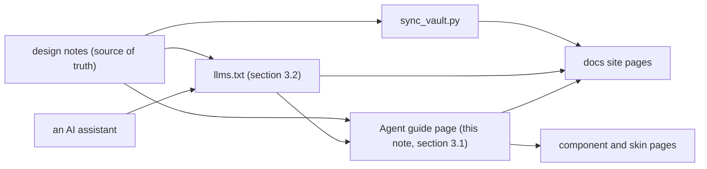

{/* Generated by docs/internal/scripts/sync_vault.py from the Camouflage design notes. Edit the notes and re-run the script; changes made here are overwritten. */}

# Agent Guide and llms.txt

:::info[Milestone: M15 (docs for v0.1)]

Documentation only: no code, no Figma. It ships with the docs site at v0.1. The lookup server that backs the same facts with live data is [Tooling](/guide/integrations/tooling) §3.3 (`camouflage-mcp`, Later).

:::

## 1. Why

AI assistants write Camouflage code from whatever they remember about Material or Cupertino, and they guess at parameters that don't exist. Two small files fix most of that:

- **`llms.txt`**: a short index at the docs root that tells an assistant what Camouflage is and where each fact lives (the [llms.txt convention](https://llmstxt.org)).
- **The agent guide**: one page of rules an assistant reads before writing code. It is the user-facing sibling of the Figma agent guide in [Figma and AI](/guide/integrations/figma-and-ai) §3.3 (that one is about Figma to theme; this one is about writing app code).

Neither needs a server. They are plain text, kept next to the docs, and every claim in them must match a note.

## 2. Shape



The assistant reads `llms.txt` first, follows the link to the guide, and then to the one component or skin page it needs. The guide stays short so it fits in a prompt; the pages carry the detail.

## 3. API

### 3.1 The agent guide (page text)

**Camouflage in one paragraph.** Camouflage is a component library for Kotlin (Compose Multiplatform) and Flutter with one vocabulary on both. Components are `Camo*` (`CamoButton`, `CamoTextField`, `CamoDialog`, …). A **skin** decides how they look (Minimal, Material, Cupertino, Fluent, Carbon); a **theme** supplies the colors, type, shapes and spacing. The component code never changes when the skin does.

**Rules**

1. **Use `Camo*` components, not Material or Cupertino widgets.** If a `Camo*` component exists for the job, use it. Don't import `material3` or Flutter's `material.dart` / `cupertino.dart` for UI inside a Camouflage app.
2. **Put a provider at the root.** Kotlin: `CamouflageProvider(skin = …, theme = …) { … }`. Flutter: `CamouflageApp(skin: …, theme: …, darkTheme: …, home: …)`, or `CamouflageProvider` above `MaterialApp` or `WidgetsApp`. Components never take a skin or theme as a parameter. Nested providers override one part of the tree.
3. **Use the vocabulary, not styling.** The visual choices are three enums:
   - `Appearance`: `Solid`, `Soft`, `Raised`, `Outline`, `Ghost`, `Link`.
   - `Tone`: `Default`, `Error`, `Success`, `Warning`, `Info`.
   - `Level` (surfaces): one step per surface container role.
   Pass them as parameters (`CamoButton(text, onClick, appearance = Solid, tone = Error)`). Don't recolor a component by hand.
4. **Never write literal colors, sizes or durations.** Read them from the theme: `Camouflage.colors`, `Camouflage.typography`, `Camouflage.spacing`, `Camouflage.shapes`, and `Camouflage.tokens<T>()` for a brand's own token set. The repo's tests fail on literals in renderers; apps should hold to the same rule.
5. **Brand = a theme, not a fork.** Change colors, type and shapes through a theme (`minimalTheme`, `materialTheme(seed)`, `cupertinoTheme(accent)`, `fluentTheme`, or your own). Run `validate()` on it: it reports contrast below 4.5:1 and missing roles.
6. **Pick the skin per platform at the root.** A Cupertino skin on Android is allowed but is a choice. Borrow one component's structure from another skin with `MinimalSkin.copy(tabs = CupertinoSkin.tabs)`; don't rebuild it.
7. **Overlays go through the platform's navigator.** Flutter: `showCamoDialog`, `showCamoBottomSheet`. Compose: Navigation 3 entries with Camouflage scene metadata (`camouflage-navigation3`). Don't hand-roll a dialog with `Box` and a scrim.
8. **Keep the accessibility defaults.** 48 touch targets, focus rings, 4.5:1 text contrast, and a required label on icon-only controls (`CamoIconButton`). A theme may shrink visuals; it may not remove the touch area.
9. **Don't bundle or assume fonts.** Skins never ship fonts. A theme takes `fontFamily` and defaults to the platform font.
10. **Don't invent parameters.** If you are unsure a parameter exists, read the component page (section 3.3 lists them) instead of guessing. The platform notes are the reference.

**Which package for what**

| Need | Kotlin artifact | Flutter package |
|---|---|---|
| Components and theme | `com.srctool.camouflage:camouflage-core` (use the BOM `camouflage-bom`) | `camouflage_core` |
| Minimal skin | `camouflage-skin-minimal` | `camouflage_skin_minimal` |
| Other skins | `camouflage-skin-material`, `-cupertino`, `-fluent` (Carbon after M14) | `camouflage_skin_material`, `_cupertino`, `_fluent` |
| Charts | `camouflage-charts` | `camouflage_charts` |
| Navigation 3 add-on | `camouflage-navigation3` | n/a |

Versions: use the BOM on Kotlin; on Flutter pin all Camouflage packages to the same minor.

**Common jobs**

| Job | Do this |
|---|---|
| Build a screen | Provider at the root, then `Camo*` components. Handle loading, empty and error states (`CamoPagedList` and `CamoSkeleton` do this for lists). |
| Add a brand | Make a theme from the brand's accent and neutrals, `validate()` it, set it on the provider. Add `custom` token sets for brand-only values. |
| Support light and dark | Provide `theme` and `darkTheme` (Flutter) or switch the theme on the provider (Compose). Never branch on dark mode in a component. |
| Move from Material | Replace each Material widget with its `Camo*` equivalent and keep the same screen structure; use `MaterialSkin` if the look must stay Material. |
| Change the look of one component | Prefer a component theme field (`ButtonTheme(height = 48.dp)`), then a building block, then a renderer override, then a new skin, in that order. |

**Know the skin's limits.** A skin may map a request to a nearby style because its dialect has no such thing (for example, Cupertino and Fluent draw `Raised` as `Soft`; Cupertino draws a FAB as a circular button). The skin note's alignment table says exactly what each choice becomes. Liquid Glass and Acrylic degrade to a plain fill where the platform can't blur (see the Cupertino and Fluent notes).

### 3.2 `llms.txt` (draft)

Served at the docs root as `/llms.txt`. It stays under about 40 lines. Replace `<docs>` with the docs site base URL.

```text
# Camouflage

> A component library with one vocabulary for Kotlin (Compose Multiplatform) and Flutter. Components are Camo* widgets; a skin (Minimal, Material, Cupertino, Fluent, Carbon) decides the look and a theme supplies colors, type, shape and spacing. Switch skins without changing component code.

Read the agent guide first. It lists the rules to follow when writing Camouflage code and the packages to depend on.

## Start here
- [Agent guide](<docs>/guide/integrations/agent-guide-and-llms-txt): rules, packages and common jobs for AI assistants
- [Design language](<docs>/guide/foundations/design-language): the vocabulary (Appearance, Tone, Level)
- [Theme](<docs>/guide/foundations/theme): colors, type, shapes, spacing, validation, Figma naming contract
- [Skin contract](<docs>/guide/architecture/skin-contract): what a skin implements

## Components
- [Component overview](<docs>/components): every Camo* component with its contract
- [Provider and scoping](<docs>/guide/architecture/provider-and-scoping): CamouflageProvider and CamouflageApp

## Skins
- [Minimal](<docs>/guide/skins/minimal-skin): Camouflage's own flat, hairline dialect
- [Material](<docs>/guide/skins/material-skin): Material 3
- [Cupertino](<docs>/guide/skins/cupertino-skin): Apple HIG, with Classic and Liquid Glass surfaces
- [Fluent](<docs>/guide/skins/fluent-skin): Fluent 2, with Solid, Acrylic and Mica surfaces
- [Carbon](<docs>/guide/skins/carbon-skin): IBM Carbon

## Optional
- [Publishing](<docs>/guide/delivery/publishing): artifacts, packages and versions
- [Tooling](<docs>/guide/integrations/tooling): tokens JSON, the camo CLI and the planned MCP server (not released)
- [Kotlin source](https://github.com/srctool/camouflage-kotlin)
- [Flutter source](https://github.com/srctool/camouflage-dart)
```

### 3.3 Where each file lives

| File | Source of truth | Published as |
|---|---|---|
| Agent guide | this note, section 3.1 | the docs page `/guide/integrations/agent-guide-and-llms-txt` (generated by `sync_vault.py`) |
| `llms.txt` | this note, section 3.2 | `static/llms.txt` in the docs site, copied from the note by the sync script, served at the root |
| `llms-full.txt` (optional) | generated | the guide plus every component page's "API" section, concatenated; for assistants that want one file |

## 4. Build steps

1. Check every claim in 3.1 against the notes it cites. The package and artifact names come from the two Publishing notes; the skin names and theme functions from each skin note. Fix the guide, not the notes, where they disagree.
2. Add `llms.txt` and `llms-full.txt` generation to `sync_vault.py` (the former copies the code block of 3.2; the latter concatenates).
3. Fill in the real docs base URL and check that every link resolves.
4. Link the guide from the docs home page and from each package README.
5. Try it: give an assistant only `llms.txt` and ask for a login screen, a themed settings page and a Cupertino-skinned variant; check the output against the rules.

**Done when**
- [ ] The guide page and `/llms.txt` are published with the v0.1 docs, and every link in `llms.txt` resolves.
- [ ] A cold assistant using only those two files produces code that uses `Camo*` components, a provider, and no literal colors or invented parameters.
- [ ] Each rule in 3.1 names the note that backs it.

## 5. Edge cases

| Case | Decided behavior |
|---|---|
| The guide and a component note disagree | The component note wins; fix the guide in the same change. |
| A skin isn't released yet (Carbon) | `llms.txt` lists it with its status; the guide says "after M14" until it ships. |
| Kotlin and Flutter differ | The guide states both forms side by side (see rule 2). A fact that applies to only one platform says so. |
| An assistant has a larger context window | `llms-full.txt` exists for it; the short guide stays the default. |
| Guide drift | The step-1 check runs again at every release, and the sync script fails the build if a link in `llms.txt` has no matching page. |
