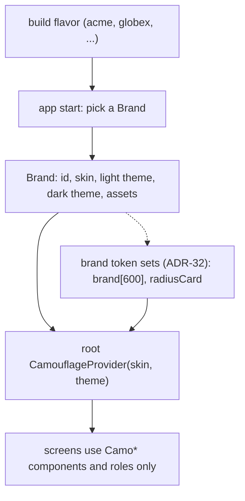

{/* Generated by docs/internal/scripts/sync_vault.py from the Camouflage design notes. Edit the notes and re-run the script; changes made here are overwritten. */}

# Multiple Brands and Flavors

:::info[Milestone: M15 (docs for v0.1)]

A usage guide, not a contract change. It describes what works today, and names the gaps that later work (the `camo` generator, ADR-44) would close. Nothing here needs new code in v0.1.

:::

## 1. Why

Many apps ship as several **brands** from one codebase: a white-label product for different clients, a main app and a lite edition, or a staging and a production look. In the build tools these are **flavors** (Android product flavors, Flutter `--flavor`, Xcode schemes). Camouflage's job is to make the visual side of this cheap: a brand is a theme (and sometimes a skin), and screens never know which brand they are in.

This note says how to set that up on each platform, what Camouflage already supports, and what is still manual.

## 2. Shape



**The rule that keeps it cheap:** components read **roles** (`primary`, `surfaceContainerHigh`, `shapes.medium`), never a brand name. Everything that differs between brands lives in the `Brand` object, so adding a brand adds one object and no screen changes.

## 3. API

### 3.1 What Camouflage already gives you

| Need | Camouflage feature |
|---|---|
| A brand's colors, type, shapes | one `CamoTheme` per brand and mode (`brandLight`, `brandDark`) |
| All 42 color roles from a few brand colors | `CamoColors.fromSeed(...)` |
| A brand's own token names (`brand[600]`, `radiusCard`) | typed token sets (`CamoTokenSet`, `CamoColorScale`, `Camouflage.tokens<T>()`, ADR-32) |
| A different look per brand | a different skin, or a skin with borrowed renderers (`MinimalSkin.copy(tabs = CupertinoSkin.tabs)`) |
| A brand's font | the theme's `fontFamily` (skins never bundle fonts, ADR-33) |
| Per-component proportions | component themes (`ButtonTheme(height = 48)`) |
| Switching brands at runtime | change the provider's `theme`; `animateCamoTheme` (Compose) blends it |
| One brand for a subtree | a nested `CamouflageProvider(theme = ...)` |
| A check that a brand is usable | `validate()` (missing roles, contrast below 4.5:1, invalid values) |

### 3.2 A `Brand` object (both platforms)

Keep everything brand-specific in one type, so the flavor only has to pick one.

Kotlin:

```kotlin
class Brand(
    val id: String,
    val skin: CamoSkin,
    val light: CamoTheme,
    val dark: CamoTheme,
    val logo: Painter,            // assets are the app's own business
)

val Acme = Brand("acme", MinimalSkin, light = acmeLight, dark = acmeDark, logo = …)
```

Flutter:

```dart
class Brand {
  const Brand({required this.id, required this.skin, required this.light, required this.dark});
  final String id;
  final CamoSkin skin;
  final CamoTheme light, dark;
}
```

Build each theme from a starter theme and the brand's colors, keep it in its own file or package, and run `validate()` on it in a test (§4).

### 3.3 Picking the brand from the flavor

The flavor is a build-time fact. The app reads it once at start and passes the matching `Brand` to the root provider.

**Android (Compose):** declare a product flavor dimension and expose the brand id.

```kotlin
// app/build.gradle.kts
flavorDimensions += "brand"
productFlavors {
    create("acme")   { dimension = "brand"; buildConfigField("String", "BRAND", "\"acme\"") }
    create("globex") { dimension = "brand"; buildConfigField("String", "BRAND", "\"globex\"") }
}
```

```kotlin
val brand = Brands.byId(BuildConfig.BRAND)
CamouflageProvider(skin = brand.skin, theme = if (dark) brand.dark else brand.light) { App() }
```

**Compose Multiplatform (iOS, desktop, web):** `BuildConfig` is Android only, so pass the brand id in through the platform entry point (an Xcode scheme or `xcconfig` value on iOS, a Gradle property or JVM argument on desktop) and call the same shared `App(brand)`.

**Flutter:** use `--flavor` where the platform supports it, and `--dart-define=BRAND=acme` for the id everywhere.

```dart
const brandId = String.fromEnvironment('BRAND', defaultValue: 'acme');
final brand = Brands.byId(brandId);

CamouflageApp(skin: brand.skin, theme: brand.light, darkTheme: brand.dark, home: const Home());
```

Flutter also exposes the active flavor name at runtime (`appFlavor`, from `package:flutter/services.dart`); check it against the Flutter version you use before relying on it.

**Web (planned port, ADR-43):** one CSS file per brand sets the `--camo-*` variables on the provider element, chosen at build or by a `data-brand` attribute.

### 3.4 Brands that differ only a little

Today a nested provider's theme **replaces** the whole theme, so "base theme plus two changes" needs `copy` / `copyWith` by hand:

```kotlin
val globexLight = acmeLight.copy(colors = acmeLight.colors.copy(primary = globexBlue))
```

Prefer one theme file per brand over chains of `copy`: they are easier to read and to validate. ADR-44 (proposed) adds an `adjustTheme` function on the provider for the cases where only a few values change.

### 3.5 Assets and text

Camouflage does not own brand assets: logos, app icons, illustrations, copy and fonts stay in the app. Keep them in the `Brand` object or in flavor source sets (Android `src/<flavor>/res`), not in components. The planned `AppIcon` generator (ADR-26) would generate icon widgets from an assets folder per flavor.

### 3.6 What is not there yet

| Gap | Effect today | Planned |
|---|---|---|
| No generator | each brand's theme and token-set classes are written by hand | `camo` generator from one tokens JSON per brand (Tooling) |
| No partial theme override | `copy` chains for small differences | ADR-44, `adjustTheme` |
| No flavor wiring | the app reads its build config itself (§3.3) | this note; no library code planned |
| No multi-brand sample | there is a runtime `Brand` switch in the sample app, but no flavor build | a two-flavor sample (task) |
| Web port | none yet | ADR-34, ADR-43 |

## 4. Build steps

1. Define the `Brand` type and one theme file per brand (light and dark), from `fromSeed` or a starter theme.
2. Add a test per brand: `validate()` returns no issues for light and dark; the brand's token sets are present (`Camouflage.tokens<…>()` is not null).
3. Wire the flavor to a brand id at app start (§3.3).
4. Add a golden or screenshot test of one representative screen per brand and mode.
5. Keep brand assets and copy outside the components.

**Done when**
- [ ] Switching the flavor changes the whole app's look with no change to any screen.
- [ ] Each brand passes `validate()` in light and dark.
- [ ] Adding a brand means adding one `Brand` and its theme, nothing else.

## 5. Edge cases

| Case | Decided behavior |
|---|---|
| A flavor id with no matching brand | Fail at app start with the id in the message. Never fall back silently to another brand. |
| A brand with a different skin | Allowed. A skin is chosen at the provider; screens are unchanged. Check the skin's alignment table for appearances it draws as another style. |
| A brand that needs a component layout change | Use a component theme field first, then a borrowed or overridden renderer; avoid per-brand branches in screens. |
| Brand-only colors the roles don't cover (a gradient, a promo accent) | A custom token set (ADR-32), referenced by a role or a component theme. An unreferenced token changes nothing. |
| Dark mode per brand | Each brand supplies both themes; a brand without a dark theme says so explicitly in its `Brand`. |
| A runtime brand switch (a tenant chosen after login) | Change the provider's theme (`animateCamoTheme` for a smooth switch); keep assets and copy in the same `Brand` so they switch together. |
| Contrast fails for a client's brand color | `validate()` reports it with the ratio; the app picks an `on*` color or a darker shade, as Camouflage never changes a brand color silently. |
